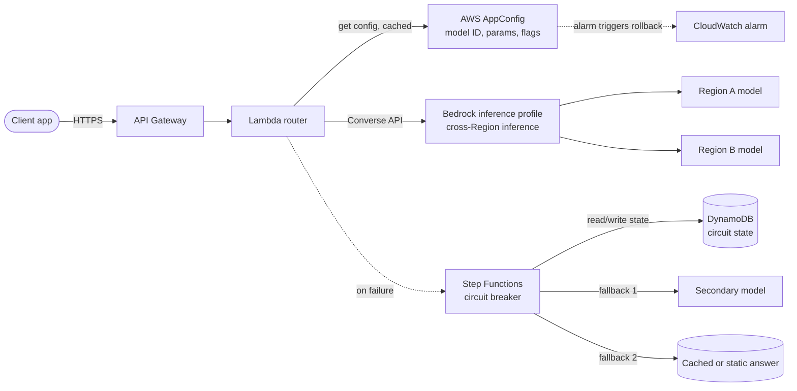
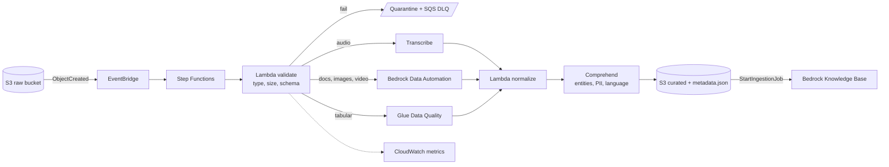
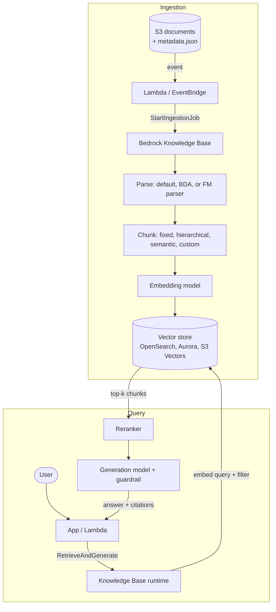
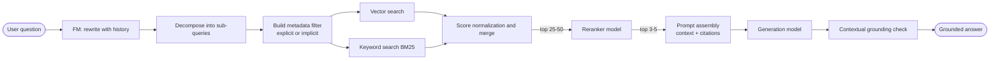

# Domain 1 — Foundation Model Integration, Data Management, and Compliance

**Weight: 31% (about 20 scored questions). The largest domain.**
Back to the [strategy guide](00-Exam-Strategy-and-Question-Patterns.md).

| Task | Topic | Expected share of the domain |
|---|---|---|
| 1.1 | Analyze requirements and design GenAI solutions | Low |
| 1.2 | Select and configure FMs (selection, switching, resilience, customization lifecycle) | High |
| 1.3 | Data validation and processing pipelines | Medium |
| 1.4 | Vector store design | High |
| 1.5 | Retrieval mechanisms | Highest |
| 1.6 | Prompt engineering and governance | High |

<!-- contents:start -->
## Contents

- [What this domain is really testing](#what-this-domain-is-really-testing)
- [Task 1.1 — Requirements and solution design](#task-11--requirements-and-solution-design)
- [Task 1.2 — Select and configure FMs](#task-12--select-and-configure-fms)
  - [1.2.1 Model selection](#121-model-selection)
  - [1.2.2 Dynamic model selection without code changes](#122-dynamic-model-selection-without-code-changes)
  - [1.2.3 Resilience](#123-resilience)
  - [1.2.4 Customization, deployment, lifecycle](#124-customization-deployment-lifecycle)
  - [Architecture: dynamic model selection and resilience](#architecture-dynamic-model-selection-and-resilience)
- [Task 1.3 — Data validation and processing](#task-13--data-validation-and-processing)
  - [Architecture: multimodal data processing pipeline](#architecture-multimodal-data-processing-pipeline)
- [Task 1.4 — Vector store design](#task-14--vector-store-design)
  - [Choosing the store](#choosing-the-store)
  - [1.4.2 Metadata frameworks](#142-metadata-frameworks)
  - [1.4.3 Performance at scale (OpenSearch)](#143-performance-at-scale-opensearch)
  - [1.4.4 Integration with enterprise sources](#144-integration-with-enterprise-sources)
  - [1.4.5 Keeping the store current](#145-keeping-the-store-current)
- [Task 1.5 — Retrieval mechanisms](#task-15--retrieval-mechanisms)
  - [1.5.1 Chunking](#151-chunking)
  - [1.5.2 Embeddings](#152-embeddings)
  - [1.5.3 and 1.5.4 Search architectures](#153-and-154-search-architectures)
  - [1.5.5 Query handling](#155-query-handling)
  - [1.5.6 Consistent access mechanisms](#156-consistent-access-mechanisms)
  - [Architecture: managed RAG, ingestion and query paths](#architecture-managed-rag-ingestion-and-query-paths)
  - [Architecture: advanced retrieval](#architecture-advanced-retrieval)
- [Task 1.6 — Prompt engineering and governance](#task-16--prompt-engineering-and-governance)
- [Question patterns for Domain 1](#question-patterns-for-domain-1)
- [Tips and tricks](#tips-and-tricks)
- [Practice questions](#practice-questions)
- [Rapid recall](#rapid-recall)

All documents and the A to Z topic index: [INDEX.md](INDEX.md)

---
<!-- contents:end -->

## What this domain is really testing

Whether you can make a design decision at each stage of the path **source data → validated data → chunks → vectors → retrieval → prompt → model**, and whether you know which stage to change when the output is wrong. Almost every question gives you a working-but-flawed pipeline and asks for the one change that fixes it under a constraint.

---

## Task 1.1 — Requirements and solution design

- **Proof of concept before scale.** A PoC on Bedrock (playgrounds, on-demand models, a small Knowledge Base) validates feasibility, latency, and value before any commitment. An answer that buys Provisioned Throughput or builds SageMaker infrastructure for a PoC is wrong.
- **Standardized components.** The AWS Well-Architected Framework **Generative AI Lens** (available in the WA Tool) is the expected answer for "consistent review of GenAI workloads across teams". It covers the six pillars across the GenAI lifecycle: scoping, model selection, customization, integration, deployment, continuous improvement. IaC templates and shared constructs are the expected answer for "consistent implementation across deployments".
- **Design order the exam rewards:** business requirement → success metric → data sensitivity and residency → latency and volume profile → model shortlist → evaluation on your own data → integration pattern.

---

## Task 1.2 — Select and configure FMs

### 1.2.1 Model selection

| Requirement in the stem | Selection logic |
|---|---|
| High volume, simple task (classification, extraction, routing) | Smallest model that passes evaluation (Nova Micro/Lite, Haiku class) |
| Complex reasoning, long documents, agent planning | Larger model (Claude Sonnet/Opus class, Nova Pro/Premier) |
| Images, documents, video in the input | Multimodal model; check modality support per model, not per family |
| Image or video generation | Nova Canvas / Reel, Titan Image, Stability models |
| Speech-to-speech conversation | Nova Sonic with bidirectional streaming |
| Embeddings | Titan Text Embeddings V2, Cohere Embed, Titan Multimodal, Nova Multimodal Embeddings |
| Open-weight or self-fine-tuned model you already own | Custom Model Import (serverless, Bedrock APIs) or SageMaker AI endpoint |
| Model only in Bedrock Marketplace | Deployed to a SageMaker endpoint, called through Bedrock APIs |

**How to choose correctly on the exam:** public benchmarks shortlist; **Bedrock Evaluations on your own prompt dataset decides**. An answer that picks a model from a leaderboard alone is a distractor. Selection criteria the exam names: capability, context window, modality, latency, cost per token, Region availability, customization support, language coverage.

### 1.2.2 Dynamic model selection without code changes

The exam-guide pattern is **Lambda + API Gateway + AWS AppConfig**.

| Mechanism | Why it wins or loses |
|---|---|
| **AppConfig** | Validators (JSON Schema or Lambda), gradual deployment strategies, bake time, **automatic rollback on a CloudWatch alarm**, Lambda extension caches config locally. The expected answer |
| Parameter Store | Works, but no staged rollout, validation, or rollback. Loses to AppConfig when "safe" or "gradual" appears |
| Lambda environment variables | Change requires a new function version or deployment. Violates "without code changes or redeployment" |
| Hard-coded model ID | Always wrong |
| Bedrock inference profile / prompt ARN / agent alias | Good indirection inside Bedrock; pair with AppConfig for provider switching |

Use the **Converse API** as the abstraction layer: one request shape for all models, so switching is a model ID change. `InvokeModel` needs a provider-specific body, so switching means code changes.

### 1.2.3 Resilience

| Technique | Detail the exam tests |
|---|---|
| **Cross-Region inference (inference profiles)** | Geographic profiles (`us.`, `eu.`, `apac.`) keep data in the geography; global profiles route anywhere for maximum throughput. No extra routing charge; price is based on the source Region. Logs (CloudTrail, invocation logs) stay in the source Region. IAM and SCPs must allow the model in **every destination Region**; a Region-deny SCP is the classic cause of `AccessDeniedException` after switching to a profile |
| **Step Functions circuit breaker** | Circuit state (closed, open, half-open) kept in DynamoDB; Lambda checks state before the call; `Retry` with backoff and jitter, then `Catch` routes to a fallback |
| **Fallback chain** | Primary model → secondary model (same prompt contract via Converse) → cached or static response. This is "graceful degradation" |
| **Cross-Region model deployment** | For custom models: copy the model to a second Region and provision capacity there. On-demand cross-Region inference does not cover custom models the same way |

Order of preference for throttling under bursty load: SDK retries with backoff → cross-Region inference profile → quota increase → Priority/Reserved or Provisioned Throughput.

### 1.2.4 Customization, deployment, lifecycle

| Option | Use when | Deployment fact |
|---|---|---|
| Bedrock fine-tuning | Labeled prompt-completion pairs; style, format, domain behaviour | Custom model served with Provisioned Throughput, or on-demand where the model supports it |
| Bedrock continued pre-training | Large unlabeled domain corpus | Same as above |
| Bedrock model distillation | Keep teacher quality with a smaller student; can use production invocation logs as source data | Student is a custom model |
| Custom Model Import | You already have weights (supported architectures) | Serverless, billed per model copy while active; cold start after idle |
| SageMaker AI + LoRA/adapters | Open-weight model, parameter-efficient tuning, full control | Base model as one inference component, each adapter as another; many adapters share one GPU base |
| SageMaker Model Registry | Versioning and approval of customized models | Model package group → approval status change → EventBridge → deployment pipeline |

**Lifecycle signals:**
- "Roll back a failed model deployment" → SageMaker blue/green deployment guardrails (canary or linear traffic shifting, auto-rollback on CloudWatch alarms), or point the alias/AppConfig value back to the previous version.
- "Model is being deprecated" → Bedrock models move Active → Legacy → End-of-Life. Abstract the model ID (AppConfig, inference profile), re-run the evaluation suite on the replacement, then switch.
- "Update models automatically" → pipeline (CodePipeline or SageMaker Pipelines) with an evaluation gate before promotion.

**Trap:** fine-tuning does not add fresh knowledge reliably and does not give citations. If the stem says "latest documents", "source attribution", or "data changes daily", the answer is RAG even if fine-tuning is offered attractively.

### Architecture: dynamic model selection and resilience

**Flow:** the router reads the model ID and inference parameters from AppConfig, calls Bedrock through an inference profile, and on repeated failure the circuit breaker opens and routes to a secondary model or a cached answer. A bad configuration is rolled back automatically by the AppConfig alarm.

---

## Task 1.3 — Data validation and processing

| Skill | Expected tools | Expert detail |
|---|---|---|
| 1.3.1 Validation | Glue Data Quality, SageMaker Data Wrangler, Lambda, CloudWatch | Glue Data Quality uses DQDL rules (completeness, uniqueness, freshness, custom SQL) inside ETL jobs or on the Data Catalog and emits results to CloudWatch/EventBridge. Data Wrangler is interactive profiling and a data quality report. Lambda is for per-object checks at ingest (file type, size, encoding, language). CloudWatch metric + alarm on rejection rate |
| 1.3.2 Multimodal processing | Bedrock multimodal models, SageMaker Processing, Transcribe, Bedrock Data Automation | Audio → Transcribe (diarization, custom vocabulary, PII redaction) → text → chunk and embed. Scanned PDFs, tables, charts → Bedrock Data Automation or an FM parser. Heavy custom batch transforms → SageMaker Processing. Video → Data Automation (scene summaries, transcripts) or multimodal embeddings |
| 1.3.3 Formatting | Converse message format, JSON bodies, endpoint payloads | See below |
| 1.3.4 Quality enhancement | Bedrock to reformat or summarize, Comprehend for entities/key phrases/language, Lambda to normalize | Entities extracted by Comprehend become **metadata** for filtering. Normalization (dates, units, encoding, de-duplication) happens before embedding, not after |

**Converse API formatting rules that appear as "why does this fail" questions:**
- `messages` must start with a `user` turn and alternate `user` / `assistant`.
- A `toolResult` block must be in the `user` turn immediately after the `assistant` turn containing the matching `toolUse` ID.
- System instructions go in `system`, not in the first user message.
- Common parameters go in `inferenceConfig` (`maxTokens`, `temperature`, `topP`, `stopSequences`); model-specific ones (for example `top_k`) go in `additionalModelRequestFields`.
- `InvokeModel` requires the provider's native JSON body; a body copied from another provider returns `ValidationException`.
- SageMaker endpoints accept whatever the serving container expects (for example a `{"inputs": ..., "parameters": {...}}` shape or an OpenAI-style messages shape). The content type and schema belong to the container, not to Bedrock.

### Architecture: multimodal data processing pipeline

**Flow:** each new object is validated, routed by modality to the right extractor, normalized, enriched with entities that become metadata, written to a curated bucket, and ingested. Failures are quarantined and counted.

---

## Task 1.4 — Vector store design

### Choosing the store

| Store | Choose it when the stem says | Watch for |
|---|---|---|
| **Bedrock Knowledge Bases (managed)** | Least overhead, fully managed ingestion and retrieval | Embedding model is fixed at creation; chunking is fixed per data source |
| **OpenSearch Serverless** | Managed vector collection, hybrid search, no cluster tuning | Minimum capacity cost even when idle |
| **OpenSearch Service (managed cluster)** | Billions of vectors, custom sharding, tuning of HNSW parameters, neural plugin, hybrid with custom scoring | You own sizing and shards |
| **Aurora PostgreSQL + pgvector** | Data already relational, SQL joins with vectors, transactional consistency, existing Aurora skills | HNSW vs IVFFlat index choice |
| **RDS PostgreSQL + S3** | Exam-guide pattern: vectors and metadata in RDS, source documents in S3 | Same pgvector logic |
| **DynamoDB + vector store** | Exam-guide pattern: DynamoDB holds metadata, session state, and document pointers; vectors live in OpenSearch (zero-ETL integration) | DynamoDB alone is not the similarity engine |
| **Neptune Analytics (GraphRAG)** | Multi-hop questions, relationships between entities, "connect information across documents" | Higher ingestion cost (entity extraction) |
| **S3 Vectors** | Very large, infrequently queried vector sets, lowest storage cost, sub-second is acceptable | Not for the lowest latency or highest QPS |
| **MemoryDB / ElastiCache (Valkey)** | Single-digit millisecond vector search, semantic cache | In-memory cost |
| **Amazon Kendra (GenAI index)** | Many enterprise connectors, document-level ACLs honoured at query time | Per-index pricing |
| **Structured store (Redshift) via Knowledge Bases** | Questions over tables; natural language to SQL | Not a vector search at all |

### 1.4.2 Metadata frameworks

- In Knowledge Bases: a sidecar file `<document>.metadata.json` next to each source object. Attributes become filterable fields.
- Sources named by the exam guide: S3 object metadata (timestamps), custom attributes (author), tags (domain classification).
- **Filtering runs before or during the vector search**, which improves both precision and latency. It is also the expected answer for multi-tenant isolation in a shared index (`tenant_id` filter, with the value taken from the caller's verified identity, never from the prompt).
- **Implicit (auto-generated) filters:** the model derives the filter from the query using a metadata schema you supply. Answer for "users do not specify filters but queries mention year, product, or region".
- Operators to recognize: `equals`, `notEquals`, `greaterThan`, `lessThan`, `in`, `notIn`, `startsWith`, `stringContains`, `listContains`, combined with `andAll` / `orAll`.

### 1.4.3 Performance at scale (OpenSearch)

| Lever | Effect |
|---|---|
| HNSW (`m`, `ef_construction`, `ef_search`) | Highest recall and lowest latency, most memory. Raise `ef_search` for recall at the cost of latency |
| IVF | Lower memory, needs a training step, lower recall |
| Quantization (scalar/byte, product, binary) and on-disk mode | Cuts memory and cost significantly; small recall loss, recovered by rescoring |
| Shards | Size shards for search (roughly 10–30 GB each); shard count aligned to data nodes; more replicas for query throughput |
| Multi-index | Separate indices per domain, language, or tenant; smaller search space and independent tuning; aliases for zero-downtime re-index |
| Hierarchical indexing | Summary-level index to pick the document, chunk-level index to pick the passage |
| Efficient filtering | Filter applied during ANN search (Faiss/Lucene engines) instead of post-filtering, which can return too few results |
| Lower embedding dimensions | 1024 → 512 or 256 reduces storage and latency with small accuracy loss |

**Neural plugin:** an ingest pipeline with a `text_embedding` processor calls a Bedrock embedding model through an ML connector, so OpenSearch creates vectors at index and query time. A search pipeline with a **normalization processor** combines BM25 and vector scores for hybrid search.

### 1.4.4 Integration with enterprise sources

Knowledge Bases connectors: S3, Confluence, SharePoint, Salesforce, web crawler, plus custom sources through direct ingestion. For wider connector coverage or ACL-aware retrieval, Kendra or Amazon Q Business. For anything else: Lambda or Glue pulls to S3, then ingest.

### 1.4.5 Keeping the store current

| Pattern | Mechanism |
|---|---|
| Incremental update | `StartIngestionJob` processes only added, changed, and deleted objects since the last sync |
| Real-time change detection | S3 event → EventBridge → Lambda → ingestion job; or DynamoDB Streams / database CDC for record-level changes |
| Low-latency single-document update | Direct ingestion API (`IngestKnowledgeBaseDocuments`) without a full sync |
| Scheduled refresh | EventBridge Scheduler → Step Functions → ingestion job, with status polling |
| Deletions | Deleting the source object and syncing removes its vectors. Stale answers after a delete mean the sync did not run |
| Serialization | Ingestion jobs on one data source do not run concurrently; buffer triggers through SQS |

**Hard rules that become questions:**
- Changing the **embedding model** means a new vector index and full re-embedding. Query and index vectors must come from the same model and dimension.
- Changing the **chunking strategy** means a new data source (or knowledge base) and re-ingestion.
- The vector index dimension must equal the embedding dimension, or ingestion fails.

---

## Task 1.5 — Retrieval mechanisms

### 1.5.1 Chunking

| Strategy | Best for | Cost and trade-off |
|---|---|---|
| Default | Quick start | About 300 tokens, respects sentence boundaries |
| Fixed-size (max tokens + overlap %) | Uniform content (FAQs, short articles), predictable cost | May split ideas; overlap mitigates |
| **Hierarchical** (parent and child) | Long structured documents (manuals, policies, contracts) | Search matches small child chunks, the larger **parent** is returned as context. Fewer distinct results than requested because children of one parent merge |
| **Semantic** | Narrative text without clear structure | Uses an FM during ingestion (extra cost); parameters: max tokens, buffer size, breakpoint percentile |
| No chunking | Documents already split, one file per chunk | You own chunk quality |
| Custom Lambda transformation | Domain-specific logic, code-aware splitting, chunk-level metadata | Most control, most effort |

Parsing is a separate decision: default text parser, **Bedrock Data Automation**, or an **FM parser** for tables, figures, and scanned pages. "Answers miss data that is in tables or charts" is a parsing fix, not a chunking fix.

**Diagnosis shortcuts:**
- Chunks too large → retrieved text is diluted, relevant sentence buried, more tokens and cost.
- Chunks too small → answer lacks context, pronouns and references unresolved.
- Needs both precision and context → hierarchical.

### 1.5.2 Embeddings

- **Titan Text Embeddings V2:** 1024, 512, or 256 dimensions; long input; multilingual; normalization option.
- **Cohere Embed:** strong multilingual; requires the correct `input_type` (`search_document` when indexing, `search_query` when querying). Mixing them degrades retrieval and is a known trap.
- **Multimodal embeddings** (Titan Multimodal, Nova Multimodal): image and text in one vector space; answer for "search images with text".
- Domain fit matters more than size. Evaluate on your own queries.
- Bulk embedding generation: Bedrock **batch inference**, or Lambda/Step Functions batching with concurrency control to stay under quota.

### 1.5.3 and 1.5.4 Search architectures

| Technique | Fixes |
|---|---|
| Semantic (vector) search | Paraphrases, concept matching |
| Keyword (BM25) | Exact terms, IDs, codes, rare names |
| **Hybrid search** | Both of the above. Expected answer when "part numbers", "error codes", "SKUs", or "acronyms" are missed |
| **Reranker models** (Amazon Rerank, Cohere Rerank; `Rerank` API or in `Retrieve`) | Right document is retrieved but ranked low. Retrieve wide (for example 25–50), rerank, pass the top few. Improves relevance and reduces generation tokens; adds latency and a per-query cost |
| Metadata filter | Wrong tenant, product, version, or date range |
| Higher `numberOfResults` | Recall problem, at the cost of tokens |

### 1.5.5 Query handling

| Technique | Use when | Expected implementation |
|---|---|---|
| Query expansion / rewrite | Short or vague queries, vocabulary mismatch | Bedrock FM rewrites or adds synonyms |
| Query reformulation with history | Follow-up questions ("what about the second one?") | Rewrite to a standalone question using conversation history |
| **Query decomposition** | Compound or comparative questions | Knowledge Bases query decomposition option, or Lambda that splits into sub-queries and merges results |
| Query transformation / routing | Different query types need different indexes or tools | Step Functions workflow |
| HyDE | Query and documents are stylistically far apart | FM writes a hypothetical answer, embed that |

### 1.5.6 Consistent access mechanisms

- **Function calling for vector search:** retrieval exposed as a tool; the model decides when and what to search (agentic RAG).
- **MCP clients for vector queries:** retrieval offered by an MCP server so any agent framework can use the same interface.
- **Standardized API:** `Retrieve` (you control the prompt and generation) vs `RetrieveAndGenerate` (managed generation with citations, session, guardrail). Choose `Retrieve` when the stem needs custom post-processing, a custom prompt chain, or a non-Bedrock generator.

### Architecture: managed RAG, ingestion and query paths

### Architecture: advanced retrieval

**Flow:** rewrite and decompose the query, restrict the search space with metadata, run vector and keyword search together, rerank a wide candidate set down to a few passages, generate, then check grounding before returning.

---

## Task 1.6 — Prompt engineering and governance

| Skill | Expected tools | Expert detail |
|---|---|---|
| 1.6.1 Instruction frameworks | Prompt Management, Guardrails, templates | Role and constraints in the system prompt; guardrail enforces policy independently of the prompt, so a prompt change cannot remove it |
| 1.6.2 Interactive systems | Step Functions, Comprehend, DynamoDB | Clarification loop as a state machine; intent recognition routes the request; DynamoDB keyed by session ID with timestamp sort key and TTL. Long conversations: sliding window or periodic summarization to control context |
| 1.6.3 Governance | Prompt Management, S3, CloudTrail, CloudWatch Logs | Parameterized templates (`{{variable}}`), **immutable versions**, variants for comparison. Approval = promotion of a version through a pipeline with IAM-restricted permissions. CloudTrail records who created, changed, or invoked; S3 versioning for template repositories |
| 1.6.4 Quality assurance | Lambda, Step Functions, CloudWatch | Lambda asserts expected output (schema, keywords, scores). Step Functions Map state runs edge-case suites. CloudWatch metrics and alarms detect regression between prompt versions |
| 1.6.5 Iterative refinement | Structured inputs, output specs, chain-of-thought, feedback loops | Delimit inputs with tags; specify output format with JSON Schema or tool-use schema; few-shot examples; reasoning steps before the answer; user feedback feeds the next version |
| 1.6.6 Complex prompt systems | Bedrock Flows | Nodes: prompt, condition, iterator/collector, knowledge base, agent, Lambda, S3, inline code. Versions and aliases. Use for sequential chains with conditional branching and pre/post-processing without code |

**Prompt Management facts worth knowing:**
- A managed prompt can be invoked directly by passing its ARN (with version) as the model identifier in Converse and supplying `promptVariables`. This is how a prompt changes without an application deployment.
- Variants let you compare different models or wording side by side before creating a version.
- Prompt optimization rewrites a prompt for a target model.

**Technique selector:**

| Problem | Technique |
|---|---|
| Output format inconsistent | JSON Schema / tool-use structured output, few-shot examples, lower temperature |
| Multi-step reasoning errors | Chain-of-thought or model reasoning mode; decompose into a prompt chain |
| One long prompt doing five jobs poorly | Prompt chaining (Flows), one job per step |
| Model follows injected instructions in a document | Delimit untrusted content, state that content inside the tags is data, add a guardrail prompt-attack filter |
| Edge cases fail | Add targeted few-shot examples, add them to the regression suite |

---

## Question patterns for Domain 1

| # | Pattern | Stem signals | Answer shape | Typical distractor |
|---|---|---|---|---|
| 1 | Fix retrieval quality | "irrelevant passages", "misses exact codes" | Hybrid search, reranker, chunking change, metadata filter | Bigger generation model, fine-tuning |
| 2 | Pick the chunking strategy | Document type described in detail | Hierarchical for long structured, semantic for narrative, fixed for uniform | Custom Lambda when "least effort" |
| 3 | Pick the vector store | Existing stack, scale, latency, cost | Match the table above | OpenSearch cluster for a small PoC |
| 4 | Keep data current | "updated hourly", "deleted documents still appear" | Event-driven incremental sync, direct ingestion | Nightly full re-index, fine-tuning |
| 5 | Model switch without code | "without redeploying", "A/B models" | AppConfig, Converse API, prompt/alias indirection | Environment variables |
| 6 | Resilience | "Regional disruption", "throttled at peak" | Cross-Region inference, circuit breaker, fallback | Retry only, bigger instance |
| 7 | Customization choice | "tone", "format", "latest data", "citations" | Fine-tune for behaviour, RAG for knowledge, distill for cost | Fine-tune for knowledge |
| 8 | Multimodal ingestion | Audio, scanned PDFs, tables | Transcribe, Data Automation, FM parser | Default parser |
| 9 | Prompt governance | "audit prompt changes", "approval", "rollback" | Prompt Management versions + CloudTrail | Prompts in code or environment variables |
| 10 | Multi-step prompt workflow | "sequence", "branch on model output", "no code" | Bedrock Flows | Step Functions when "no code"; Flows when heavy custom logic is needed |
| 11 | Request formatting failure | Error after adding tools or history | Message order, tool result placement, native body | IAM change |
| 12 | Multi-tenant RAG | "tenants must not see each other's data" | Metadata filter from verified identity, or separate knowledge base per tenant for strict isolation | Prompt instruction to ignore other tenants |

## Tips and tricks

1. **Classify by pipeline stage first.** Parsing, chunking, embedding, indexing, searching, ranking, and generating each have a distinct fix. The option that acts on the faulty stage wins.
2. **"Right document, wrong rank" is always the reranker.** "Right concept, wrong exact term" is always hybrid search.
3. **Managed first.** If Knowledge Bases can do it and the stem says least overhead, do not pick the Lambda pipeline.
4. **Fine-tuning is never the answer to a freshness or attribution requirement.**
5. **AppConfig is the answer to "change at runtime safely".** Converse is the answer to "same code for any model".
6. **A geographic inference profile satisfies residency; a global one does not.**
7. **Metadata is both a quality tool and a security boundary.** Expect it in both Domain 1 and Domain 3 questions.
8. **Flows vs Step Functions:** Flows for prompt-centric, low-code chains inside Bedrock. Step Functions for long-running, cross-service orchestration, human approval, and custom error handling.
9. **Embedding model changes are expensive.** Any answer that swaps the embedding model "without re-indexing" is wrong.
10. **Evaluate on your own data.** Model choice by public benchmark alone is a distractor.

---

## Practice questions

**Q1.** A support assistant uses a Bedrock knowledge base over 40,000 product manuals. Users report that questions containing exact part numbers such as "KX-4471-B" return passages about similar but different parts. Semantic questions work well. Which change fixes this with the LEAST effort?

- A. Fine-tune the embedding model on the manuals
- B. Switch the knowledge base query to hybrid search
- C. Increase the number of retrieved results to 100
- D. Reduce the chunk size to 100 tokens

**Answer: B.** Exact identifiers are a lexical-match problem. Hybrid search adds keyword matching to the vector search with a query-time setting. A is out of scope and expensive, C adds noise and tokens, D harms context.

**Q2.** A legal team ingests 300-page contracts. Retrieval finds the right clause, but answers lack surrounding definitions and conditions found a few paragraphs away. Which chunking strategy is most appropriate?

- A. Fixed-size chunks of 200 tokens with no overlap
- B. Semantic chunking with a low breakpoint threshold
- C. Hierarchical chunking
- D. No chunking

**Answer: C.** Small child chunks give precise matches, and the parent chunk supplies the surrounding context to the model.

**Q3.** A company must switch between two foundation model providers during incidents, with staged rollout and automatic rollback, and without deploying code. Which design meets this?

- A. Store the model ID in a Lambda environment variable and update it during incidents
- B. Store the model configuration in AWS AppConfig, read it from Lambda through the AppConfig extension, and call the Converse API
- C. Create one Lambda function per provider and change the API Gateway integration
- D. Store the model ID in the prompt template

**Answer: B.** AppConfig provides validation, gradual deployment, and alarm-based rollback; Converse keeps the request shape identical across providers.

**Q4.** After moving an application to a `us.` inference profile to reduce throttling, some requests fail with `AccessDeniedException` while others succeed. What is the most likely cause?

- A. The inference profile does not support streaming
- B. A service control policy denies Bedrock actions in one of the destination Regions
- C. The model's context window was exceeded
- D. Model invocation logging is disabled

**Answer: B.** Cross-Region inference routes to several Regions; permissions must allow the model in each. Intermittent failure matches routing to a denied Region.

**Q5.** A knowledge base indexes policy PDFs. Many answers are wrong when the information is inside tables and scanned pages. Text paragraphs are answered correctly. What should the developer change? (Select TWO.)

- A. Configure the data source to use Bedrock Data Automation or a foundation model as the parser
- B. Increase the generation model temperature
- C. Re-ingest the documents after changing the parsing configuration
- D. Replace the vector store with DynamoDB
- E. Enable prompt caching

**Answer: A and C.** The fault is at the parsing stage; the change takes effect only after re-ingestion.

**Q6.** A team wants business analysts to build a three-step workflow: classify a ticket, branch on the category, then generate a reply using a knowledge base. They want versioning and no custom orchestration code. Which service fits best?

- A. AWS Step Functions with Lambda tasks
- B. Amazon Bedrock Flows
- C. Amazon Bedrock Agents with custom orchestration
- D. Amazon SQS with Lambda consumers

**Answer: B.** Prompt, condition, and knowledge base nodes with versions and aliases, no code.

---

## Rapid recall

- Converse = model-agnostic; InvokeModel = provider-native body.
- AppConfig = runtime switch with validation and rollback.
- Geographic profile keeps data in geography; global does not.
- Hierarchical = precise match + broad context. Semantic = narrative, costs an FM call at ingest.
- Hybrid = exact terms. Reranker = ordering. Filter = scope. Decomposition = multi-part.
- Parser choice fixes tables and scans.
- New embedding model = full re-index.
- `Retrieve` = you control generation; `RetrieveAndGenerate` = managed answer with citations.
- Prompt Management = versions and variables; Flows = chains and branches; CloudTrail = who changed what.
- Glue Data Quality and Data Wrangler validate; Transcribe, Comprehend, Data Automation transform.
