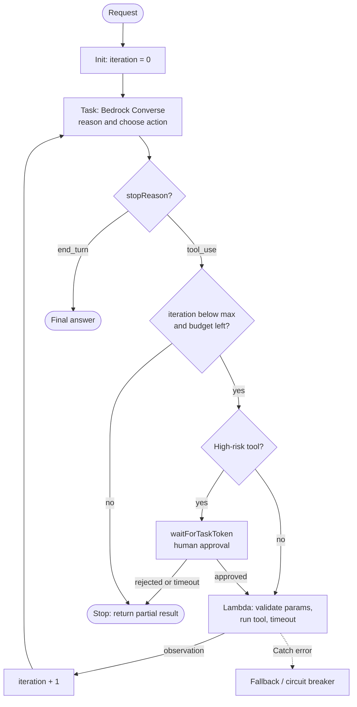
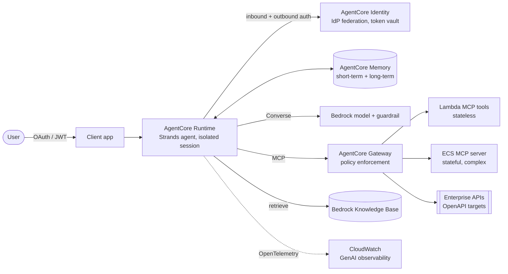
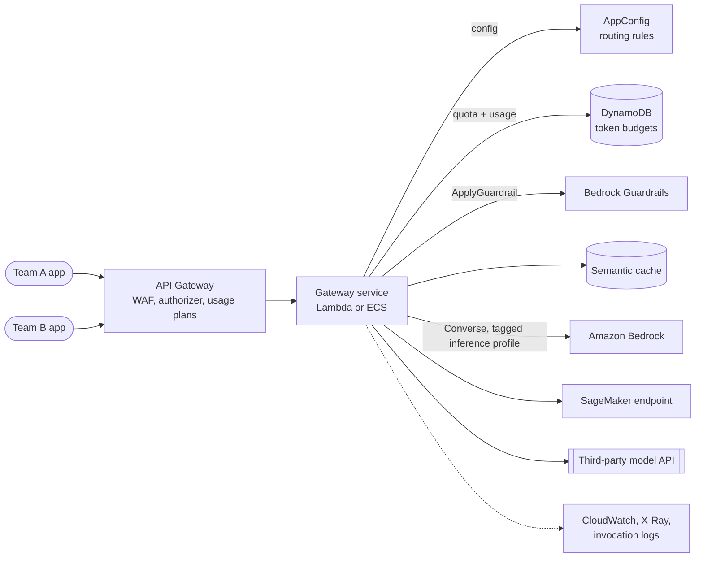
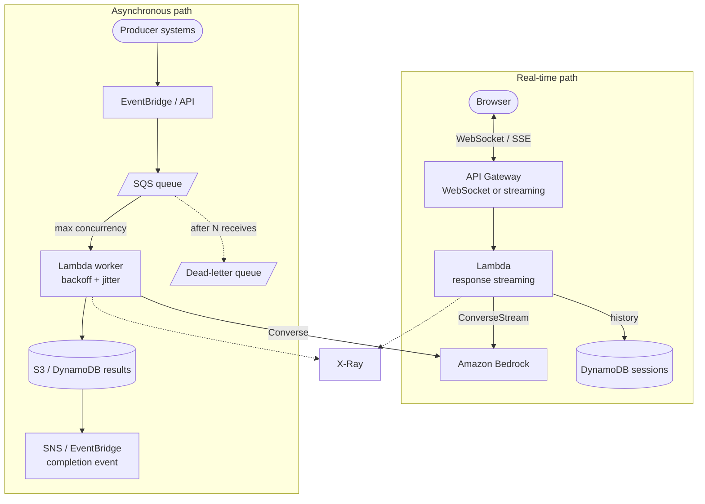

# Domain 2 — Implementation and Integration

**Weight: 26% (about 17 scored questions).**
Back to the [strategy guide](00-Exam-Strategy-and-Question-Patterns.md).

| Task | Topic | Expected share of the domain |
|---|---|---|
| 2.1 | Agentic AI solutions and tool integrations | Highest |
| 2.2 | Model deployment strategies | Medium |
| 2.3 | Enterprise integration architectures | Medium |
| 2.4 | FM API integrations (sync, async, streaming, resilience, routing) | High |
| 2.5 | Application integration patterns and developer tools | Medium |

<!-- contents:start -->
## Contents

- [What this domain is really testing](#what-this-domain-is-really-testing)
- [Task 2.1 — Agentic AI and tool integration](#task-21--agentic-ai-and-tool-integration)
  - [The agent platform map](#the-agent-platform-map)
  - [Bedrock Agents: details that become answer options](#bedrock-agents-details-that-become-answer-options)
  - [AgentCore: one line per component](#agentcore-one-line-per-component)
  - [Strands Agents and Agent Squad](#strands-agents-and-agent-squad)
  - [Model Context Protocol (MCP)](#model-context-protocol-mcp)
  - [ReAct and structured reasoning with Step Functions](#react-and-structured-reasoning-with-step-functions)
  - [Safeguards (Skill 2.1.3): the four named controls](#safeguards-skill-213-the-four-named-controls)
  - [Tool integration quality (Skill 2.1.6)](#tool-integration-quality-skill-216)
  - [Human collaboration (Skill 2.1.5)](#human-collaboration-skill-215)
  - [Model coordination (Skill 2.1.4)](#model-coordination-skill-214)
  - [Architecture: agentic system with AgentCore and MCP](#architecture-agentic-system-with-agentcore-and-mcp)
- [Task 2.2 — Model deployment strategies](#task-22--model-deployment-strategies)
  - [LLM-specific deployment concerns (Skill 2.2.2)](#llm-specific-deployment-concerns-skill-222)
  - [Optimized approaches (Skill 2.2.3)](#optimized-approaches-skill-223)
- [Task 2.3 — Enterprise integration](#task-23--enterprise-integration)
  - [CI/CD for GenAI (what a correct pipeline contains)](#cicd-for-genai-what-a-correct-pipeline-contains)
  - [Architecture: GenAI gateway](#architecture-genai-gateway)
- [Task 2.4 — FM API integrations](#task-24--fm-api-integrations)
  - [Interaction shapes](#interaction-shapes)
  - [Streaming specifics](#streaming-specifics)
  - [Resilience (Skill 2.4.3)](#resilience-skill-243)
  - [Routing (Skill 2.4.4)](#routing-skill-244)
  - [Architecture: streaming and asynchronous integration](#architecture-streaming-and-asynchronous-integration)
- [Task 2.5 — Application integration patterns and development tools](#task-25--application-integration-patterns-and-development-tools)
- [Question patterns for Domain 2](#question-patterns-for-domain-2)
- [Tips and tricks](#tips-and-tricks)
- [Practice questions](#practice-questions)
- [Rapid recall](#rapid-recall)

All documents and the A to Z topic index: [INDEX.md](INDEX.md)

---
<!-- contents:end -->

## What this domain is really testing

Two decisions, repeated in many forms:

1. **How much autonomy does the workload need, and who controls the loop?** Model-driven agent, managed agent, or deterministic workflow.
2. **What is the interaction shape?** Synchronous, streaming, asynchronous, or batch, and what each one requires from API Gateway, Lambda, SQS, and the SDK.

---

## Task 2.1 — Agentic AI and tool integration

### The agent platform map

| Option | What it is | Choose when the stem says |
|---|---|---|
| **Amazon Bedrock Agents** | Fully managed agent: instructions, action groups, knowledge bases, guardrail, memory, versions and aliases | "Fully managed", "configure, not code", "least operational overhead" |
| **Amazon Bedrock AgentCore** | Modular platform services for agents built with any framework and any model | "Existing LangGraph/CrewAI/Strands agent", "long-running", "session isolation", "enterprise identity for tools", "many tools behind one endpoint" |
| **Strands Agents** | Open-source, model-driven SDK. Agent = model + tools + system prompt | "Code-first", "AWS-native SDK", "custom tool behaviour", "multi-agent patterns in code" |
| **AWS Agent Squad** | Open-source multi-agent orchestrator. A classifier routes each request to the best agent and keeps per-agent conversation history | "Route user intents to specialist agents", "maintain context across agents" |
| **AWS Step Functions** | Deterministic state machine | "Explicit control", "audit every step", "stopping conditions", "human approval", "ReAct implemented as a workflow" |
| **Amazon Bedrock Flows** | Low-code prompt chain | "Fixed sequence", "no code", "branch on model output" |

### Bedrock Agents: details that become answer options

| Feature | What to know |
|---|---|
| Action groups | Defined by an OpenAPI schema or function details. Executed by a **Lambda function** or by **return of control** |
| **Return of control** | The agent returns the chosen action and parameters to the calling application, which executes it and sends back the result. Answer for "the action must run in the client's environment", "the API is not reachable from Lambda", "application must apply its own authorization" |
| **User confirmation** | Agent asks the user to approve a specific action before running it. Answer for "confirm before any write or payment" |
| Session attributes | `sessionAttributes` persist for the session and are passed to Lambda (user ID, tenant, auth context). `promptSessionAttributes` are injected into the prompt for one turn (current date, locale). Never let the model generate identity values |
| Advanced prompts | Override the pre-processing, orchestration, knowledge-base response, and post-processing templates; optional parser Lambda. Disable unneeded steps to cut latency |
| Memory | Session summaries retained across sessions, keyed by a memory ID |
| Multi-agent collaboration | **Supervisor** mode plans and delegates; **supervisor with routing** sends simple requests straight to one collaborator and plans only for complex ones (lower latency) |
| Versions and aliases | Version = immutable snapshot. Alias points to a version; the application calls the alias. Rollback = repoint the alias |
| Inline agents | Agent configuration (model, tools, instructions) supplied at invocation time. Answer for "different tools per user or tenant at runtime" |
| Custom orchestration | Replace the default ReAct loop with your own Lambda-driven strategy |
| Trace | `enableTrace` returns pre-processing, orchestration (rationale, action, observation), and post-processing steps. First stop for debugging tool choice |

### AgentCore: one line per component

| Component | Role | Exam cue |
|---|---|---|
| **Runtime** | Serverless hosting with per-session isolation, long-running and async sessions; hosts agents and MCP servers; framework- and model-agnostic | "Deploy existing agent code without managing infrastructure" |
| **Memory** | Short-term (session events) and long-term (extracted facts, summaries, user preferences) | "Remember preferences across sessions without building a store" |
| **Gateway** | Turns Lambda functions, OpenAPI/Smithy APIs, and existing MCP servers into MCP tools behind one endpoint; semantic tool search | "Expose existing APIs to agents as tools", "hundreds of tools, model picks the wrong one" |
| **Identity** | Inbound auth (IAM or OAuth/JWT from an existing IdP) and outbound credentials (OAuth 2LO/3LO, API keys in a token vault) | "Agent acts on behalf of the user in Salesforce/Slack/GitHub" |
| **Code Interpreter** | Isolated sandbox for generated code | "Agent must run calculations or data analysis safely" |
| **Browser** | Managed cloud browser | "Agent must operate a website without an API" |
| **Observability** | OpenTelemetry traces, metrics, and logs into CloudWatch | "Trace every agent step and tool call" |
| **Policy** | Deterministic authorization of tool calls, enforced at the Gateway, outside the agent's reasoning | "Agent must never issue refunds above 500 USD regardless of the prompt" |
| **Evaluations** | Built-in and custom evaluators for agent quality | Domain 5 |

### Strands Agents and Agent Squad

- **Strands:** tools are plain functions with a decorator (schema inferred from the signature and docstring); built-in MCP client; multi-agent patterns are **agents-as-tools** (hierarchy), **swarm** (peers hand off with shared context), **graph** (explicit nodes and conditional edges), and **workflow** (fixed task dependencies). State and memory through session managers (file, S3) and conversation managers (sliding window, summarizing). Hooks and callbacks implement custom behaviour ("Strands API to implement custom behaviors" in the exam guide).
- **Agent Squad:** classifier selects the agent per turn using agent descriptions and history; storage back ends for conversation history (in-memory, DynamoDB); a supervisor agent coordinates a team for tasks that need several specialists.

### Model Context Protocol (MCP)

| Fact | Detail |
|---|---|
| Purpose | Standard interface between agents (clients) and tools/data (servers). Write the tool once, use it from any framework |
| Primitives | Tools, resources, prompts |
| Transports | stdio for local, streamable HTTP for remote |
| **Lambda** | Stateless, lightweight tools, short execution, scale to zero. The exam-guide answer for "lightweight tool access" |
| **Amazon ECS (Fargate)** | Stateful sessions, long-running or heavy tools, large dependencies, persistent connections. The exam-guide answer for "complex tools" |
| AgentCore Gateway / Runtime | Managed endpoint that fronts tools as MCP, or hosts MCP servers with auth and isolation |
| MCP client libraries | Give consistent access patterns across agents |

### ReAct and structured reasoning with Step Functions

**Flow:** the state machine owns the loop. The model proposes an action, the workflow checks limits, optionally pauses for a human, runs the tool in Lambda, and feeds the observation back until the model finishes or a limit is reached.

### Safeguards (Skill 2.1.3): the four named controls

| Control | Implementation |
|---|---|
| Stopping conditions | Step Functions iteration counter and Choice state; max turns in the agent framework; token or cost budget |
| Timeouts | Lambda timeout per tool; `TimeoutSeconds` and `HeartbeatSeconds` on states; client read timeouts |
| Resource boundaries | **IAM execution role per tool or agent with least privilege**; permission boundaries; policy enforcement at the gateway. The prompt is not a boundary |
| Failure isolation | Circuit breaker around unreliable tools or models; `Retry` then `Catch` to a fallback |

### Tool integration quality (Skill 2.1.6)

- **Tool descriptions and parameter schemas drive tool selection.** "Agent picks the wrong tool" is fixed by clearer, non-overlapping descriptions, fewer tools per agent, or semantic tool search, not by a larger model.
- **Validate parameters in Lambda** before acting (type, range, authorization against session identity). Models can produce well-formed but wrong arguments.
- **Return errors as tool results** with actionable text so the model can correct itself, rather than throwing.
- **Idempotency** for write tools; the model may retry.

### Human collaboration (Skill 2.1.5)

| Need | Pattern |
|---|---|
| Approval before a step continues | Step Functions `.waitForTaskToken`; reviewer UI calls `SendTaskSuccess` / `SendTaskFailure` through API Gateway; state timeout for escalation |
| Approval of one agent action | Bedrock Agents user confirmation |
| Low-confidence document extraction | Data Automation or Textract confidence threshold → human review queue |
| Feedback collection | API Gateway endpoint → Lambda → DynamoDB/S3; feeds evaluation datasets |

### Model coordination (Skill 2.1.4)

Specialist models per subtask (cheap classifier, strong reasoner, dedicated embedding or image model); ensembles with aggregation logic (majority vote, judge model) through a Step Functions Parallel state; a selection framework that routes by task type, complexity, or measured metrics.

### Architecture: agentic system with AgentCore and MCP

**Flow:** the user authenticates through the existing IdP; the agent runs in an isolated runtime session, keeps memory, calls the model, and reaches every tool through one MCP gateway where deterministic policy is enforced. All steps emit traces.

---

## Task 2.2 — Model deployment strategies

| Requirement | Deployment |
|---|---|
| Variable traffic, managed models, no infrastructure | Bedrock on-demand, invoked from Lambda |
| Steady high volume, guaranteed capacity, or custom model that needs dedicated capacity | Bedrock Provisioned Throughput / Reserved capacity |
| Own weights, serverless, Bedrock API surface | Custom Model Import |
| Open-weight or proprietary model, full control of container and instance, VPC-only | SageMaker AI real-time endpoint |
| Long-running or large-payload inference, tolerate queueing, scale to zero | SageMaker asynchronous inference |
| Many fine-tuned variants of one base model | SageMaker inference components with LoRA adapters |
| Bedrock for most, self-hosted for a specialist model | Hybrid: route by task through a gateway |

### LLM-specific deployment concerns (Skill 2.2.2)

| Concern | Detail |
|---|---|
| Memory | GPU memory scales with parameter count × precision. Quantization (8-bit, 4-bit) reduces it. Choose the instance by model memory first, then throughput |
| Containers | Large Model Inference (LMI) containers or text-generation inference containers with continuous batching and token streaming |
| Model loading | Store artifacts **uncompressed** in S3, use fast model loading, raise the container startup health-check and model download timeouts. Cold start of a multi-GB model is minutes, so keep a minimum instance or use provisioned capacity for interactive paths |
| Scaling metric | Scale on **concurrent requests** or tokens, not CPU. GPU endpoints saturate without CPU rising |
| Serverless inference | SageMaker Serverless Inference has no GPU; it is a distractor for LLM hosting |
| Throughput unit | Tokens per second and time to first token, not requests per second |

### Optimized approaches (Skill 2.2.3)

- **Right-size the model:** a small model for routine tasks, a large one only where evaluation shows it is needed.
- **Model cascading:** try the cheap model; escalate when confidence is low, validation fails, or a complexity classifier says so. Bedrock Intelligent Prompt Routing does this within a model family as a managed feature.
- **Task-specific small models** (fine-tuned or distilled) replace a general large model for narrow tasks.

---

## Task 2.3 — Enterprise integration

| Skill | Pattern | Expected services |
|---|---|---|
| 2.3.1 Enterprise connectivity | API-based integration with legacy systems; event-driven loose coupling; data synchronization | API Gateway (private integrations), EventBridge, SQS/SNS, change data capture into S3 |
| 2.3.2 Add GenAI to existing apps | Microservice exposes FM capability; webhooks; events | API Gateway, Lambda webhook handlers, EventBridge rules and API destinations |
| 2.3.3 Secure access | Identity federation, role-based access, least privilege | IAM Identity Center or Cognito federated to the enterprise IdP; IAM roles scoped to specific model ARNs and inference profiles; Lambda authorizers |
| 2.3.4 Cross-environment | Data stays on premises or at the edge | **Outposts** for local data processing, **Wavelength** for low-latency edge, Direct Connect or VPN with interface VPC endpoints for private routing to Bedrock |
| 2.3.5 CI/CD and GenAI gateway | Automated, tested, reversible releases; central consumption layer | CodePipeline, CodeBuild, evaluation gates, security scans, rollback; gateway abstraction |

**Identity rules the exam tests:**
- User identity must reach the data layer. Pass verified claims (from the JWT) to retrieval filters and tool Lambdas; do not take identity from model output or user text.
- Least privilege for model access: `bedrock:InvokeModel` / `bedrock:InvokeModelWithResponseStream` on named model or inference-profile ARNs, not `bedrock:*` on `*`.
- A tool Lambda's execution role limits what the agent can do, no matter what the prompt says.

**Hybrid cues:**

| Stem | Answer |
|---|---|
| "Data cannot leave the data center, but FM capability is required" | Process and store on Outposts; send only permitted, minimized, or anonymized content to the Region over private connectivity, or host a model locally |
| "Ultra-low latency for mobile users on 5G" | Wavelength |
| "On-premises app must call Bedrock without internet" | Direct Connect or VPN + interface VPC endpoint + Route 53 Resolver inbound endpoint for private DNS |

### CI/CD for GenAI (what a correct pipeline contains)

1. Source: application code, **prompts, agent and guardrail definitions, IaC** all versioned.
2. Build (CodeBuild): unit tests, IaC and dependency security scans, prompt-injection test suite.
3. Deploy to test.
4. **Automated evaluation gate:** run a golden dataset or a Bedrock evaluation job; fail the stage below a threshold.
5. Manual approval for production where governance requires it.
6. Progressive deployment: Lambda alias canary, agent alias or prompt version switch, AppConfig gradual rollout.
7. Automatic rollback on CloudWatch alarms.

The GenAI-specific element the exam looks for is step 4. A pipeline with only unit tests is incomplete.

### Architecture: GenAI gateway

**Flow:** every team calls one endpoint. The gateway authenticates, enforces per-team rate and token quotas, applies guardrails, checks the cache, routes to the right model, and records usage for chargeback. Application inference profiles with tags attribute Bedrock cost per team.

**Why a gateway is the answer:** "centralized abstraction layer", "consistent security and logging across teams", "per-team quotas and cost allocation", "switch providers without changing consumers".

---

## Task 2.4 — FM API integrations

### Interaction shapes

| Shape | API | Infrastructure | Use for |
|---|---|---|---|
| Synchronous | `Converse`, `InvokeModel` | Lambda, ECS, EKS, EC2 with the SDK; API Gateway with request validation | Short interactive calls |
| Streaming | `ConverseStream`, `InvokeModelWithResponseStream` | WebSocket API, server-sent events, Lambda response streaming, API Gateway response streaming | Chat, long generations, perceived latency |
| Asynchronous | Same APIs called by a worker | **SQS** queue + consumers, DLQ, concurrency limit | High volume, decoupling, smoothing bursts under quota |
| Batch | `CreateModelInvocationJob` | S3 JSONL in and out | Offline bulk, about half the on-demand price |
| Async generation | `StartAsyncInvoke` | S3 output | Long media generation (video) |

### Streaming specifics

| Fact | Why it matters |
|---|---|
| Streaming improves **time to first token**, not total time or cost | Distractors claim streaming reduces cost |
| IAM action for streaming is `bedrock:InvokeModelWithResponseStream` | Streaming fails with access denied when only `InvokeModel` is granted |
| WebSocket API | Bidirectional, long-lived; Lambda pushes chunks with the connections API. Best for chat with client interrupts |
| Server-sent events over HTTP | One-way stream; Lambda function URL in `RESPONSE_STREAM` mode, API Gateway response streaming, or a container behind a load balancer |
| Buffered REST integration | A standard buffered Lambda proxy integration returns the whole payload at once and is subject to the integration timeout. The fix for "users wait 25 seconds then see everything" is a streaming path |
| Guardrails with streaming | Synchronous mode buffers and checks chunks before release (safer, slower); asynchronous mode releases chunks immediately and checks in parallel (faster, some content may be shown before intervention) |
| Tool use in a stream | Tool input arrives as partial JSON deltas; assemble before executing |

### Resilience (Skill 2.4.3)

- **SDK retries:** exponential backoff with jitter, standard or adaptive retry mode, bounded attempts. Retry `ThrottlingException`, `ModelTimeoutException`, `ServiceUnavailableException`, `InternalServerException`; do not retry `ValidationException` or `AccessDeniedException`.
- **Client timeouts:** raise the SDK read timeout for long generations; otherwise the client times out and retries a request that was still running, doubling cost.
- **API Gateway:** throttling (rate and burst), usage plans and API keys per consumer.
- **Fallbacks:** secondary model, cross-Region inference, cached response, reduced feature (graceful degradation).
- **X-Ray:** active tracing on API Gateway and Lambda, SDK instrumentation or OpenTelemetry, to see where time goes across service boundaries.
- **SQS details:** visibility timeout longer than the worst-case model call; DLQ after a few receives; Lambda maximum concurrency on the event source mapping to cap parallel Bedrock calls.

### Routing (Skill 2.4.4)

| Type | Implementation |
|---|---|
| Static | Application code maps task type to model |
| Dynamic, content-based | Classifier step, then Step Functions Choice state to a specialist model |
| Metric-based intelligent routing | Route on observed latency, error rate, cost; Bedrock Intelligent Prompt Routing for quality-aware routing within a family |
| At the edge of the API | API Gateway request transformation (mapping) directs to different integrations by header, path, or body field |

### Architecture: streaming and asynchronous integration

**Flow:** interactive users receive tokens as they are generated over a persistent or streaming connection; bulk and background work is queued, processed at a controlled concurrency with retries, and announced on completion.

---

## Task 2.5 — Application integration patterns and development tools

| Skill | What to know |
|---|---|
| 2.5.1 FM API interfaces | API Gateway in front of FM calls must handle **streaming responses**, **token limit management** (count or estimate tokens, cap `maxTokens`, reject oversize input with request validation), and **retry strategies for model timeouts** |
| 2.5.2 Accessible interfaces | **AWS Amplify** for declarative UI components and AI routes; **OpenAPI** specifications for API-first design (also the schema format for agent action groups); **Bedrock Flows** as the no-code builder |
| 2.5.3 Business system enhancement | Lambda for CRM enrichment (summarize a case, draft a reply); Step Functions for document processing orchestration; **Bedrock Data Automation** for extraction from documents, images, audio, video using standard output or custom **blueprints** |
| 2.5.4 Developer productivity | **Amazon Q Developer** generates and refactors code, writes tests, explains errors, suggests API usage |
| 2.5.5 Advanced applications | Strands Agents and Agent Squad for orchestration; Step Functions for agent design patterns; Bedrock for prompt chaining |
| 2.5.6 Troubleshooting efficiency | **CloudWatch Logs Insights** to query prompts and responses in invocation logs; **X-Ray** to trace FM API calls; Q Developer for error pattern recognition |

**Bedrock Data Automation in one paragraph:** a project defines what to extract. Standard output gives generic structure (text, summaries, tables, transcripts). Custom output uses blueprints that define the exact fields and normalization for a document type. Invocation is asynchronous with results in S3 (a synchronous call exists for single images and short documents), and results include confidence scores that drive human review. It replaces a hand-built chain of Textract, Transcribe, Rekognition, and an FM for most intelligent document processing questions that say "least development effort".

---

## Question patterns for Domain 2

| # | Pattern | Stem signals | Answer shape | Typical distractor |
|---|---|---|---|---|
| 1 | Which agent platform | Existing framework, managed vs code-first, long-running | Map in Task 2.1 | Rewriting working agents into another product |
| 2 | Where the action executes | "API reachable only from the client", "app must authorize" | Return of control | Lambda in a VPC with complex networking |
| 3 | Approve before acting | "Human must approve", "confirm payment" | User confirmation, `waitForTaskToken` | Prompt instruction to ask first |
| 4 | Constrain an agent | "Runaway loops", "must not exceed", "cannot access" | Max iterations, timeouts, IAM, gateway policy | Stronger wording in the system prompt |
| 5 | MCP hosting | "Lightweight stateless tool" vs "complex stateful tool" | Lambda vs ECS | EC2 fleet |
| 6 | Wrong tool chosen | Many similar tools | Better descriptions, fewer tools per agent, semantic tool search, specialist sub-agents | Larger model, higher temperature |
| 7 | Streaming UX | "Users wait then see the full answer", "typing effect" | Streaming API + WebSocket/SSE | Bigger Lambda, Provisioned Throughput |
| 8 | Burst handling | "Thousands of documents at once", "throttling" | SQS buffer with concurrency control, batch inference | Synchronous fan-out with retries |
| 9 | Hosting an open model | GPU, memory, cold start | SageMaker endpoint, LMI container, scale on concurrency | Lambda, SageMaker Serverless |
| 10 | Many fine-tuned variants | "One base model, 50 customer adapters" | Inference components with LoRA adapters | 50 endpoints |
| 11 | Central governance of FM use | "Multiple teams", "quotas", "cost allocation" | GenAI gateway, usage plans, tagged inference profiles | Each team builds its own |
| 12 | Release safety | "Prompt change broke production" | Pipeline with evaluation gate and rollback | Manual console edits |
| 13 | Hybrid and edge | Residency, 5G | Outposts, Wavelength, PrivateLink | Global inference profile |
| 14 | Document processing | Mixed document types, fields with confidence | Data Automation with blueprints + human review | Custom OCR pipeline |

## Tips and tricks

1. **Autonomy vs control is the main axis.** Words such as "deterministic", "auditable", "approval", and "exactly these steps" point to Step Functions. Words such as "decide which tools", "open-ended", and "plan" point to an agent.
2. **The prompt is never a security control.** Any option that constrains an agent only by instruction loses to IAM, gateway policy, guardrails, or workflow limits.
3. **Return of control vs Lambda action group:** who must execute the action? If it is the caller, choose return of control.
4. **Lambda for stateless MCP, ECS for stateful or heavy MCP.** This pairing is stated in the exam guide.
5. **Streaming fixes perceived latency only.** It does not reduce tokens, cost, or throttling.
6. **SQS smooths bursts; batch inference cuts cost; Provisioned Throughput guarantees capacity.** Three different problems.
7. **Scale LLM endpoints on concurrency, not CPU.**
8. **Aliases are the rollback mechanism** for agents, flows, and Lambda; versions are immutable.
9. **Identity flows from the token, through session attributes, to the tool and the retrieval filter.** Never from the model.
10. **A GenAI pipeline without an evaluation stage is the incomplete option.**

---

## Practice questions

**Q1.** A company has a LangGraph agent running on a developer's container. It must be moved to production with session isolation between users, sessions that can last several hours, and no servers to manage. The team does not want to rewrite the agent. Which option is best?

- A. Recreate the agent as an Amazon Bedrock Agent with action groups
- B. Deploy the agent to Amazon Bedrock AgentCore Runtime
- C. Package the agent as a Lambda function behind API Gateway
- D. Host the agent on an EC2 Auto Scaling group

**Answer: B.** Framework-agnostic, isolated, long-running, serverless. A requires a rewrite, C cannot run for hours, D adds operations.

**Q2.** A Bedrock agent must update orders in an on-premises system that is reachable only from the company's desktop application. Which design should the developer use?

- A. An action group with a Lambda function in a VPC connected by VPN
- B. An action group configured for return of control
- C. A knowledge base containing order data
- D. A guardrail with a denied topic for order updates

**Answer: B.** The desktop application receives the action and parameters, performs the update locally, and returns the result to the agent.

**Q3.** An agent occasionally loops for minutes calling the same search tool and generates large bills. Which controls address this? (Select TWO.)

- A. Implement the loop in Step Functions with an iteration counter and a Choice state that stops at a maximum
- B. Raise the model temperature so the agent explores other tools
- C. Set a timeout on the tool Lambda function and a `TimeoutSeconds` value on the workflow
- D. Add "do not loop" to the system prompt
- E. Enable model invocation logging

**Answer: A and C.** Deterministic stopping conditions and timeouts. D is not enforceable; E observes but does not prevent.

**Q4.** A chat application calls Bedrock through an API Gateway REST API and a Lambda proxy. Long answers appear all at once after 20 seconds and sometimes time out. Which change gives the best user experience?

- A. Increase Lambda memory to 10 GB
- B. Purchase Provisioned Throughput
- C. Use `ConverseStream` and deliver chunks over a WebSocket API or a streaming response
- D. Reduce the temperature

**Answer: C.** The problem is buffered delivery. Streaming returns tokens as they are generated.

**Q5.** A team hosts one open-weight base model and must serve 60 customer-specific fine-tuned variants cost-effectively with low latency. Which approach fits?

- A. Sixty SageMaker real-time endpoints
- B. One SageMaker endpoint with the base model and LoRA adapters as inference components
- C. Sixty Bedrock Provisioned Throughput commitments
- D. SageMaker Serverless Inference with one model per customer

**Answer: B.** Adapters share the base model's GPU memory. D has no GPU; A and C multiply cost.

**Q6.** Several product teams call Bedrock directly. Security wants uniform guardrails, per-team token quotas, central logging, and cost allocation, with the ability to change models without touching the teams' code. What should be built?

- A. A shared IAM role for all teams
- B. A GenAI gateway: API Gateway with usage plans and an authorizer, a routing service that applies guardrails and tracks tokens, and tagged application inference profiles
- C. One AWS account per model
- D. A CloudWatch dashboard per team

**Answer: B.** The central abstraction layer provides control, observability, and provider independence.

---

## Rapid recall

- Bedrock Agents = managed. AgentCore = platform for any framework. Strands = code-first SDK. Agent Squad = intent routing across agents. Step Functions = deterministic control.
- Return of control = caller executes. User confirmation = user approves.
- Session attributes carry identity; the model does not.
- MCP: Lambda stateless, ECS stateful.
- Gateway turns APIs into tools; Identity handles OAuth for tools; Policy enforces limits outside the model.
- Streaming needs `InvokeModelWithResponseStream` permission and a streaming-capable front end.
- SQS for bursts, batch for cheap bulk, Provisioned Throughput for guaranteed capacity.
- SageMaker for own models: LMI container, uncompressed artifacts, concurrency-based scaling, adapters as inference components.
- Outposts = local data. Wavelength = 5G edge. PrivateLink = private path.
- Pipeline = scans + evaluation gate + progressive deploy + rollback.
