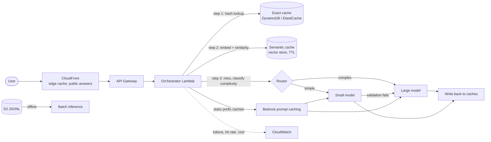
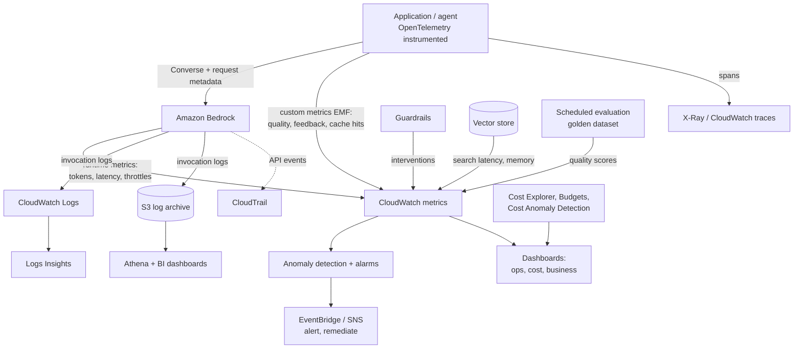

# Domain 4 — Operational Efficiency and Optimization for GenAI Applications

**Weight: 12% (about 8 scored questions).**
Back to the [strategy guide](00-Exam-Strategy-and-Question-Patterns.md).

| Task | Topic | Expected share of the domain |
|---|---|---|
| 4.1 | Cost optimization and resource efficiency | High |
| 4.2 | Application performance | High |
| 4.3 | Monitoring systems | High |

<!-- contents:start -->
## Contents

- [What this domain is really testing](#what-this-domain-is-really-testing)
  - [The three-way trade-off](#the-three-way-trade-off)
- [Task 4.1 — Cost optimization and resource efficiency](#task-41--cost-optimization-and-resource-efficiency)
  - [4.1.1 Token efficiency](#411-token-efficiency)
  - [4.1.2 Cost-effective model selection](#412-cost-effective-model-selection)
  - [4.1.3 Throughput and capacity](#413-throughput-and-capacity)
  - [4.1.4 Caching: five kinds, five purposes](#414-caching-five-kinds-five-purposes)
  - [Architecture: cost and latency optimization](#architecture-cost-and-latency-optimization)
- [Task 4.2 — Application performance](#task-42--application-performance)
  - [4.2.1 Latency](#421-latency)
  - [4.2.2 Retrieval performance](#422-retrieval-performance)
  - [4.2.3 and 4.2.5 Throughput and resource allocation](#423-and-425-throughput-and-resource-allocation)
  - [4.2.4 Inference parameters](#424-inference-parameters)
  - [4.2.6 System-level performance](#426-system-level-performance)
- [Task 4.3 — Monitoring](#task-43--monitoring)
  - [What to monitor and where it comes from](#what-to-monitor-and-where-it-comes-from)
  - [Skills mapped to mechanisms](#skills-mapped-to-mechanisms)
  - [Architecture: GenAI observability stack](#architecture-genai-observability-stack)
- [Question patterns for Domain 4](#question-patterns-for-domain-4)
- [Tips and tricks](#tips-and-tricks)
- [Practice questions](#practice-questions)
- [Rapid recall](#rapid-recall)

All documents and the A to Z topic index: [INDEX.md](INDEX.md)

---
<!-- contents:end -->

## What this domain is really testing

Whether you understand that **tokens are the unit of cost, latency, and capacity** in GenAI, and whether you can pick the single lever that addresses the stated bottleneck without damaging the other two. Every question is a trade-off between cost, latency, and quality; the qualifier tells you which one to protect.

### The three-way trade-off

| Lever | Cost | Latency | Quality | Notes |
|---|---|---|---|---|
| Smaller model | Lower | Lower | Possibly lower | Verify with evaluation |
| Prompt caching | Lower | Lower | Same | Needs a stable, long prefix |
| Semantic / exact cache | Much lower on hits | Much lower on hits | Risk of stale or wrong match | Needs TTL and threshold |
| Batch inference | About half | Hours | Same | Offline only |
| Flex tier | Lower | Higher, variable | Same | Synchronous but not time-critical |
| Priority tier / latency-optimized | Higher | Lower | Same | Customer-facing paths |
| Provisioned / Reserved capacity | Lower only at high steady utilization | Stable | Same | Wasteful when idle |
| Streaming | Same | Lower perceived | Same | Total time unchanged |
| Reranker | Slightly higher per query, fewer generation tokens | Slightly higher | Higher | Net cost can fall |
| Shorter output (`maxTokens`, concise instructions) | Lower | Lower | Same if answer fits | Output tokens are the most expensive and the slowest |
| Fewer / smaller chunks | Lower | Lower | Risk of missing context | Pair with reranking |
| Parallel calls | Same | Lower | Same | Needs quota headroom |
| Distillation / fine-tuned small model | Lower at scale | Lower | Near teacher on the narrow task | Upfront effort |

---

## Task 4.1 — Cost optimization and resource efficiency

### 4.1.1 Token efficiency

| Technique named in the exam guide | What it means in practice |
|---|---|
| Token estimation and tracking | Count tokens before the call where supported; read `usage` (input, output, cache read, cache write) from every response; publish per-feature and per-tenant metrics |
| Context window optimization | Put only what the task needs in the context; order stable content first |
| Response size controls / response limiting | `maxTokens`, stop sequences, explicit length and format instructions, structured output |
| Prompt compression | Remove redundant instructions and examples, shorten system prompts, summarize long inputs first with a cheap model |
| Context pruning | Lower top-k, rerank then keep the top few, drop old turns, summarize conversation history, trim tool outputs before returning them to the model |

**Expert details:**
- **Output tokens cost several times more than input tokens and dominate latency.** Limiting output is usually the most effective single change.
- **Long conversations grow quadratically in cost** because every turn resends the history. Sliding window or periodic summarization is the fix for "cost per conversation rises with length".
- **Agents multiply tokens:** each loop iteration resends instructions, tool definitions, and prior observations. Cache the static prefix, trim tool results, and limit iterations.
- For some models, the requested `maxTokens` is reserved against the tokens-per-minute quota when the request starts. An oversized `maxTokens` causes throttling without any real usage; right-size it.

### 4.1.2 Cost-effective model selection

| Pattern | Description |
|---|---|
| Tiered usage by complexity | Classifier or heuristic sends easy requests to a small model and hard ones to a large model |
| Model cascade | Small model first; escalate when a validator or confidence check fails |
| **Intelligent Prompt Routing** | Managed routing between models of the same family by predicted response quality, with a fallback model |
| **Model distillation** | Large teacher generates training data; small student is tuned to match on your task |
| Price-to-performance measurement | Evaluation job reports quality; combine with token cost and latency to choose |

A correct answer always keeps a quality check in the loop. "Switch everything to the cheapest model" without evaluation is a distractor.

### 4.1.3 Throughput and capacity

| Concept | Detail |
|---|---|
| Quotas | Requests per minute and tokens per minute per model per Region. Throttling is a quota event, not a failure of the model |
| Capacity planning | Tokens per minute needed = requests per minute × (average input tokens + average output tokens), with peak factor |
| Cross-Region inference | More headroom for on-demand without commitment |
| Batch inference | JSONL in S3, job runs asynchronously, results in S3, about 50% lower price. For embeddings backfills, bulk classification, summarizing archives, offline evaluation |
| Provisioned Throughput / Reserved | Fixed capacity for a term. Cost-effective only when utilization is consistently high. Monitor utilization and resize |
| Service tiers | Priority (fastest, premium), Standard (default), Flex (cheaper, slower), selected per request; Reserved is committed capacity |
| Auto-scaling | Applies to what you host (SageMaker endpoints on concurrency; Lambda and SQS consumers). Bedrock on-demand has no scaling knob, only quotas and tiers |

### 4.1.4 Caching: five kinds, five purposes

| Cache type | Key | Stores | Use when | Risk |
|---|---|---|---|---|
| **Prompt caching** (Bedrock) | Exact prefix up to a cache checkpoint | Model's processed prefix | Long repeated system prompt, tool definitions, or document followed by varying questions | Prefix must be identical; short TTL; minimum prefix length |
| **Semantic caching** | Embedding similarity of the query above a threshold | Full response | Many users ask the same thing in different words (FAQs) | False matches, stale answers, leaking personalized answers across users |
| **Deterministic request hashing** / exact cache | Hash of normalized prompt + model + parameters | Full response | Identical repeat requests, temperature 0, idempotent tasks | Low hit rate for free text |
| **Result fingerprinting** | Hash of the inputs that determine the result (document version + task) | Derived output (summary, extraction) | Re-processing unchanged documents | Invalidation when the source changes |
| **Edge caching** | URL and cache key at CloudFront | HTTP response | Public, non-personalized, predictable responses | Never for personalized content |

**Prompt caching rules:**
- Place static content first (system prompt, tools, reference document), then a cache checkpoint, then dynamic content.
- Cache reads are billed at a steep discount and are faster; cache writes can cost slightly more than normal input.
- Anything that changes the prefix (a timestamp, a user name, reordered tools) causes a miss. "Caching enabled but no savings" is almost always dynamic content placed before the checkpoint, a prefix below the minimum size, or requests spaced further apart than the TTL.
- It does not change the output. It is the answer when quality must stay identical.

**Semantic cache design:** embed query → similarity search in a low-latency vector store (ElastiCache/MemoryDB, OpenSearch) → on hit above threshold return the stored answer → on miss call the model and store. Scope the key by tenant, user role, and data version; set a TTL; invalidate when the knowledge base is re-synced.

### Architecture: cost and latency optimization

**Flow:** public answers are served at the edge; the orchestrator tries an exact match, then a semantic match; on a miss it routes by complexity, reuses the cached prompt prefix, escalates to the large model only when needed, and writes the result back. Offline work bypasses all of this through batch inference.

---

## Task 4.2 — Application performance

### 4.2.1 Latency

Decompose latency before choosing a fix: **network + queueing + retrieval + time to first token + (output tokens ÷ tokens per second) + post-processing**.

| Where the time goes | Fix |
|---|---|
| Output generation (long answers) | Shorter output, smaller or faster model, latency-optimized inference, streaming for perception |
| Time to first token | Smaller prompt, prompt caching, Priority tier, latency-optimized inference |
| Sequential independent calls | Parallelize (Step Functions Parallel/Map, concurrent SDK calls) |
| Multi-step agent loop | Fewer steps, disable unneeded pre/post-processing, supervisor-with-routing, direct tool call for simple intents |
| Retrieval | Index tuning, filters, smaller k, cache embeddings of frequent queries |
| Predictable queries | **Pre-computation:** generate ahead of time (nightly reports, common questions) and serve from a store |
| Cold starts | Provisioned concurrency for Lambda; minimum instances for endpoints |
| Throttling retries | Capacity fix (cross-Region inference, quota, tier), not more retries |

**Latency-optimized inference** is a request-time performance setting for supported models and Regions. It costs more and falls back to standard if capacity is not available. Choose it when the stem says "time-sensitive" and the model must not change.

**Benchmark with percentiles** (p50, p90, p99) for time to first token and total latency, under realistic prompt sizes.

### 4.2.2 Retrieval performance

- **Index optimization:** HNSW parameters, quantization, shard and replica sizing, warm-up of vector graphs, periodic segment merge.
- **Query preprocessing:** normalize, rewrite, extract filters before searching.
- **Hybrid search with custom scoring:** weight keyword and vector scores for the workload; apply metadata filters during the search.
- Reranking improves relevance but adds a model call; use it where precision matters and trim the candidate count to control latency.

### 4.2.3 and 4.2.5 Throughput and resource allocation

- Think in tokens per minute, not requests per second.
- Manage concurrency deliberately: SQS with a concurrency cap, client-side rate limiters, adaptive retry mode.
- GenAI traffic has long, variable request durations; scale self-hosted capacity on concurrent requests or queue depth.
- Batch what can wait; reserve on-demand headroom for interactive traffic.

### 4.2.4 Inference parameters

| Parameter | Effect | Guidance |
|---|---|---|
| Temperature | Randomness of token selection | Low (0–0.3) for extraction, classification, code, factual Q&A; higher for creative variety |
| Top-p | Sample from the smallest set of tokens whose probability sums to p | Lower narrows choices. Adjust temperature or top-p, not both |
| Top-k | Sample from the k most likely tokens | Model-specific; set through additional model fields |
| Max tokens | Hard cap on output | Too low truncates (`stopReason = max_tokens`); too high wastes quota |
| Stop sequences | End generation at a marker | Useful for structured or single-item outputs |

Parameter changes are validated by **A/B testing** on real traffic or an evaluation set, not by intuition.

### 4.2.6 System-level performance

- **API call profiling:** trace each request and record prompt size, completion size, and duration per call to find the heavy prompts.
- **Vector query optimization:** see 4.2.2.
- **LLM-specific latency reduction:** caching, streaming, shorter outputs, routing.
- **Efficient service communication:** reuse SDK clients and connections, use VPC endpoints, avoid chains of small synchronous calls, fan out in parallel, pass references (S3 keys) instead of large payloads between steps.

---

## Task 4.3 — Monitoring

### What to monitor and where it comes from

| Signal | Source |
|---|---|
| Invocations, latency, client and server errors, throttles, input and output token counts, time to first token | **CloudWatch metrics** for Bedrock, by model ID |
| Full prompts, responses, token usage, caller identity, request metadata | **Model invocation logging** (off by default) to S3 and/or CloudWatch Logs |
| Guardrail invocations and interventions by policy | Guardrails CloudWatch metrics, guardrail trace |
| Agent reasoning steps, tool calls, knowledge base lookups | Bedrock Agents trace; AgentCore Observability (OpenTelemetry spans in CloudWatch) |
| End-to-end request path and time per component | **X-Ray** / OpenTelemetry |
| API activity and configuration changes | CloudTrail |
| Quality (hallucination rate, relevance, user ratings) | **Custom metrics** published by the application or by scheduled evaluation jobs |
| Cost by team, application, or tenant | Cost allocation tags on application inference profiles and other resources; Cost Explorer; Budgets; **AWS Cost Anomaly Detection** |
| Vector store health | OpenSearch metrics (search latency and rate, k-NN memory, JVM pressure, capacity units), ingestion job logs |

### Skills mapped to mechanisms

| Skill | Mechanism |
|---|---|
| 4.3.1 Holistic observability | One dashboard combining operational metrics, traces, FM interaction traces, and business metrics (resolution rate, deflection, cost per conversation) |
| 4.3.2 GenAI-specific monitoring | Token usage tracking; prompt effectiveness and response quality as custom metrics; **CloudWatch anomaly detection** on token bursts and response drift; invocation logs for request/response analysis; benchmarks; cost anomaly detection |
| 4.3.3 Actionable insights | Dashboards for operations and business; compliance monitoring; **forensic traceability** (correlate user → request ID → prompt → retrieval → tool calls → response); user interaction and model behaviour tracking |
| 4.3.4 Tool performance | Per-tool call count, latency, error rate; tool selection patterns; multi-agent handoff tracking; baselines with anomaly detection |
| 4.3.5 Vector store operations | Performance monitoring, automated index optimization routines, data quality validation (duplicates, stale or orphaned chunks, dimension mismatches) |
| 4.3.6 FM-specific troubleshooting | **Golden datasets** to detect hallucinations; **output diffing** for consistency across versions or runs; **reasoning path tracing** to find logical errors; dedicated observability pipelines |

**Useful implementation details:**
- Publish custom metrics with the embedded metric format from Lambda so no extra API calls are needed.
- Attach request metadata (application, tenant, feature) to model calls so invocation logs can be filtered and costs attributed.
- Query invocation logs with CloudWatch Logs Insights for top token consumers, longest prompts, and error patterns; send to S3 and query with Athena for long-term analysis and dashboards.
- Alarms that matter: throttle count, p99 latency, guardrail intervention rate, output-token anomaly, cache hit rate drop, evaluation score drop, daily cost anomaly.
- Invocation logs are sensitive. Encrypt, restrict, and expire them (links to Domain 3).

### Architecture: GenAI observability stack

**Flow:** the application and Bedrock emit metrics, traces, and content logs; guardrails and the vector store add their own signals; scheduled evaluations turn quality into a metric; anomaly detection raises alarms that trigger alerts or remediation; logs feed ad hoc and long-term analysis.

---

## Question patterns for Domain 4

| # | Pattern | Stem signals | Answer shape | Typical distractor |
|---|---|---|---|---|
| 1 | Which cache | Repeated prefix vs repeated question vs identical request | Prompt caching vs semantic cache vs exact hash | Semantic cache for personalized answers; prompt caching for varying prefixes |
| 2 | Cut cost, keep quality | "Without reducing quality" | Prompt caching, batch, right-sized `maxTokens`, context pruning with reranker | Smaller model with no evaluation |
| 3 | Cut cost, offline workload | "Overnight", "not time-sensitive" | Batch inference or Flex tier | Provisioned Throughput |
| 4 | Reduce latency | "Time-sensitive", "users wait" | Streaming, latency-optimized, parallelism, pre-computation | Batch, extra chain steps |
| 5 | Throttling | 429 at peak | Backoff, cross-Region inference, quota, capacity commitment by workload shape | Larger model, more Lambda memory |
| 6 | Capacity commitment | Steady vs spiky | Provisioned/Reserved for steady; on-demand for spiky | Commitment for unpredictable load |
| 7 | Cost growth in chat or agents | "Cost rises with conversation length" | History summarization, sliding window, caching, trimmed tool output | Bigger context window |
| 8 | Parameter choice | "Consistent", "creative", "truncated" | Temperature, top-p, max tokens | Changing the model |
| 9 | What to monitor | "Detect sudden spike", "which team" | Anomaly detection, cost tags on inference profiles, invocation logs | CloudTrail for token counts |
| 10 | Quality monitoring | "Detect degradation over time" | Scheduled evaluation on golden dataset → metric → alarm | Latency metrics only |
| 11 | Agent and tool monitoring | "Which tool is slow or failing" | Traces with per-tool spans, baselines | Model-level metrics only |
| 12 | Vector store operations | "Search slowing as index grows" | Index optimization, quantization, shard/replica tuning, monitoring | Bigger generation model |

## Tips and tricks

1. **Identify the protected variable.** "Without affecting quality" removes smaller models and aggressive pruning. "Without affecting latency" removes batch and Flex. "Lowest cost" permits them.
2. **Prefix repeated → prompt caching. Question repeated → semantic cache. Request identical → hash.**
3. **Semantic caching is wrong for personalized, time-sensitive, or permission-dependent answers** unless the key includes the scope.
4. **Batch means hours and S3.** If a user is waiting, it is not batch.
5. **Provisioned capacity is a utilization bet.** Spiky or unknown load keeps on-demand plus cross-Region inference.
6. **Streaming is a perception fix.** It never appears as the correct answer to a cost question.
7. **Limit output first.** It reduces cost and latency at once.
8. **Quality must be a metric.** Monitoring answers that contain only operational metrics are incomplete for GenAI.
9. **Token counts live in CloudWatch metrics and invocation logs, not CloudTrail.**
10. **For cost attribution, look for tags on application inference profiles or request metadata**, not separate accounts per feature.

---

## Practice questions

**Q1.** A legal assistant sends a 30,000-token contract with every question in a session. Users ask about ten questions per contract within a few minutes. Which change reduces cost and latency the MOST without changing answers?

- A. Semantic caching of responses
- B. Prompt caching with the contract placed before a cache checkpoint
- C. Batch inference
- D. Reducing temperature to 0

**Answer: B.** A long identical prefix with varying questions is the prompt caching case. A would return one question's answer for another only on near-duplicates and adds risk.

**Q2.** A company classifies 4 million archived support tickets each month. Results are needed within 24 hours. Which option is MOST cost-effective?

- A. On-demand invocation from Lambda with high concurrency
- B. Provisioned Throughput for one month
- C. Bedrock batch inference with input and output in S3
- D. Priority service tier

**Answer: C.** Offline, bulk, deadline in hours.

**Q3.** A public FAQ bot receives the same 200 questions phrased in many ways. Answers are not personalized and change monthly. Which design lowers cost the most?

- A. Prompt caching of the system prompt
- B. A semantic cache with a similarity threshold and a TTL, invalidated when content is updated
- C. A larger model with a longer context window
- D. Deterministic hashing of the raw question string

**Answer: B.** Paraphrases need similarity matching; D would miss most variants.

**Q4.** A chat application enabled prompt caching, but the usage data shows zero cache-read tokens. The system prompt begins with the current timestamp and the user's name, followed by 4,000 tokens of static instructions. What is the fix?

- A. Increase `maxTokens`
- B. Move the timestamp and user name after the static instructions and the cache checkpoint
- C. Switch to a global inference profile
- D. Enable model invocation logging

**Answer: B.** The cache matches an exact prefix; dynamic content at the start invalidates it on every request.

**Q5.** An application has steady interactive traffic during business hours and almost none at night, with occasional unpredictable peaks that cause throttling. Which approach handles peaks at the lowest cost?

- A. Purchase Provisioned Throughput sized for the peak
- B. Use a cross-Region inference profile with on-demand, plus retries with backoff and jitter
- C. Move interactive traffic to batch inference
- D. Increase Lambda reserved concurrency

**Answer: B.** Extra on-demand headroom without paying for idle capacity.

**Q6.** A team needs to detect when answer quality degrades after silent upstream changes, and to be alerted automatically. Which solution is best?

- A. Alarm on `InvocationLatency`
- B. Run a scheduled evaluation against a golden dataset, publish scores as CloudWatch custom metrics, and alarm with anomaly detection
- C. Review CloudTrail events weekly
- D. Increase the guardrail filter strength

**Answer: B.** Quality becomes a monitored metric with an automated alarm.

---

## Rapid recall

- Tokens = cost, latency, capacity. Output tokens are the expensive ones.
- Prompt caching: static first, checkpoint, dynamic last. Same output, lower cost and latency.
- Semantic cache: paraphrased repeats, scoped keys, TTL.
- Batch: about half price, S3, hours. Flex: cheaper, slower, synchronous. Priority: faster, premium.
- Provisioned / Reserved: steady high utilization only.
- Cross-Region inference: headroom for bursts.
- Cascade and Intelligent Prompt Routing: pay for the large model only when needed. Distillation: small model, near-teacher quality.
- Latency fixes: shorter output, streaming, parallel calls, pre-computation, latency-optimized inference.
- Temperature low for facts, high for creativity. `max_tokens` stop reason means truncation.
- Metrics in CloudWatch, content in invocation logs, API activity in CloudTrail, paths in X-Ray, quality from scheduled evaluations, cost from tags and Cost Anomaly Detection.
