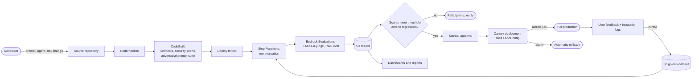
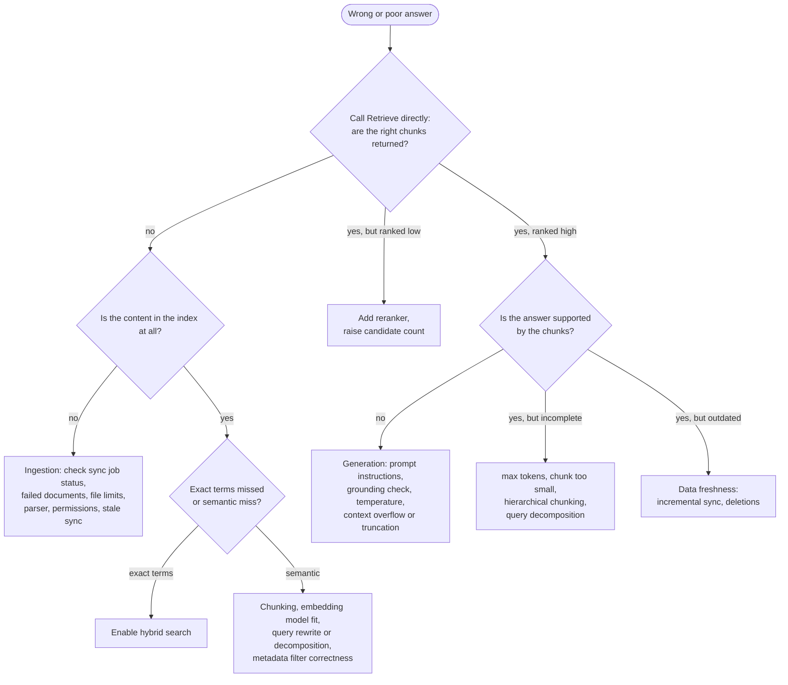

# Domain 5 — Testing, Validation, and Troubleshooting

**Weight: 11% (about 7 scored questions).**
Back to the [strategy guide](00-Exam-Strategy-and-Question-Patterns.md).

| Task | Topic | Expected share of the domain |
|---|---|---|
| 5.1 | Evaluation systems for GenAI | About two thirds |
| 5.2 | Troubleshooting GenAI applications | About one third |

The domain is small, but its skills are reused in every other domain: half of the Domain 1, 2, and 4 scenarios are troubleshooting questions in disguise.

<!-- contents:start -->
## Contents

- [What this domain is really testing](#what-this-domain-is-really-testing)
- [Task 5.1 — Evaluation systems](#task-51--evaluation-systems)
  - [Evaluation method selector](#evaluation-method-selector)
  - [Metrics vocabulary](#metrics-vocabulary)
  - [LLM-as-a-judge: what makes an answer correct](#llm-as-a-judge-what-makes-an-answer-correct)
  - [Skills mapped to mechanisms](#skills-mapped-to-mechanisms)
  - [Building the golden dataset](#building-the-golden-dataset)
  - [Online testing mechanics](#online-testing-mechanics)
  - [Architecture: evaluation and CI/CD quality gate](#architecture-evaluation-and-cicd-quality-gate)
- [Task 5.2 — Troubleshooting](#task-52--troubleshooting)
  - [Fault isolation for RAG](#fault-isolation-for-rag)
  - [5.2.1 Content handling (context window, truncation)](#521-content-handling-context-window-truncation)
  - [5.2.2 FM integration issues](#522-fm-integration-issues)
  - [5.2.3 and 5.2.5 Prompt engineering and prompt maintenance](#523-and-525-prompt-engineering-and-prompt-maintenance)
  - [5.2.4 Retrieval system issues](#524-retrieval-system-issues)
- [Question patterns for Domain 5](#question-patterns-for-domain-5)
- [Tips and tricks](#tips-and-tricks)
- [Practice questions](#practice-questions)
- [Rapid recall](#rapid-recall)

All documents and the A to Z topic index: [INDEX.md](INDEX.md)

---
<!-- contents:end -->

## What this domain is really testing

1. **Which evaluation method fits which question** (programmatic metric, LLM-as-a-judge, human, RAG evaluation, agent evaluation, online test).
2. **Fault isolation:** given a symptom, identify the faulty component and the diagnostic that proves it before changing anything.

---

## Task 5.1 — Evaluation systems

### Evaluation method selector

| You need to know | Method | Notes |
|---|---|---|
| Which model is best for my task, at scale and low cost | **Bedrock model evaluation, automatic** with a custom prompt dataset | Programmatic metrics for accuracy, robustness, toxicity |
| Nuanced quality (correctness, completeness, helpfulness, tone) at scale | **LLM-as-a-judge** | Evaluator model scores each response with an explanation; built-in and custom metrics |
| Subjective quality, brand voice, expert judgement | **Human evaluation** | Your own work team or an AWS-managed team; ratings, rankings, comparisons |
| Is my retriever returning the right context | **RAG evaluation, retrieve only** | Context relevance, context coverage |
| Is my RAG answer correct and grounded | **RAG evaluation, retrieve and generate** | Correctness, completeness, faithfulness, citation precision and coverage, helpfulness, responsible AI metrics |
| Quality of a RAG system or model not hosted on Bedrock | **Bring your own inference responses** | Supply the outputs (and retrieved contexts) in the dataset |
| Does my agent complete tasks and use tools properly | **Agent evaluation** | Task completion, tool selection and parameter accuracy, reasoning quality from traces |
| Which variant performs better with real users | **A/B test** | Split live traffic, compare business and quality metrics |
| Is the new version safe to roll out | **Canary** / shadow | Small traffic share with automatic rollback; shadow compares without user exposure |
| Did a change break something that worked | **Regression test** on a golden dataset | Automated, in the pipeline |

### Metrics vocabulary

| Metric | Measures | Use / limit |
|---|---|---|
| ROUGE | N-gram overlap, recall-oriented | Summarization; ignores meaning |
| BLEU | N-gram overlap, precision-oriented | Translation; ignores meaning |
| BERTScore | Semantic similarity with embeddings | Paraphrase-tolerant comparison to a reference |
| Exact match / F1 | Token-level agreement | Extractive Q&A, classification |
| Correctness | Agreement with ground truth | Needs reference answers |
| Completeness | Covers all parts of the question | |
| **Faithfulness** | Answer is supported by the retrieved context | The hallucination metric for RAG; needs no ground truth |
| Context relevance | Retrieved chunks relate to the question | Retriever precision |
| Context coverage | Retrieved chunks contain everything in the ground truth | Retriever recall; needs ground truth |
| Citation precision / coverage | Cited passages are correct / all support is cited | Attribution quality |
| Relevance, coherence, fluency, helpfulness | Response quality dimensions | Judge-model metrics |
| Harmfulness, stereotyping, refusal | Responsible AI dimensions | Judge-model metrics |
| Robustness | Stability under perturbed input | Typos, rephrasing |
| Precision@k, recall@k, MRR, NDCG | Ranking quality | Custom retrieval tests |

The exam guide's four named quality dimensions are **relevance, factual accuracy, consistency, and fluency**. Traditional ML metrics (accuracy, AUC) and n-gram metrics alone are "traditional approaches" that the correct answer goes beyond.

### LLM-as-a-judge: what makes an answer correct

- Use a **capable judge model**, preferably different from the generator, to limit self-preference.
- Provide a **rubric** (built-in metric definitions or a custom metric prompt with a rating scale).
- **Calibrate** against a human-labelled sample; keep periodic human spot checks.
- It scales where human review does not. "Thousands of responses weekly with consistent criteria" points to it. "Final sign-off on subjective brand tone" points to human evaluation.

### Skills mapped to mechanisms

| Skill | Mechanism |
|---|---|
| 5.1.1 Assessment frameworks | Metrics for relevance, factual accuracy, consistency, fluency; reference-based and reference-free |
| 5.1.2 Model evaluation systems | Bedrock Model Evaluations; A/B and canary testing; multi-model comparison; cost-performance analysis (token efficiency, latency-to-quality ratio, business outcomes) |
| 5.1.3 User-centered evaluation | Feedback UI (thumbs, ratings, comments) stored with the request ID; annotation workflows for experts; feedback joins invocation logs to grow the evaluation dataset |
| 5.1.4 Quality assurance | Continuous evaluation (EventBridge schedule → Step Functions → evaluation job), regression tests, **automated quality gates** in the deployment pipeline |
| 5.1.5 Multi-perspective assessment | RAG evaluation + LLM-as-a-judge + human feedback together |
| 5.1.6 Retrieval quality testing | Relevance scoring, context matching verification, retrieval latency |
| 5.1.7 Agent performance | Task completion rate, tool usage effectiveness, agent evaluations, reasoning quality across steps |
| 5.1.8 Reporting | Evaluation report cards, comparison views, dashboards, scheduled reports to stakeholders |
| 5.1.9 Deployment validation | Synthetic user workflows (canaries), AI-specific validation for hallucination rate and semantic drift, response consistency checks |

### Building the golden dataset

- Real user questions sampled from invocation logs, de-identified.
- Expert-written reference answers and, for RAG, the expected source passages.
- Coverage of categories, edge cases, adversarial prompts, and known past failures.
- Versioned in S3; grows from user feedback and incidents.
- Used for model selection, prompt regression, deployment gates, and drift monitoring.

### Online testing mechanics

| Technique | Implementation options |
|---|---|
| A/B test of prompts | Prompt Management variants or versions selected by a flag |
| A/B test of models | AppConfig feature flag or weighted routing in the gateway; SageMaker production variants for self-hosted models |
| Canary | Lambda alias weights with CodeDeploy, API Gateway canary stage, AppConfig gradual deployment, with CloudWatch alarm rollback |
| Shadow | Send a copy of traffic to the candidate, log and evaluate, do not return its output |
| Synthetic workflows | Scheduled scripted conversations that assert on structure, grounding, and latency |

**Semantic drift check:** embed the new version's answers and the baseline answers for the same questions; alert when similarity falls below a threshold. **Output diffing:** compare old and new outputs directly for format and content changes.

### Architecture: evaluation and CI/CD quality gate

**Flow:** every change to prompts, agents, or infrastructure is tested and scanned, deployed to a test environment, evaluated against the golden dataset, and blocked if scores fall. Approved changes roll out as a canary with alarm-based rollback, and production feedback flows back into the dataset.

---

## Task 5.2 — Troubleshooting

### Fault isolation for RAG

**The first diagnostic step is always to separate retrieval from generation** by inspecting the retrieved chunks (the `Retrieve` API or the citations in the trace). Options that change the model before doing this are distractors.

### 5.2.1 Content handling (context window, truncation)

| Symptom | Cause | Diagnostic | Fix |
|---|---|---|---|
| `ValidationException` saying the input is too long | Prompt + context exceeds the context window | Count input tokens; check history and chunk sizes | Fewer or smaller chunks, summarize history, map-reduce summarization, larger-context model |
| Answer stops mid-sentence; JSON fails to parse | Output cap reached | `stopReason = max_tokens` | Raise `maxTokens`, ask for shorter output, paginate, continue generation |
| Model ignores facts placed in the middle of a long context | Dilution in long prompts | Compare answers with reduced context | Rerank and pass fewer chunks; put key instructions at the start or end |
| Earlier turns forgotten | Application-side truncation of history | Log what is actually sent | Summarize older turns instead of dropping them |
| Works for short documents, fails for long ones | Fixed chunk count regardless of size | Token usage per request | **Dynamic chunking:** fit chunks to a token budget |

### 5.2.2 FM integration issues

| Error / signal | Typical cause | Action |
|---|---|---|
| `AccessDeniedException` (403) | Missing IAM action (`InvokeModel` vs `InvokeModelWithResponseStream`), model not enabled, SCP, destination Region of an inference profile denied, KMS key policy | Fix permissions; do not retry |
| `ValidationException` (400) | Malformed body, wrong field for the model, input too long, invalid message order, model requires an inference profile ID instead of the model ID | Fix the request; do not retry |
| `ResourceNotFoundException` (404) | Wrong model ID, ARN, or Region; model not available there | Correct the identifier or Region |
| `ThrottlingException` (429) | Requests or tokens per minute exceeded | Backoff with jitter; cross-Region inference; quota increase; smooth with SQS |
| `ModelNotReadyException` (429) | Model warming (for example after idle for imported models) | SDK retries automatically; allow for cold start |
| `ModelTimeoutException` (408) | Model took too long | Shorter prompt or output, streaming, retry |
| `ModelErrorException` (424) | Model failed on the request | Retry; inspect input |
| `ServiceUnavailableException` (503), `InternalServerException` (500) | Service-side transient | Retry with backoff; fall back |
| `ServiceQuotaExceededException` | Resource count limit | Request an increase |
| Client read timeout while the model is still generating | SDK read timeout shorter than generation | Raise the read timeout or stream |
| `stopReason = tool_use` not handled | Application treats the turn as final | Execute the tool and return a `toolResult` |
| `stopReason = guardrail_intervened` | Guardrail blocked or masked | Read the guardrail trace |
| Parameter not recognized by the SDK | Outdated SDK version | Upgrade the SDK |

**Agent-specific faults:**

| Symptom | Cause |
|---|---|
| Agent cannot call its Lambda function | Missing resource-based permission on the function for the Bedrock service principal |
| Action group returns an error to the agent | Lambda response does not match the expected response format |
| Changes not visible in production | Agent not prepared, or alias still points to an older version |
| Wrong tool chosen or wrong parameters | Vague or overlapping tool descriptions and schemas; read the orchestration trace (rationale, action, observation) |
| Agent loops | No stopping condition; tool returns unhelpful errors; unclear completion criteria |
| Knowledge base returns nothing inside the agent | Knowledge base description does not tell the agent when to use it; filter mismatch |

### 5.2.3 and 5.2.5 Prompt engineering and prompt maintenance

| Problem | Diagnostic tool | Fix |
|---|---|---|
| Inconsistent output format | **Schema validation** on responses; count failures | Structured output with JSON Schema, few-shot examples, lower temperature |
| Quality fell after a prompt edit | **Version comparison** in Prompt Management; regression run on the golden dataset | Roll back the version; refine one change at a time |
| Model confused by the template | **CloudWatch Logs** of rendered prompts (check variable substitution, missing values, conflicting instructions) | Fix the template; add template tests |
| Cannot tell which prompt version produced a response | **X-Ray** annotations / trace attributes carrying prompt ID and version: a prompt observability pipeline | Tag every invocation with prompt and model version |
| Prompt works on one model, fails after migration | Evaluation on both models | Re-optimize the prompt for the target model; do not assume portability |
| Edge cases fail | Prompt testing framework with categorized cases | Add targeted examples and add the cases to the suite |

**Systematic refinement** means: reproduce on a dataset, change one variable, measure, version, and promote through the gate. Editing the prompt in production and observing is the wrong answer.

### 5.2.4 Retrieval system issues

| Problem | Diagnostic | Fix |
|---|---|---|
| Relevance is poor across the board | Inspect retrieved chunks and scores for a query sample | Chunking strategy, parser, embedding model fit |
| Relevance fell over time | **Drift monitoring:** track context relevance on the golden set; compare query topics to corpus | Refresh content, add sources, re-evaluate the embedding model |
| Nothing or random results after a change | **Vectorization issues:** query and index embedded with different models or dimensions; wrong embedding input type | Same model and settings for both; re-index |
| Some documents never appear | Ingestion job statistics and failure reasons; unsupported format or size; metadata file errors; role lacks S3 or KMS access | Fix and re-sync |
| Filters return no results | Metadata attribute name or type mismatch; filter too restrictive | Correct the metadata schema or filter |
| Deleted or old content still returned | Sync not run after source changes | Incremental sync on change events |
| Search is slow | Index size, HNSW settings, shard layout, missing filter pushdown | Index optimization, quantization, replicas, pre-filtering |
| Tables and figures not found | Parser | Data Automation or FM parser; re-ingest |

---

## Question patterns for Domain 5

| # | Pattern | Stem signals | Answer shape | Typical distractor |
|---|---|---|---|---|
| 1 | Pick the evaluation method | Scale, subjectivity, RAG, agent | Method selector above | Human review for thousands of items; ROUGE for factual accuracy |
| 2 | Pick the metric | "Supported by context", "retriever finds everything" | Faithfulness, context coverage, context relevance | BLEU, accuracy |
| 3 | Evaluate an external system | Not on Bedrock | Bring your own inference responses | Rebuild on Bedrock |
| 4 | Prevent regressions | "Prompt change degraded quality" | Golden dataset + automated gate in the pipeline | Manual testing |
| 5 | Safe rollout | "New model version", "limit impact" | Canary with alarms and rollback; A/B for comparison | Big-bang switch |
| 6 | Agent quality | "Completes tasks", "uses right tools" | Task completion, tool accuracy, trace-based evaluation | Response fluency only |
| 7 | Retrieval vs generation | Wrong answers from RAG | Inspect retrieved chunks first | Switch model first |
| 8 | Truncation and overflow | Cut-off output, too-long input | `stopReason`, token counts, dynamic chunking | Higher temperature |
| 9 | API error interpretation | Specific exception name | Error table above | Retry on validation or access errors |
| 10 | Prompt maintenance | "Which version", "format drift" | Version comparison, schema validation, logs, traces | Rewrite from scratch |
| 11 | Embedding and index faults | "After changing the embedding model" | Re-index with the same model for query and index | Tune temperature |
| 12 | User feedback loop | "Improve continuously from users" | Feedback capture → dataset → evaluation | One-off survey |

## Tips and tricks

1. **Faithfulness = grounded in context (no ground truth needed). Correctness = matches the reference answer (ground truth needed).** The exam uses this distinction.
2. **Context relevance tests the retriever's precision; context coverage tests its recall.**
3. **N-gram metrics are the "traditional" trap.** Semantic quality questions want LLM-as-a-judge or human evaluation.
4. **Scale → LLM-as-a-judge. Subjective or high-stakes sign-off → human. Both → combine them.**
5. **Inspect before you change.** The option that adds a diagnostic (trace, retrieved chunks, `stopReason`, logs) usually precedes any fix in the correct sequence.
6. **4xx about your request (400, 403, 404): fix it. 429 and 5xx: retry with backoff.**
7. **A regression needs a baseline.** Answers that mention a golden dataset, versioned prompts, and automated gates beat ad hoc testing.
8. **Canary answers "is it safe"; A/B answers "which is better".**
9. **Agents are evaluated on outcomes and trajectories,** not only on the final text.
10. **Any change to embedding model, chunking, or parser requires re-ingestion** before re-testing.

---

## Practice questions

**Q1.** A team wants to evaluate 5,000 weekly chatbot responses for correctness, completeness, and professional tone using consistent criteria, with explanations for low scores. Which approach is most appropriate?

- A. Compute ROUGE against reference answers
- B. Bedrock model evaluation with LLM-as-a-judge using built-in and custom metrics
- C. Human evaluation by subject matter experts for all responses
- D. Monitor `InvocationLatency`

**Answer: B.** Nuanced quality at scale with explanations. C does not scale; A measures word overlap.

**Q2.** A RAG application's answers are fluent, but auditors find claims that are not in the source documents. Which metric should the team track to quantify this?

- A. Context relevance
- B. Faithfulness
- C. BLEU
- D. Robustness

**Answer: B.** Faithfulness measures whether the answer is supported by the retrieved context.

**Q3.** A company runs its RAG pipeline with a self-managed vector database and a model on SageMaker. It wants to use Bedrock's RAG evaluation metrics without migrating. What should it do?

- A. Recreate the pipeline with Bedrock Knowledge Bases
- B. Create a RAG evaluation job using bring-your-own inference responses, supplying the prompts, retrieved contexts, and generated answers
- C. Use CloudWatch Synthetics
- D. Use SageMaker Model Monitor data quality checks

**Answer: B.** Bedrock Evaluations can score outputs produced elsewhere.

**Q4.** After a deployment, responses from a document summarizer are frequently cut off, and downstream JSON parsing fails. The model and prompt are unchanged; only an inference configuration file was edited. What should the developer check first?

- A. The knowledge base chunking strategy
- B. The `stopReason` in the responses and the `maxTokens` value
- C. The guardrail content filter strength
- D. The IAM policy on the Lambda role

**Answer: B.** Truncated output with `stopReason = max_tokens` indicates the output cap.

**Q5.** A developer changes the knowledge base's embedding configuration in the application's query code to a newer model for better quality. Retrieval immediately returns unrelated passages. What is the cause and fix?

- A. Temperature is too high; lower it
- B. Query vectors and index vectors come from different models; re-embed the corpus with the new model into a new index, or revert the query model
- C. The reranker is disabled; enable it
- D. The S3 bucket lacks versioning; enable it

**Answer: B.** Vectors from different models are not comparable.

**Q6.** A team must ensure that prompt and agent changes cannot reach production if answer quality falls. Which solution meets this with the least manual effort? (Select TWO.)

- A. Maintain a versioned golden dataset and run an automated evaluation stage in the pipeline that fails below defined thresholds
- B. Ask developers to test a few prompts in the console before merging
- C. Deploy with a canary and CloudWatch alarms that trigger automatic rollback
- D. Increase the model's temperature in production
- E. Disable model invocation logging to reduce noise

**Answer: A and C.** A pre-deployment quality gate plus a guarded rollout.

---

## Rapid recall

- Methods: automatic metrics, LLM-as-a-judge, human, RAG (retrieve only / retrieve and generate), agent evaluation, bring your own responses.
- Faithfulness = grounded. Correctness = matches reference. Context relevance = precision. Context coverage = recall.
- ROUGE summarization, BLEU translation, BERTScore semantic. All "traditional" compared with judge models.
- Golden dataset: versioned, from real traffic and failures, used for gates and drift.
- Canary = safety. A/B = comparison. Shadow = no user exposure. Synthetic workflows = continuous validation.
- First RAG diagnostic: look at the retrieved chunks.
- `max_tokens` stop reason = truncated output. Input too long = context overflow.
- Fix 400/403/404; retry 429/5xx.
- Agent faults: Lambda permission, response format, alias version, tool descriptions; read the trace.
- Prompt faults: version comparison, schema validation, rendered-prompt logs, trace attributes.
