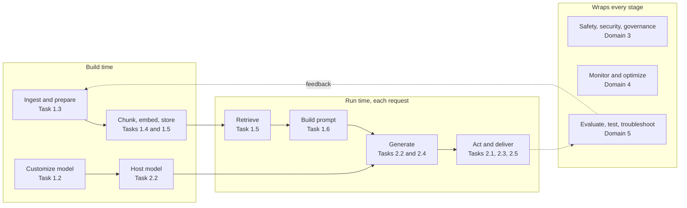
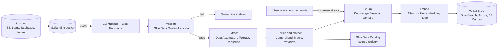
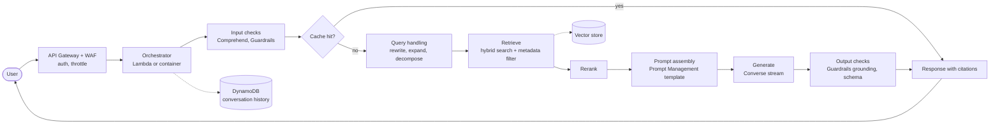
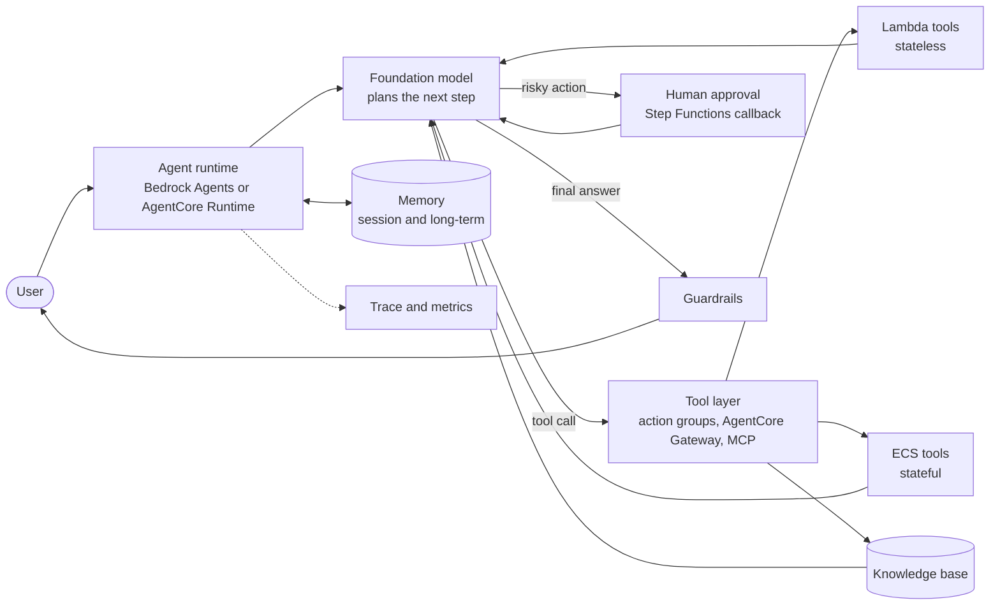
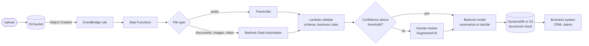
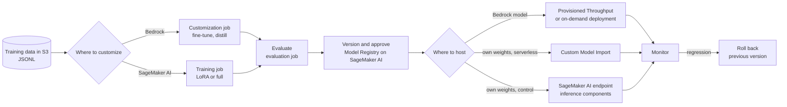
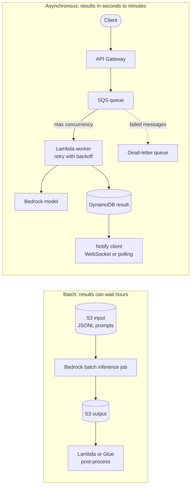
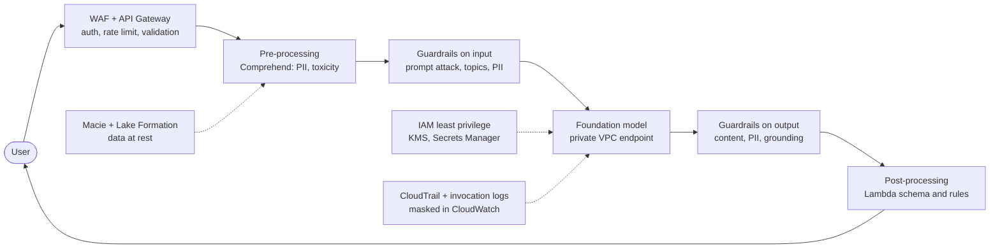
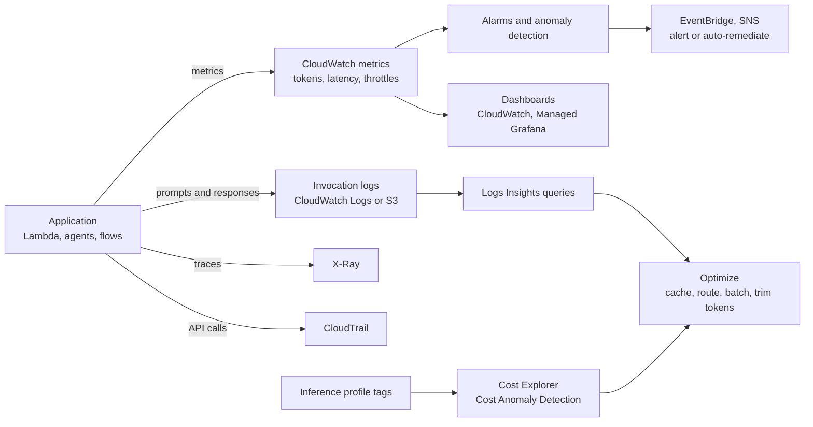
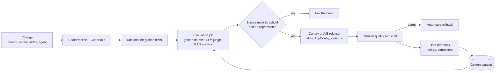

# AIP-C01 — GenAI Pipelines: What to Use at Each Stage

Every pipeline a GenAI application can contain, drawn stage by stage, with the service to use at each stage and the exam skill it maps to. Use it to place any question: find the pipeline, find the stage, read the row.

Back to the [index](../INDEX.md) · [Service list](06-Service-List-When-to-Use.md) · [API list](07-API-List-by-Task.md) · [Deep dives](Deep_dive_services.md)

**How to read the stage tables**

- **Managed choice** is the Bedrock feature or purpose-built AWS service. It is the default answer when the stem says least operational overhead or least development effort.
- **Custom or SageMaker AI choice** is what you use when the stem names a requirement the managed choice cannot meet: your own container, a specific GPU, an unsupported model, custom logic.
- **Skill** is the exam-guide skill the stage belongs to (first digit is the domain).

## Contents

- [1. The whole picture](#1-the-whole-picture)
- [2. Ingestion pipeline](#2-ingestion-pipeline)
- [3. Retrieval and generation pipeline](#3-retrieval-and-generation-pipeline)
- [4. Agent pipeline](#4-agent-pipeline)
- [5. Document and media processing pipeline](#5-document-and-media-processing-pipeline)
- [6. Model customization and hosting pipeline](#6-model-customization-and-hosting-pipeline)
- [7. Batch and asynchronous inference pipeline](#7-batch-and-asynchronous-inference-pipeline)
- [8. Safety and security wrap](#8-safety-and-security-wrap)
- [9. Monitoring and optimization pipeline](#9-monitoring-and-optimization-pipeline)
- [10. Evaluation and release pipeline](#10-evaluation-and-release-pipeline)
- [11. Bedrock or SageMaker AI at each stage](#11-bedrock-or-sagemaker-ai-at-each-stage)
- [12. Stage map by domain](#12-stage-map-by-domain)
- [13. Which pipeline is the question describing](#13-which-pipeline-is-the-question-describing)
- [14. Stage drills](#14-stage-drills)
- [Sources](#sources)

---

## 1. The whole picture

**Flow:** two build-time tracks prepare what the application needs: an index of your data, and a hosted model. At run time each request retrieves, builds a prompt, generates, then acts or delivers. Three concerns wrap every stage: safety and security, monitoring and optimization, evaluation and troubleshooting. Evaluation results and user feedback flow back into ingestion and prompts.

| Stage | Question it answers | Domain and task | Pipeline |
|---|---|---|---|
| Design and select | Which model, which pattern, is it feasible? | Domain 1, Tasks 1.1 and 1.2 | [Section 6](#6-model-customization-and-hosting-pipeline) |
| Ingest and prepare | Is the data clean, extracted and safe to use? | Domain 1, Task 1.3 | [Section 2](#2-ingestion-pipeline) |
| Chunk, embed, store | How is knowledge indexed and kept current? | Domain 1, Tasks 1.4 and 1.5 | [Section 2](#2-ingestion-pipeline) |
| Retrieve | How does the right context reach the prompt? | Domain 1, Task 1.5 | [Section 3](#3-retrieval-and-generation-pipeline) |
| Build prompt | How are instructions managed and governed? | Domain 1, Task 1.6 | [Section 3](#3-retrieval-and-generation-pipeline) |
| Customize and host | Where does the model run, and at what capacity? | Domain 1, Task 1.2 and Domain 2, Task 2.2 | [Section 6](#6-model-customization-and-hosting-pipeline) |
| Generate | Which API, sync or stream, how is it made resilient? | Domain 2, Task 2.4 | [Section 3](#3-retrieval-and-generation-pipeline), [Section 7](#7-batch-and-asynchronous-inference-pipeline) |
| Act | How does the model use tools and people? | Domain 2, Task 2.1 | [Section 4](#4-agent-pipeline) |
| Integrate and deliver | How does it fit the enterprise and reach the user? | Domain 2, Tasks 2.3 and 2.5 | [Section 5](#5-document-and-media-processing-pipeline) |
| Protect | What stops harm, leaks and misuse? | Domain 3 | [Section 8](#8-safety-and-security-wrap) |
| Observe and optimize | What does it cost, how fast is it, what is failing? | Domain 4 | [Section 9](#9-monitoring-and-optimization-pipeline) |
| Evaluate and release | Is it good enough to ship, and does it stay good? | Domain 5 | [Section 10](#10-evaluation-and-release-pipeline) |

---

## 2. Ingestion pipeline

**Flow:** files land in S3, an event starts a workflow, each file is validated, extracted and enriched, then chunked, embedded and written to the vector store. Change events or a schedule re-run only what changed.

| Stage | Managed choice | Custom or SageMaker AI choice | Exam trigger | Skill |
|---|---|---|---|---|
| Collect | Knowledge Bases connectors (S3, Confluence, SharePoint, Salesforce, web crawler); AppFlow for SaaS data; DataSync and Transfer Family for files | Kinesis or MSK for streams; DynamoDB Streams or database change capture; Glue or EMR jobs | "Integrate document systems and wikis", "real-time changes" | 1.4.4 |
| Orchestrate | EventBridge rule on S3 events that starts Step Functions | Glue workflows | "Event-driven", "retry and branch per file type" | 2.3.2 |
| Validate | Glue Data Quality rules | Lambda checks; Data Wrangler profiling; CloudWatch metrics | "Data must meet quality standards before the FM uses it" | 1.3.1 |
| Extract | Bedrock Data Automation; Knowledge Bases parser (Data Automation or foundation model) | Textract, Transcribe, Rekognition; SageMaker Processing with your own code | "Tables and scanned pages", "audio", "custom libraries" | 1.3.2 |
| Enrich | Comprehend entities, key phrases, language, custom classification; Bedrock to reformat or summarize | Lambda normalization | "Improve input quality", "tags for filtering" | 1.3.4, 1.4.2 |
| Protect | Macie on the bucket; Comprehend PII redaction job | Lambda masking from offsets | "Sensitive data must not reach the index" | 3.2.2 |
| Chunk | Knowledge Bases chunking: fixed, hierarchical, semantic, none | Custom transformation Lambda | The document shape described in the stem | 1.5.1 |
| Embed | Bedrock embedding model such as Titan; batch inference for bulk loads | Your embedding model on a SageMaker AI endpoint; Lambda batching | "Dimensionality and domain fit", "millions of documents" | 1.5.2 |
| Store | Knowledge Bases with OpenSearch Serverless, Aurora, S3 Vectors or Neptune Analytics | OpenSearch Service domain you tune (shards, HNSW, several indexes); DynamoDB for metadata | "Scale", "SQL joins", "graph relationships" | 1.4.1, 1.4.3, 1.5.3 |
| Describe | Glue Data Catalog; metadata file beside each document | Custom attributes and tags | "Trace which source fed the answer" | 1.4.2, 3.3.2 |
| Keep current | Incremental sync on change events or a schedule; direct document ingestion | Change data capture into your own index | "Deleted content is still returned" | 1.4.5 |

**Common wrong turns**

- Changing chunk size to fix missing table data. That is the extract stage: change the parser.
- Re-embedding the whole corpus nightly when incremental sync exists.
- Embedding documents with one model and queries with another. Results look random.

---

## 3. Retrieval and generation pipeline

**Flow:** the request passes the front door and input checks, a cache may answer it, the query is improved, context is retrieved and reranked, the prompt is assembled from a managed template, the model generates, the output is checked, and the answer streams back with citations.

`RetrieveAndGenerate` collapses retrieve, assemble, generate and cite into one managed call. Use `Retrieve` when you need to own any of those stages.

| Stage | Managed choice | Custom or SageMaker AI choice | Exam trigger | Skill |
|---|---|---|---|---|
| Front door | API Gateway with WAF, authorizer, usage plans, request validation | AppSync for GraphQL and real time; load balancer in front of containers | "Throttle per client", "validate before the model" | 2.4.1, 2.5.1 |
| Identity | Cognito or IAM Identity Center; verified claims passed to filters | Custom authorizer | "Users see only their documents" | 2.3.3, 3.2.1 |
| Input checks | Guardrails on input; Comprehend pre-processing | Lambda rules | "Block injection, PII, off-topic requests" | 3.1.1, 3.1.4 |
| Cache | Prompt caching for a repeated prefix | Semantic cache in ElastiCache or OpenSearch; exact-match hash in DynamoDB; CloudFront for static answers | "Same questions repeated", "avoid unnecessary FM calls" | 4.1.4 |
| Conversation state | Session ID on the knowledge base or agent call | DynamoDB conversation history | "Maintain context across turns" | 1.6.2 |
| Query handling | Knowledge Bases query decomposition | Bedrock for expansion, Lambda for decomposition, Step Functions for transformation | "Compound question", "vague query" | 1.5.5 |
| Retrieve | Knowledge Bases retrieval with hybrid search and a metadata filter | OpenSearch vector, neural and hybrid queries; Aurora pgvector SQL; Kendra retriever | "Exact codes missed", "existing index", "permissions" | 1.5.3, 1.5.4 |
| Structured data | Structured knowledge base that generates the SQL | Text-to-SQL prompt with Athena | "Deterministic numbers from tables" | 3.1.2 |
| Rerank | Bedrock reranker model | Cross-encoder on a SageMaker AI endpoint | "Right chunk retrieved but ranked low" | 1.5.4 |
| Assemble prompt | Prompt Management template with variables and versions | Templates in S3; prompts built in code | "Consistent role and format", "approval workflow" | 1.6.1, 1.6.3 |
| Generate | `Converse` or `ConverseStream` on Bedrock | `InvokeEndpoint` on SageMaker AI | See [Section 6](#6-model-customization-and-hosting-pipeline) | 2.2.1, 2.4.2 |
| Stay resilient | Cross-Region inference; SDK retries with backoff | Step Functions circuit breaker; fallback model from AppConfig | "Throttled at peak", "provider outage" | 1.2.3, 2.4.3 |
| Output checks | Guardrails on output with contextual grounding; JSON schema | Lambda post-processing; API Gateway response filtering | "Unsupported claims", "must be valid JSON" | 3.1.2, 3.1.3 |
| Deliver | API Gateway response streaming or WebSocket; citations in the response | Server-sent events from a container | "Users wait, then see everything" | 2.4.2, 3.4.1 |
| Standard access | Function calling for vector search; MCP client | Your own retrieval API | "Consistent retrieval interface for agents" | 1.5.6 |

**Common wrong turns**

- Adding a reranker when the right chunk was never retrieved. Fix retrieval first: hybrid search, filters, chunking.
- Choosing a larger model to fix a retrieval problem.
- Building a tenant filter from text in the prompt. The filter must come from the verified identity.

---

## 4. Agent pipeline

**Flow:** the runtime holds the session. The model decides the next step, calls a tool through the tool layer, reads the result, and repeats until it can answer. Memory persists context, risky actions pause for a person, and guardrails check the final answer.

| Stage | Managed choice | Custom or SageMaker AI choice | Exam trigger | Skill |
|---|---|---|---|---|
| Runtime | Bedrock Agents | AgentCore Runtime with Strands Agents or another framework | "Least code" against "code-first, any framework, session isolation" | 2.1.1, 2.5.5 |
| Reasoning pattern | The agent's built-in orchestration | Step Functions loop for ReAct; Strands patterns; Agent Squad routing | "Structured reasoning steps", "route between agents" | 2.1.2, 2.1.4 |
| Tools | Action groups backed by Lambda; return of control | AgentCore Gateway turning APIs into MCP tools; MCP server on Lambda (stateless) or ECS (stateful) | "Expose existing APIs", "lightweight" against "complex" tools | 2.1.6, 2.1.7 |
| Knowledge | Knowledge base attached to the agent | Retrieval tool over your own index | "Ground the agent in company data" | 1.5.6 |
| Memory | Agent session memory | AgentCore Memory; DynamoDB | "Remember across sessions" | 2.1.1 |
| Safeguards | Guardrail on the agent; IAM role limits | Step Functions iteration limit and timeouts; Lambda timeouts; circuit breaker; AgentCore Policy | "Agent loops", "must not exceed its authority" | 2.1.3 |
| Human in the loop | User confirmation on an action | Step Functions callback token; API Gateway feedback endpoint; Augmented AI | "Approve before a refund" | 2.1.5 |
| Identity for tools | Agent service role | AgentCore Identity acting for the user; Secrets Manager | "Act as the user in a third-party system" | 2.3.3 |
| Several agents | Supervisor with collaborator agents | Strands, Agent Squad | "Specialist agents" | 2.1.1, 2.1.4 |
| Observe and evaluate | Agent trace | AgentCore Observability and Evaluations; CloudWatch; X-Ray | "Why did it choose that tool" | 3.4.1, 4.3.4, 5.1.7 |

**Common wrong turns**

- Using an agent when the path is fixed. A known sequence is a flow or a Step Functions workflow.
- Putting an authorization rule in the agent's instructions. Limits belong in IAM, policy and the tool code.
- Hosting a stateful tool server on Lambda.

---

## 5. Document and media processing pipeline

**Flow:** an upload raises an event that starts a workflow. The file is routed by type, extracted, validated, sent to a person when confidence is low, summarized or decided by a model, then stored and pushed to the business system.

| Stage | Managed choice | Custom or SageMaker AI choice | Exam trigger | Skill |
|---|---|---|---|---|
| Trigger | S3 event through an EventBridge rule | S3 notification to Lambda or SQS | "Start processing when a file arrives" | 2.3.2 |
| Orchestrate | Step Functions | Lambda chain (the distractor) | "Orchestrate document processing" | 2.5.3 |
| Extract | Bedrock Data Automation with blueprints | Textract, Transcribe, Rekognition, a multimodal model | "Fields with least development effort" | 2.5.3, 1.3.2 |
| Classify and split | Data Automation splitting and blueprint matching | Comprehend custom classification | "Mixed packet in one file" | 2.5.3 |
| Validate | Lambda schema and business rules | Glue Data Quality for datasets | "Reject malformed results" | 1.3.1 |
| Human review | Augmented AI | Step Functions callback with your own interface | "Low-confidence extraction" | 2.1.5 |
| Reason | Bedrock model through `Converse` | SageMaker AI endpoint | "Summarize", "decide", "draft a reply" | 2.2.1 |
| Store and integrate | DynamoDB or S3; Lambda into the CRM; EventBridge events to other systems | API destinations for external webhooks | "Enhance an existing business system" | 2.5.3, 2.3.1 |

---

## 6. Model customization and hosting pipeline

**Flow:** training data goes to a customization job in Bedrock or a training job in SageMaker AI. The result is evaluated, versioned and approved, then hosted in the way that fits the model and the traffic. Monitoring feeds a rollback path.

| Stage | Managed choice | Custom or SageMaker AI choice | Exam trigger | Skill |
|---|---|---|---|---|
| Design | Proof of concept on Bedrock; Well-Architected Generative AI Lens | Benchmarks on your own data | "Validate feasibility before full build" | 1.1.2, 1.1.3 |
| Decide the approach | Prompt engineering, then RAG, then customization | No service; this is the decision | "Facts change" means RAG; "style or format" means fine-tuning | 1.2.1 |
| Switch models freely | AppConfig holding the model ID, read by Lambda behind API Gateway | Routing code | "Change provider without code changes" | 1.2.2 |
| Prepare data | JSONL in S3 | Glue, SageMaker Processing, Ground Truth labeling | "Format data for the model" | 1.3.3 |
| Customize | Bedrock fine-tuning, continued pre-training, distillation | SageMaker AI training job or JumpStart fine-tuning with LoRA | "Smaller, cheaper model", "open-weights model" | 1.2.4, 4.1.2 |
| Evaluate | Bedrock Model Evaluations | SageMaker Clarify evaluations; your own test set | "Compare against the base model" | 5.1.2 |
| Version and approve | Named custom model versions | SageMaker Model Registry with approval status | "Approval before deployment" | 1.2.4 |
| Host | Provisioned Throughput; on-demand deployment for Nova; Custom Model Import; Marketplace | SageMaker AI endpoint: real time, asynchronous, inference components; large model inference container | See the [hosting deep dive](Deep_dive_services.md#3-hosting-imported-and-custom-models-bedrock-or-sagemaker-ai) | 2.2.1, 2.2.2 |
| Right-size | Smaller model, cascading, Intelligent Prompt Routing | Quantization; instance choice | "Balance performance and resources" | 2.2.3 |
| Automate | CodePipeline calling Bedrock; Step Functions | SageMaker Pipelines | "Automated deployment pipeline" | 1.2.4, 2.3.5 |
| Release safely | Change the model ID through an AppConfig gradual rollout | Endpoint blue/green with canary and automatic rollback; production variants | "Roll back a failed deployment" | 1.2.4, 5.1.9 |
| Monitor | CloudWatch metrics and invocation logs | SageMaker Model Monitor with data capture | "Detect degradation" | 4.3.2 |
| Retire | Move to the successor model before end of life | Delete the endpoint; archive the package | "Retire and replace models" | 1.2.4 |
| Document | Tags and descriptions | SageMaker Model Cards | "Programmatic model cards" | 3.3.1 |

---

## 7. Batch and asynchronous inference pipeline

**Flow:** batch reads prompts from S3 and writes results to S3 with no client waiting. Asynchronous puts each request on a queue; a worker with capped concurrency calls the model, stores the result and notifies the client.

| Workload shape | Use | Why | Skill |
|---|---|---|---|
| A person is waiting | `ConverseStream` | Lowest perceived latency | 2.4.2 |
| Request may outlast the API timeout | SQS queue, Lambda worker, result store, notification | Decouples, retries, protects quotas | 2.4.1 |
| Many prompts, results by tomorrow | Bedrock batch inference job | Lower price and no pressure on real-time quotas | 4.2.3 |
| Bulk embeddings | Batch inference, or Lambda batching with capped concurrency | Stays under quota | 1.5.2 |
| Parallel steps inside a workflow | Step Functions Map state with a concurrency limit | Controlled fan-out | 4.2.3, 4.2.5 |
| Self-hosted model, large or slow requests | SageMaker AI asynchronous endpoint | Queues internally and scales to zero | 2.2.1 |
| Self-hosted model, whole dataset | SageMaker AI batch transform | No endpoint to keep running | 2.2.1 |
| One long generation such as video | Bedrock asynchronous invocation with output in S3 | Not the same as batch inference | 2.4.1 |

---

## 8. Safety and security wrap

**Flow:** every request crosses the layers in order. Identity, encryption, logging and data controls sit beside the path and apply to all of it.

| Layer | Control | Exam trigger | Skill |
|---|---|---|---|
| Edge | WAF, API Gateway authorizer, throttling, request validation | "Rate limit", "reject malformed input" | 3.1.4 |
| Pre-processing | Comprehend PII and toxicity detection; Lambda rules | "Pre-processing filter" | 3.1.4, 3.2.3 |
| Model input | Guardrails: prompt attack filter, denied topics, content filters, sensitive information | "Jailbreak", "restricted subject" | 3.1.1, 3.1.5 |
| Grounding | Knowledge base with citations; contextual grounding check; Automated Reasoning checks | "Reduce hallucinations", "verifiable" | 3.1.3 |
| Model output | Guardrails on output; JSON schema; text-to-SQL for deterministic results | "Harmful output", "structured output" | 3.1.2 |
| Post-processing | Lambda validation; API Gateway response filtering | "Business rule on the answer" | 3.1.4 |
| Model outside Bedrock | `ApplyGuardrail` before and after the call | "Same policy for a SageMaker model" | 3.1.1 |
| Network | Interface VPC endpoints; no internet path | "Traffic must stay private" | 3.2.1 |
| Identity and access | IAM least privilege on models, knowledge bases and tools; Identity Center or Cognito; Lake Formation | "Granular data access" | 3.2.1, 2.3.3 |
| Data at rest | KMS keys; Macie; S3 lifecycle and retention | "Find sensitive data", "retention policy" | 3.2.2 |
| Logs | Model invocation logging; CloudWatch log data protection; CloudTrail | "Audit", "no PII in logs" | 3.3.1, 3.3.4 |
| Governance | Glue Data Catalog and lineage; Model Cards; metadata tags for source attribution | "Traceability", "document limitations" | 3.3.1, 3.3.2, 3.3.3 |
| Residency | Outposts for on-premises data; Wavelength for edge; Region choice and geographic inference profiles | "Data must stay in the country" | 2.3.4 |
| Responsible AI | Evaluations for bias and toxicity; LLM-as-a-judge; A/B tests of prompts; citations and reasoning traces | "Fairness", "explain the answer" | 3.4.1, 3.4.2, 3.4.3 |

---

## 9. Monitoring and optimization pipeline

**Flow:** the application emits four signals: metrics, prompt and response logs, traces and API events. Alarms act on metrics, queries explain logs, tags split cost, and what you learn drives an optimization.

| Need | Signal | Tool | Skill |
|---|---|---|---|
| Tokens, latency, throttles, errors | Bedrock metrics | CloudWatch metrics, alarms, anomaly detection | 4.3.1, 4.3.2 |
| What was asked and answered | Model invocation logs | Logs Insights; S3 with Athena for long history | 2.5.6, 4.3.6 |
| Where time goes across services | Traces | X-Ray, OpenTelemetry | 2.4.3, 4.3.1 |
| Who called which API | API events | CloudTrail | 3.3.2 |
| Cost per team or tenant | Tags on application inference profiles | Cost Explorer; Cost Anomaly Detection | 4.1.1, 4.3.2 |
| Quality drift | Scheduled evaluation on a golden set; user feedback | Evaluation job; custom CloudWatch metrics | 4.3.2, 5.1.3 |
| Tool health | Tool latency, errors, call counts | CloudWatch; agent trace | 4.3.4 |
| Vector store health | Index size, query latency, sync failures | OpenSearch and knowledge base metrics | 4.3.5 |
| One view for the team | Aggregated metrics | CloudWatch dashboards, Managed Grafana, Quick Sight | 4.3.3, 5.1.8 |
| Self-hosted model drift | Endpoint data capture | SageMaker Model Monitor | 4.3.2 |
| Availability from outside | Scripted requests | CloudWatch Synthetics canaries | 4.3.1 |

**Optimization levers**

| Problem | Lever | Skill |
|---|---|---|
| High token cost | Trim context, cap output, compress prompts, prompt caching | 4.1.1, 4.1.4 |
| Expensive model doing easy work | Model cascading, Intelligent Prompt Routing, distillation | 4.1.2 |
| Repeated questions | Semantic cache; exact-match cache | 4.1.4 |
| Throttling | Backoff with jitter, cross-Region inference, quota increase; Provisioned Throughput for steady load | 4.1.3, 4.2.3 |
| Slow first token | Streaming, latency-optimized inference, smaller model | 4.2.1 |
| Slow multi-step workflow | Parallel calls, pre-computation | 4.2.1, 4.2.6 |
| Slow or weak retrieval | Index tuning, quantization, pre-filtering, hybrid search, reranking | 4.2.2 |
| Bulk work at real-time prices | Batch inference | 4.2.3 |
| Inconsistent output | Lower temperature and top-p, structured output | 4.2.4 |

---

## 10. Evaluation and release pipeline

**Flow:** any change to a prompt, model, index or agent runs through tests and an evaluation job against a golden dataset. A threshold gate blocks regressions. Passing changes release to a small share of traffic, are monitored, and roll back on an alarm. User feedback grows the golden dataset.

| Stage | Managed choice | Custom or SageMaker AI choice | Exam trigger | Skill |
|---|---|---|---|---|
| Test data | Golden dataset in S3 | Ground Truth labeling; questions generated by a model and reviewed | "Representative test set" | 5.1.1 |
| Model and prompt quality | Bedrock Model Evaluations: automatic metrics, LLM-as-a-judge, human review | SageMaker Clarify evaluations for a self-hosted model | "Compare models or prompts" | 5.1.2, 5.1.5 |
| RAG quality | Bedrock RAG evaluation of retrieval and of generation | Your own metrics in Lambda | "Is retrieval or generation at fault" | 5.1.5, 5.1.6 |
| Agent quality | Agent trace; AgentCore Evaluations | Task completion and tool-use tests | "Agent performs tasks correctly" | 5.1.7 |
| Prompt regression | Prompt versions compared in an evaluation job | Lambda expected-output checks; Step Functions edge-case suites; CloudWatch | "A prompt change broke answers" | 1.6.4, 5.2.5 |
| Gate | Evaluation stage in CodePipeline with a score threshold | Custom build step | "Block a release that scores lower" | 5.1.4, 2.3.5 |
| Release | Aliases and versions for agents, flows and prompts; AppConfig gradual rollout | Lambda alias weights; SageMaker AI production variants | "Canary", "A/B test" | 5.1.2, 5.1.9 |
| User feedback | Feedback fields in the application | Feedback API into DynamoDB; ratings; annotation workflow | "Improve from user experience" | 5.1.3 |
| Report | CloudWatch dashboards | Quick Sight, Managed Grafana | "Communicate metrics to stakeholders" | 5.1.8 |
| Troubleshoot | Invocation logs, agent trace, ingestion job report | Logs Insights, X-Ray, Amazon Q Developer | "Find the failing component" | 5.2.1, 5.2.2, 5.2.3, 5.2.4, 2.5.6 |

---

## 11. Bedrock or SageMaker AI at each stage

| Stage | Bedrock side | SageMaker AI side | Choose the SageMaker AI side when |
|---|---|---|---|
| Data preparation | Data Automation; knowledge base parsers | Processing, Data Wrangler, Ground Truth | Custom libraries, heavy transforms, labeling |
| Embedding | Bedrock embedding models; batch inference | Embedding model on an endpoint, for example from JumpStart | You trained or need a specific embedding model |
| Customization | Fine-tuning, continued pre-training, distillation jobs | Training jobs; JumpStart fine-tuning; LoRA adapters | Open-weights model, control over training |
| Hosting | On-demand, Provisioned Throughput, Custom Model Import, Marketplace | Real-time, asynchronous and batch endpoints; inference components | Custom container, GPU choice, always-warm latency, unsupported model |
| Invocation | `Converse`, `InvokeModel` | `InvokeEndpoint` | The model lives on an endpoint |
| Orchestration | Flows, Agents, AgentCore | Pipelines | You are automating the model lifecycle, not the application |
| Safety | Guardrails attached to the call | `ApplyGuardrail` around the call; Clarify for bias | The model is not on Bedrock |
| Evaluation | Model Evaluations; RAG evaluation | Clarify evaluations; Ground Truth for human labels | The model is self-hosted; you need labeled data |
| Monitoring | CloudWatch metrics and invocation logs | Model Monitor with data capture | Drift on a self-hosted endpoint |
| Versioning | Prompt Management, agent and flow versions | Model Registry | You version model packages |
| Documentation | Tags, descriptions | Model Cards | The stem asks for model cards |
| Release | Aliases; AppConfig rollout | Blue/green, canary, shadow variants, automatic rollback | You deploy your own model versions |
| Workspace | Bedrock console and playgrounds | Unified Studio | One governed workspace for data and AI teams |

**Not either one:** vector stores (OpenSearch, Aurora, S3 Vectors), workflow (Step Functions), front door (API Gateway), configuration (AppConfig) and observability (CloudWatch, X-Ray) are the same whichever side hosts the model.

---

## 12. Stage map by domain

| Domain and task | Stages it covers | First services to think of |
|---|---|---|
| 1.1 Design | Feasibility, architecture standards | Bedrock proof of concept, Well-Architected Generative AI Lens |
| 1.2 Select and configure FMs | Model choice, switching, resilience, customization lifecycle | AppConfig, Step Functions circuit breaker, cross-Region inference, SageMaker AI, Model Registry |
| 1.3 Data validation and processing | Validate, extract, format, enrich | Glue Data Quality, Data Wrangler, Transcribe, Data Automation, Comprehend, Lambda |
| 1.4 Vector stores | Store, metadata, scale, connect, keep current | Knowledge Bases, OpenSearch, Aurora, DynamoDB, S3 metadata |
| 1.5 Retrieval | Chunk, embed, search, rerank, query handling, access | Knowledge Bases chunking, Titan embeddings, hybrid search, reranker, MCP |
| 1.6 Prompts | Templates, governance, context, testing, chains | Prompt Management, Guardrails, Flows, DynamoDB, CloudTrail |
| 2.1 Agents and tools | Runtime, reasoning, safeguards, coordination, people, tools | Bedrock Agents, AgentCore, Strands, Agent Squad, Step Functions, MCP on Lambda or ECS |
| 2.2 Deployment | Hosting mode, large-model containers, right-sizing | Lambda, Provisioned Throughput, SageMaker AI endpoints |
| 2.3 Enterprise integration | Connectivity, events, identity, residency, CI/CD, gateway | API Gateway, EventBridge, Identity Center, Outposts, Wavelength, CodePipeline |
| 2.4 FM API integration | Sync, async, streaming, resilience, routing | Converse, SQS, WebSocket, X-Ray, Step Functions |
| 2.5 Application integration | API design, interfaces, business systems, developer tools | API Gateway, Amplify, Flows, Data Automation, Q Developer |
| 3.1 Input and output safety | Filters, grounding, layered defense, threats | Guardrails, Comprehend, Lambda, API Gateway |
| 3.2 Security and privacy | Network, access, PII | VPC endpoints, IAM, Lake Formation, Macie, Comprehend |
| 3.3 Governance | Compliance, lineage, oversight, audit | Model Cards, Glue, Data Catalog, CloudTrail, CloudWatch Logs |
| 3.4 Responsible AI | Transparency, fairness, policy | Agent tracing, evaluations, LLM-as-a-judge, guardrails, model cards |
| 4.1 Cost | Tokens, model choice, capacity, caching | Token limits, cascading, Provisioned Throughput, prompt caching |
| 4.2 Performance | Latency, retrieval speed, throughput, parameters | Streaming, index tuning, batch inference, temperature |
| 4.3 Monitoring | Observability, KPIs, dashboards, tools, vector store | CloudWatch, X-Ray, invocation logs, Cost Explorer |
| 5.1 Evaluation | Quality, comparison, feedback, QA, RAG, agents, release | Bedrock Model Evaluations, golden datasets, canary, A/B |
| 5.2 Troubleshooting | Content, integration, prompts, retrieval | Logs Insights, X-Ray, agent trace, ingestion job report |

---

## 13. Which pipeline is the question describing

| Clue in the stem | Pipeline | Start with |
|---|---|---|
| "Documents in S3, SharePoint, Confluence must be searchable" | Ingestion | Knowledge Bases data source |
| "New or deleted documents are not reflected" | Ingestion, keep current | Incremental sync on change events |
| "Scanned PDFs, tables, audio, video" | Ingestion, extract | Data Automation, Transcribe |
| "Answers are wrong, incomplete or cite the wrong source" | Retrieval and generation | Inspect retrieved chunks first |
| "Users wait a long time for the answer" | Retrieval and generation, deliver | Streaming |
| "Must take actions", "call APIs", "multi-step task" | Agent | Bedrock Agents or AgentCore |
| "Approve before executing" | Agent, human in the loop | Step Functions callback |
| "Invoices, claims, forms into a business system" | Document and media processing | Data Automation with Step Functions |
| "Fine-tuned", "own weights", "GPU", "container" | Customization and hosting | Hosting decision tree |
| "Millions of items overnight", "not time-sensitive" | Batch | Bedrock batch inference |
| "Request exceeds the timeout", "spiky submissions" | Asynchronous | SQS with a worker |
| "PII", "jailbreak", "private network", "audit" | Safety and security wrap | Guardrails, VPC endpoints, CloudTrail |
| "Cost doubled", "throttled", "slow", "which team" | Monitoring and optimization | CloudWatch metrics, then the lever |
| "Before release", "regression", "compare models", "canary" | Evaluation and release | Evaluation job with a gate |

---

## 14. Stage drills

Cover the two right-hand columns and name the stage and the fix.

| Symptom or requirement | Stage | Fix |
|---|---|---|
| Answers miss numbers that sit in tables | Ingestion, extract | Data Automation or foundation model parser, then re-ingest |
| Deleted policy still quoted | Ingestion, keep current | Sync on change events |
| Product code queries return nothing | Retrieval | Hybrid search |
| Correct passage is retrieved at rank 9 | Rerank | Reranker model |
| A user sees another tenant's content | Retrieval filter | Metadata filter from the verified identity |
| Question mixes two topics and gets half an answer | Query handling | Query decomposition |
| Whole answer appears after 20 seconds | Deliver | Streaming API and a streaming path to the client |
| 429 errors at 9 a.m. | Generate, capacity | Backoff, cross-Region inference, quota |
| Need to change model with no deployment | Configuration | AppConfig |
| Agent repeats the same tool call | Agent safeguards | Iteration limit and timeout in the loop |
| Refunds must be approved by a person | Agent, human in the loop | Callback token |
| Extraction confidence is low on some claims | Document processing | Human review |
| Fine-tuned Bedrock model cannot be invoked | Hosting | Provisioned Throughput |
| Two million summaries by morning | Batch | Batch inference job |
| PII appears in the log group | Logs | Log data protection, mask earlier |
| Model on SageMaker AI needs the same content policy | Safety | `ApplyGuardrail` |
| Monthly bill doubled with flat traffic | Monitoring | Token metrics, then caching or context trimming |
| New prompt version reduced answer quality | Evaluation gate | Evaluation job, roll back the version |
| Stakeholders want weekly quality numbers | Report | Dashboard on evaluation and feedback metrics |
| Retrieval or generation at fault? | RAG evaluation | Score retrieval and generation separately |

---

## Sources

- [Exam guide: domains and tasks](https://docs.aws.amazon.com/aws-certification/latest/ai-professional-01/ai-professional-01.html)
- [Exam guide: in-scope services](https://docs.aws.amazon.com/aws-certification/latest/ai-professional-01/aip-01-in-scope-services.html)
- [Knowledge Bases parsing options](https://docs.aws.amazon.com/bedrock/latest/userguide/kb-advanced-parsing.html)
- [Bedrock Data Automation](https://docs.aws.amazon.com/bedrock/latest/userguide/bda.html)
- [Custom Model Import](https://docs.aws.amazon.com/bedrock/latest/userguide/model-customization-import-model.html)
- [Create an application inference profile](https://docs.aws.amazon.com/bedrock/latest/userguide/inference-profiles-create.html)

Depth for each pipeline: [Domain 1](../01-Domain1-FM-Integration-Data-Compliance.md) · [Domain 2](../02-Domain2-Implementation-Integration.md) · [Domain 3](../03-Domain3-Safety-Security-Governance.md) · [Domain 4](../04-Domain4-Operational-Efficiency-Optimization.md) · [Domain 5](../05-Domain5-Testing-Validation-Troubleshooting.md) · [Architecture diagrams (draw.io)](../diagrams/AIP-C01-Architectures.drawio)
