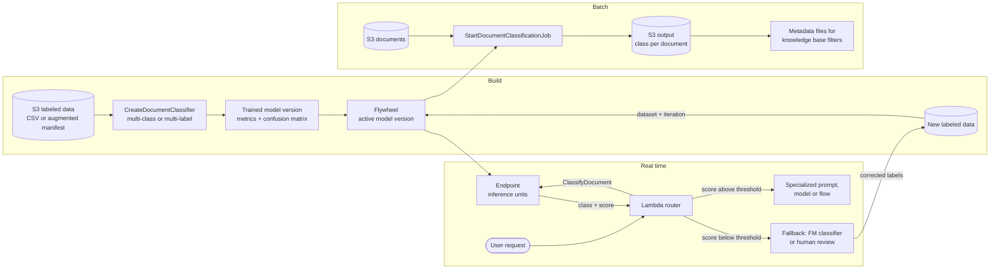
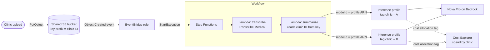
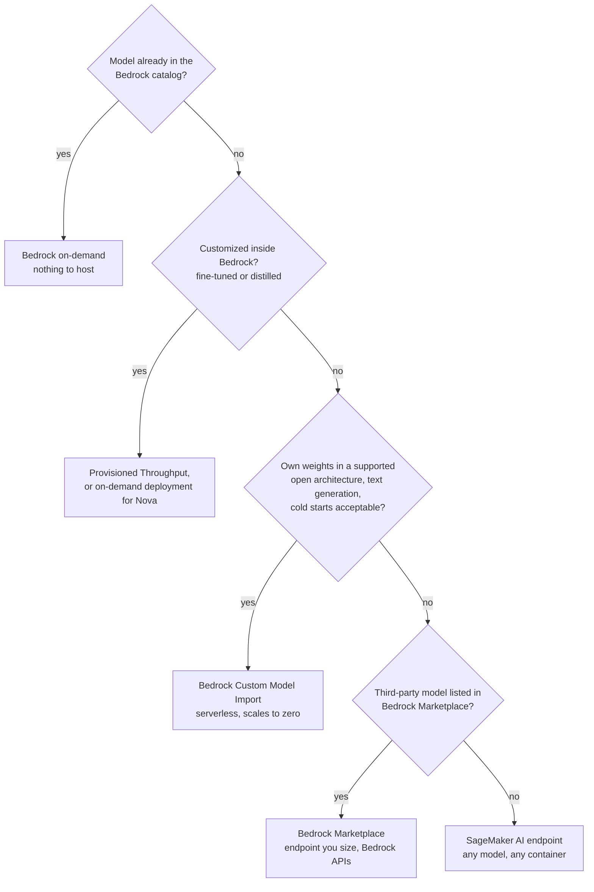

# AIP-C01 — Service Deep Dives

In-depth notes for single services and patterns: how the feature works, the details that decide exam questions, worked examples and practice questions. One numbered section per topic; new deep dives are added at the bottom.

Back to the [index](../INDEX.md) · [Service list](06-Service-List-When-to-Use.md) · [API list](07-API-List-by-Task.md)

## Contents

- [1. Amazon Comprehend custom classification](#1-amazon-comprehend-custom-classification)
  - [1.1 Where it sits in the exam](#11-where-it-sits-in-the-exam)
  - [1.2 How it works end to end](#12-how-it-works-end-to-end)
  - [1.3 Decisions you make before training](#13-decisions-you-make-before-training)
  - [1.4 Training data rules](#14-training-data-rules)
  - [1.5 Reading the metrics](#15-reading-the-metrics)
  - [1.6 Running inference](#16-running-inference)
  - [1.7 Endpoints, inference units and cost](#17-endpoints-inference-units-and-cost)
  - [1.8 Flywheels and model lifecycle](#18-flywheels-and-model-lifecycle)
  - [1.9 Security controls](#19-security-controls)
  - [1.10 When to use it and when not to](#110-when-to-use-it-and-when-not-to)
  - [1.11 Worked examples](#111-worked-examples)
  - [1.12 Troubleshooting table](#112-troubleshooting-table)
  - [1.13 Exam tips and tricks](#113-exam-tips-and-tricks)
  - [1.14 Practice questions](#114-practice-questions)
  - [1.15 Rapid recall](#115-rapid-recall)
  - [1.16 Sources](#116-sources)
- [2. Per-tenant cost tracking with application inference profiles](#2-per-tenant-cost-tracking-with-application-inference-profiles)
  - [2.1 The scenario](#21-the-scenario)
  - [2.2 Architecture](#22-architecture)
  - [2.3 Why each answer is right](#23-why-each-answer-is-right)
  - [2.4 Options that look right and are not](#24-options-that-look-right-and-are-not)
  - [2.5 How to build it](#25-how-to-build-it)
  - [2.6 Details that decide a harder version](#26-details-that-decide-a-harder-version)
  - [2.7 Practice questions](#27-practice-questions)
  - [2.8 Rapid recall](#28-rapid-recall)
  - [2.9 Sources](#29-sources)
- [3. Hosting imported and custom models: Bedrock or SageMaker AI](#3-hosting-imported-and-custom-models-bedrock-or-sagemaker-ai)
  - [3.1 Where it sits in the exam](#31-where-it-sits-in-the-exam)
  - [3.2 The six ways to host a model](#32-the-six-ways-to-host-a-model)
  - [3.3 Decision tree](#33-decision-tree)
  - [3.4 Bedrock or SageMaker AI in one table](#34-bedrock-or-sagemaker-ai-in-one-table)
  - [3.5 Limitations to memorize](#35-limitations-to-memorize)
  - [3.6 SageMaker AI endpoint types](#36-sagemaker-ai-endpoint-types)
  - [3.7 APIs for each path](#37-apis-for-each-path)
  - [3.8 Exam tips and tricks](#38-exam-tips-and-tricks)
  - [3.9 Practice questions](#39-practice-questions)
  - [3.10 Rapid recall](#310-rapid-recall)
  - [3.11 Sources](#311-sources)

---

## 1. Amazon Comprehend custom classification

Custom classification trains a text classifier on **your labels** and then assigns those labels to new documents. You supply labeled examples; Comprehend picks the algorithm, trains, tests and hosts the model. It is still available to new customers (only topic modeling, event detection and prompt safety classification were closed).

### 1.1 Where it sits in the exam

| Skill | Guide wording | How custom classification fits |
|---|---|---|
| 1.6.2 | "Amazon Comprehend for intent recognition" | The named use: classify the user's message into an intent before choosing a prompt, flow or tool |
| 2.4.4 | "Dynamic content-based routing to specialized FMs" | The classifier is the routing signal; Step Functions or Lambda does the routing |
| 2.2.3 | "API-based model cascading to perform routine queries" | A cheap classifier decides whether a small model, a large model or no model handles the request |
| 1.4.2 | "Tagging systems for domain classification" | Classify documents at ingestion and write the class as metadata for filtering |
| 1.3.4 | "Enhance input data quality" | Document type and domain labels added before the model sees the content |
| 3.1.1 | "Custom moderation workflows" | Organization-specific categories that the built-in filters do not cover |
| 2.5.3 | "Orchestrate document processing systems" | Classify first, then send each type to the right extraction step |

In almost every question it is a **supporting step in front of or beside the foundation model**, not the star.

### 1.2 How it works end to end



**Flow:** labeled data in S3 trains a model version. Real-time requests go through an endpoint and return a class with a confidence score that your code routes on. Bulk documents go through an asynchronous job with no endpoint. Corrected labels flow back as new training data, and a flywheel trains and compares the next version.

| Step | API | What you get |
|---|---|---|
| Train | `CreateDocumentClassifier` | A model version; status ends as `TRAINED` or `TRAINED_WITH_WARNING` |
| Inspect | `DescribeDocumentClassifier` | Evaluation metrics; the confusion matrix is written to the S3 output location |
| Host | `CreateEndpoint` | Real-time capacity measured in inference units |
| Classify one | `ClassifyDocument` | Classes or labels with scores, synchronously |
| Classify many | `StartDocumentClassificationJob` | Results in S3; no endpoint needed |
| Improve | `CreateFlywheel`, `CreateDataset`, `StartFlywheelIteration` | New versions trained and compared against the active one |
| Share | `PutResourcePolicy`, `ImportModel` | Copy of the model in another account |

### 1.3 Decisions you make before training

**Decision 1: mode.** It is fixed at training time and cannot be changed later.

| | Multi-class | Multi-label |
|---|---|---|
| Meaning | Exactly one class per document; classes are mutually exclusive | One or more labels per document |
| Console name | Single-label | Multi-label |
| Number of classes | 2 to 1,000 | 2 to 100 |
| Response field | `Classes` | `Labels` |
| How you read scores | Scores compete; take the top class | Each label has its own score; apply a threshold per label |
| Stem wording | "Route each ticket to one team", "document type" | "A message can concern billing and shipping", "tag with all applicable topics" |

**Decision 2: model type.**

| | Plain-text model | Native document model |
|---|---|---|
| Trained on | UTF-8 text | PDF (digital or scanned), Word, JPG, PNG, single-page TIFF, Textract output JSON |
| Signals used | Text content | Text content **plus layout** |
| Languages | English, Spanish, German, Italian, French, Portuguese; one language per classifier | English |
| Training file | CSV or augmented manifest | CSV only |
| Text extraction cost | None | Extra charge for scanned files |
| Flywheel support | Yes | No |
| Best for | Chat messages, emails, tickets, transcripts | Forms, invoices, scanned packets where layout identifies the type |

Either model type can classify any supported input, but accuracy is best when the inference documents match the training documents.

### 1.4 Training data rules

| Rule | Detail |
|---|---|
| CSV, multi-class | Two columns: class, document text. **No header row** |
| CSV, multi-label | Labels in the first column separated by a delimiter (default is the pipe character) |
| CSV, native documents | Three columns: class, file name, page number |
| Augmented manifest | Output of a SageMaker Ground Truth labeling job; plain-text models only; up to 5 manifest files |
| Minimum data, CSV multi-class | **50 documents per class** |
| Minimum data, CSV multi-label | 10 per class and 50 in total |
| Minimum data, augmented manifest | 10 annotations per class |
| Total training size | 5 GB for plain text; 10,000 pages for native documents |
| Class balance | Keep the largest class within **10 times** the smallest |
| Test data | If you supply none, Comprehend trains on 90 percent and tests on 10 percent. A test set you supply must contain every label at least once |
| One language | All training documents for a classifier use the same language |

The minimums get a model trained. They do not get a good model. More, clearer and better-separated examples per class matter more than any setting.

### 1.5 Reading the metrics

Comprehend reports metrics on the test set. The headline precision, recall and F1 are **macro averages**: every class counts equally, however rare.

| Metric | Meaning | Use it for |
|---|---|---|
| Accuracy | Correct labels over all labels | Balanced multi-class sets only |
| Precision (macro) | Of the documents given a class, how many belonged to it; averaged across classes | Cost of a wrong route |
| Recall (macro) | Of the documents that belong to a class, how many were found; averaged across classes | Cost of a missed case |
| F1 (macro) | Balance of the two | Single headline number |
| Micro precision, recall, F1 | Computed over all documents together, so large classes dominate | Overall volume-weighted quality |
| Hamming loss | Fraction of labels predicted wrongly; lower is better | Multi-label models |
| Confusion matrix | Actual class against predicted class, in `confusion_matrix.json` in the output location | Finding which two classes are confused |

**Reading patterns**

- **High micro, low macro:** the big classes are fine and one or more small classes are failing. Add examples for the small classes.
- **High accuracy on a skewed set means little.** A model that always predicts the majority class scores well. Read per-class recall.
- **Two classes confused with each other:** their definitions overlap. Merge them, or add examples that show the difference.
- **Metrics describe the test set, not production.** If production text differs from training text (new product names, another channel), quality drops with no change in the stored metrics.

### 1.6 Running inference

| | Real time | Asynchronous |
|---|---|---|
| API | `ClassifyDocument` | `StartDocumentClassificationJob` |
| Needs an endpoint | **Yes** (`EndpointArn`) | No (model ARN or flywheel ARN) |
| Input | One document per call: `Text`, or `Bytes` for a native document | S3 prefix; `ONE_DOC_PER_FILE` or `ONE_DOC_PER_LINE` |
| Size limit | 10 KB of text; native documents one page and 10,000 characters | 5 GB per job, 10 MB per file, up to 1,000,000 documents; native documents up to 25,000 pages |
| Output | Classes or labels with scores in the response | JSON Lines file in S3 |
| Cost model | Endpoint billed for every second it exists | Billed per unit of text processed |
| Use when | A user is waiting; routing in a request path | Backlogs, nightly loads, ingestion pipelines |

- For scanned or image input, `DocumentReaderConfig` tells Comprehend to extract text with Textract (`DetectDocumentText` or `AnalyzeDocument`) before classifying.
- The response gives a **score**, not a decision. Your code applies the threshold and chooses the fallback.

### 1.7 Endpoints, inference units and cost

| Fact | Detail |
|---|---|
| Inference unit | 100 characters per second, up to 2 documents per second |
| Sizing | Units needed = the larger of (characters per second ÷ 100) and (documents per second ÷ 2) |
| Billing | Per unit, per second, from creation until deletion, **whether or not requests arrive** |
| Limits | Per-endpoint and per-account unit quotas, adjustable through Service Quotas |
| Scaling | Application Auto Scaling on `comprehend:document-classifier-endpoint:DesiredInferenceUnits`: target tracking on inference utilization, or scheduled scaling |
| Changing the model | `UpdateEndpoint` with a new model ARN swaps the version behind the same endpoint |
| Throttling | Requests beyond provisioned throughput are throttled; add units or scale automatically |

**Sizing example:** 3 chat messages per second at 800 characters each is 2,400 characters per second, so 24 units on characters and 2 on documents. Provision 24.

**Cost reasoning the exam expects**

| Traffic shape | Cheapest correct design |
|---|---|
| Steady interactive traffic | Endpoint with target tracking |
| Business-hours traffic | Endpoint with scheduled scaling down outside hours |
| Nightly or weekly bulk run | Asynchronous job; **no endpoint** |
| Rare, unpredictable requests | An endpoint idles and still bills; a small FM called on demand can be cheaper |
| Experiment finished | Delete the endpoint |

### 1.8 Flywheels and model lifecycle

A **flywheel** is a Comprehend resource that manages retraining of one custom model.

| Concept | Meaning |
|---|---|
| Data lake | S3 location that Comprehend manages; holds training and test data for every version. Do not edit it by hand |
| Dataset | New labeled data you add, typed `TRAIN` or `TEST` |
| Iteration | A run that evaluates the active version on the new data and trains a new version |
| Active model version | The version used when a job or endpoint references the flywheel ARN. You promote a new version after comparing metrics |
| Cost | No charge for the flywheel itself; you pay for training and storage |
| Scope | Plain-text custom classification and custom entity recognition |

Other lifecycle tools:

- **Versions:** each training run under the same classifier name creates a named version. Keep the previous version to roll back.
- **Rollback:** point the endpoint back with `UpdateEndpoint`, or set the previous version as the flywheel's active version.
- **Cross-account promotion:** attach a resource policy to the model in the source account, then `ImportModel` in the target account. Both must be in the same Region. No retraining and no copying of training data.
- **Labeling new data:** SageMaker Ground Truth produces augmented manifests; Amazon Augmented AI collects corrections on low-confidence predictions.

### 1.9 Security controls

| Need | Control |
|---|---|
| Read training data and write output | `DataAccessRoleArn`: an IAM role Comprehend assumes, scoped to the buckets; the caller needs `iam:PassRole` |
| Encrypt the training volume | `VolumeKmsKeyId` |
| Encrypt the stored model | `ModelKmsKeyId` |
| Encrypt job output | `KmsKeyId` in the output configuration |
| Keep training traffic private | `VpcConfig` on the training job and on asynchronous jobs |
| Call the API privately | Interface VPC endpoint for Comprehend |
| Share a model | Resource policy on the model (`ModelPolicy` or `PutResourcePolicy`) |
| Stop content being used to improve the service | AWS Organizations AI services opt-out policy |
| Audit | CloudTrail records training, endpoint and classification calls |

### 1.10 When to use it and when not to

**Use it when**

| Stem says | Why custom classification |
|---|---|
| "Thousands of labeled historical examples exist" | The training data is already there |
| "Fixed, stable set of categories" | Retraining is rare |
| "High volume, predictable cost, low latency" | A purpose-built classifier is cheaper per request than an FM call at scale |
| "The same input must always get the same label" | Deterministic output for audit and routing |
| "Classify before choosing the model, prompt or flow" | Skills 1.6.2 and 2.4.4 |
| "Tag every document with its type or domain at ingestion" | Asynchronous job feeding metadata filters |
| "Scanned forms whose layout identifies the type" | Native document model |
| "No ML expertise on the team" | No algorithm, infrastructure or hosting to manage |

**Use something else when**

| Stem says | Use instead | Why not custom classification |
|---|---|---|
| "No labeled data", "only a handful of examples" | FM with a zero-shot or few-shot prompt | The classifier needs at least 50 documents per class |
| "Categories change every week" | FM with the category list in the prompt, stored in Prompt Management or AppConfig | Every change means relabeling and retraining |
| "Explain why", "nuanced judgment", "extract details too" | FM | The classifier returns a label and a score, nothing else |
| "Block these subjects on a Bedrock model call" | Guardrails denied topics | Guardrails acts inline with no model to train |
| "Detect prompt injection" | Guardrails prompt attack filter | Not a classification you should build yourself |
| "Collect booking details in a dialogue", voice | Amazon Lex | Lex handles slots and turn-taking, not only the label |
| "Route simple prompts to a cheaper model in the same family" | Bedrock Intelligent Prompt Routing | That routes on prompt complexity, with nothing to train |
| "Split a mixed packet and extract fields" | Bedrock Data Automation | Classification, splitting and extraction in one managed step |
| "Sentiment, language, standard entities" | Comprehend built-in APIs | No training needed |
| "Find similar documents", "semantic search" | Embeddings and a vector store | Classification is not retrieval |
| "Long documents in real time" | Asynchronous job, or classify a summary or the first page | Real-time input is limited to 10 KB of text |
| "Mixed languages in one classifier", unsupported language | Detect language and use one classifier per language, or an FM | One language per classifier |

**The comparison that decides most questions**

| | Comprehend custom classification | FM prompt classification |
|---|---|---|
| Labeled data | Required | Not required |
| New category | Retrain | Edit the prompt |
| Cost at high volume | Low and predictable | Scales with tokens |
| Cost at low volume | Endpoint bills while idle | Pay per call |
| Latency | Low and steady | Higher and variable |
| Consistency | Deterministic | Can vary; needs low temperature and a strict output schema |
| Reasoning or explanation | None | Available |
| Maintenance | Retraining pipeline | Prompt versions and evaluation |

They also combine: classifier first, FM only for low-confidence cases. That is the cascading pattern of Skill 2.2.3.

### 1.11 Worked examples

**Example 1: intent router for a support assistant** (Skills 1.6.2, 2.4.4)

- **Situation:** 2 million chat messages a month; five intents (billing, shipping, returns, technical, other); two years of agent-tagged history.
- **Design:** multi-class plain-text classifier → endpoint with target tracking → Lambda calls `ClassifyDocument` → score at or above the threshold selects a managed prompt and model per intent → score below the threshold goes to a small FM with a few-shot prompt, and to a human if that also fails.
- **Why it is right:** labeled data exists, intents are stable, volume is high, and a wrong route is cheap to detect through the score.
- **Detail that earns the mark:** the threshold lives in AppConfig so it can change without a deployment.

**Example 2: domain tags for retrieval precision** (Skills 1.4.2, 1.3.4)

- **Situation:** 400,000 documents from six departments in one knowledge base; answers mix HR policy with engineering content.
- **Design:** asynchronous classification job over the S3 prefix → Lambda writes a metadata file beside each document with the department → knowledge base sync → queries carry a metadata filter.
- **Why it is right:** it is a one-off bulk job, so there is no endpoint; the class becomes a filter, which is a precision lever.
- **Trap:** creating an endpoint for this. It would bill for the whole run and afterwards.

**Example 3: custom moderation categories** (Skill 3.1.1)

- **Situation:** a marketplace must flag listings for counterfeit claims, off-platform payment requests and medical claims. One listing can break several rules.
- **Design:** multi-label classifier → per-label thresholds → flagged items go to a review queue through Step Functions.
- **Why it is right:** categories are organization-specific, several can apply at once, and there is a labeled history of moderator decisions.
- **Boundary:** content that passes through a Bedrock model call still gets Guardrails. The classifier covers text that never reaches a model.

**Example 4: scanned claim packets** (Skill 2.5.3)

- **Situation:** scanned PDFs of invoices, discharge summaries and ID cards; the type is obvious from layout, less so from wording.
- **Design:** native document model trained on labeled pages → asynchronous job with a document reader configuration → each type goes to its extraction step.
- **Why it is right:** layout is the signal, and only a native document model uses it.
- **When the answer changes:** if the stem also wants field extraction with the least development effort, Bedrock Data Automation does classification and extraction together.

**Example 5: keeping the model current** (lifecycle)

- **Situation:** new products appear monthly and routing accuracy slowly falls.
- **Design:** low-confidence predictions go to human review → corrected labels become a flywheel dataset → an iteration trains a new version and evaluates both versions on the same test data → promote the new version only if it is better → the endpoint that references the flywheel serves the new active version.
- **Why it is right:** it gives a managed comparison before promotion and a rollback path.

### 1.12 Troubleshooting table

| Symptom | Likely cause | Fix |
|---|---|---|
| `ClassifyDocument` is rejected | Called with a model ARN, or the endpoint is not in service | Create an endpoint and pass its ARN |
| Throttling at peak | Provisioned inference units too low | Raise units or add auto scaling |
| High bill with little traffic | Endpoint left running | Delete it; use asynchronous jobs for bulk work |
| Training fails on input | Header row in the CSV, fewer than the minimum documents for a class, wrong delimiter | Fix the file and resubmit |
| Training fails with access denied | Data access role cannot read the bucket or use the KMS key | Fix the role and key policy |
| One class is never predicted | Too few examples, or it overlaps with another class | Add examples; check the confusion matrix; merge or redefine |
| Good metrics, poor production results | Production text differs from training text | Add production samples to training and to the test set; retrain |
| Rare class missing from the test results | The automatic 10 percent split held no example of it | Provide your own test set containing every label |
| Scanned documents misclassified | Plain-text model used on layout-dependent documents | Train a native document model |
| Multi-label results look wrong | Reading only the top score | Apply a threshold to each label |
| Long documents rejected in real time | Over 10 KB of text or more than one page | Use an asynchronous job or classify a shorter excerpt |
| Tickets in a second language misrouted | One classifier trained on one language | Detect the language first and route to a classifier per language |
| `ImportModel` fails across accounts | No resource policy on the source model, or different Regions | Add the policy; import in the same Region |

### 1.13 Exam tips and tricks

1. **Real time needs an endpoint; batch does not.** An option that calls `ClassifyDocument` with the model ARN is wrong. An option that creates an endpoint for a nightly job is wasteful.
2. **Endpoints bill while idle.** "Cost-effective" with sporadic traffic argues against a permanent endpoint.
3. **Mode follows the wording.** "Exactly one" or "route to one team" is multi-class. "One or more" or "all that apply" is multi-label.
4. **Labeled data is the gate.** With history available, the classifier wins on cost and consistency. With none, the FM wins.
5. **The classifier returns a score and your code decides.** Low confidence goes to a fallback. Options that say Comprehend "routes" or "blocks" by itself are wrong.
6. **Macro metrics expose weak small classes.** A high overall number with a failing rare class means imbalance; the fix is data, not a bigger endpoint.
7. **Layout means native document model.** Scanned forms and PDFs where structure identifies the type need it.
8. **Flywheel is the answer for "retrain regularly and compare before promoting".** Not a hand-built pipeline, when least overhead is asked.
9. **`ImportModel` is the answer for cross-account promotion.** Not retraining in production and not copying data.
10. **Custom classification is not a safety control on a Bedrock call.** Subject restrictions and injection defense belong to Guardrails.
11. **It pairs with Step Functions or Lambda for routing, and with AppConfig for thresholds.** The guide names those services for the routing itself.
12. **Classifier plus FM is a cascade, not redundancy.** In a "Select TWO" cost question, a cheap first-stage classifier and an FM for the hard cases are complementary.
13. **Intent label or conversation?** If the stem only needs the label inside a pipeline, Comprehend. If it needs slots, prompts and voice, Lex.
14. **One language per classifier.** Mixed-language input needs language detection first.

### 1.14 Practice questions

**Q1.** A retailer receives customer messages that often concern more than one subject, such as a late delivery and an incorrect charge. Each message must be tagged with every applicable subject so that each team sees it. The retailer has 30,000 messages already tagged by agents. Which approach meets the requirement with the least operational overhead?

- A. Train a Comprehend custom classifier in multi-class mode and take the top two classes
- B. Train a Comprehend custom classifier in multi-label mode and apply a score threshold to each label
- C. Use Comprehend key phrase detection and map phrases to subjects in Lambda
- D. Fine-tune a foundation model on the tagged messages and host it with Provisioned Throughput

**Answer: B.** Several subjects per message is multi-label, and the labeled history exists. In A, multi-class scores compete, so "top two" is not a valid reading. C needs rules you must maintain. D works but adds cost and management for a task a managed classifier covers.

**Q2.** A team trained a custom classifier and wants to classify 600,000 archived emails once, then repeat monthly for new mail. Latency does not matter. Which design is the most cost-effective?

- A. Create an endpoint with the maximum inference units and call `ClassifyDocument` from a Lambda function for each email
- B. Start an asynchronous document classification job over the S3 prefix each month
- C. Create an endpoint with scheduled scaling that runs all month at one inference unit
- D. Send each email to a foundation model with a classification prompt

**Answer: B.** Asynchronous jobs need no endpoint and bill for what is processed. A and C pay for an endpoint, and C keeps paying between runs. D costs more per document at this volume.

**Q3.** An application calls `ClassifyDocument` and passes the ARN of a trained classifier version. Every call fails. Training completed successfully. What is the cause?

- A. The classifier must be attached to a flywheel before use
- B. Real-time classification requires an endpoint, and the request must reference the endpoint ARN
- C. The classifier must be imported with `ImportModel` first
- D. The IAM role lacks permission for `DetectEntities`

**Answer: B.** Real-time custom inference runs on an endpoint. A flywheel is optional, and `ImportModel` is for copying across accounts.

**Q4.** An intent classifier behind an endpoint is throttled every weekday between 09:00 and 11:00. Outside those hours utilization is under 10 percent. Which change fixes the throttling at the lowest cost?

- A. Provision the endpoint permanently for the peak
- B. Increase the memory of the Lambda function that calls the endpoint
- C. Configure Application Auto Scaling on the endpoint's inference units
- D. Replace the endpoint with asynchronous jobs

**Answer: C.** Target tracking or scheduled scaling adds units for the peak and removes them afterwards. A fixes throttling but pays for peak capacity all day. B does nothing for endpoint throughput. D breaks the real-time requirement.

**Q5.** A classifier reports accuracy of 0.96, micro F1 of 0.95 and macro F1 of 0.61. The business complains that fraud-related tickets, about 1 percent of volume, are almost never routed to the fraud team. What should the team do first?

- A. Increase the endpoint's inference units
- B. Lower the confidence threshold for all classes
- C. Add training examples for the under-represented class and review the confusion matrix
- D. Switch the classifier to multi-label mode

**Answer: C.** High micro with low macro means a small class is failing. More examples for that class and a look at which class absorbs its documents is the fix. A is a capacity change. B raises wrong routes everywhere. D changes the problem definition without adding signal.

**Q6.** An insurer classifies scanned claim documents with a custom classifier trained on text that was extracted earlier. Invoices and receipts, which use similar words but different layouts, are often confused. Which change is most likely to improve accuracy?

- A. Train a native document model on labeled PDF and image files
- B. Increase the number of inference units
- C. Add a Guardrails contextual grounding check
- D. Convert the classifier to multi-label mode

**Answer: A.** A native document model uses layout as well as text. The other options do not add the missing signal.

**Q7.** A startup wants to route incoming requests to one of eight handlers. It has no historical data, about five examples per category, and the product team expects to add or rename categories weekly. Which approach fits best?

- A. Comprehend custom classification in multi-class mode with an endpoint
- B. A foundation model with a few-shot classification prompt managed in Bedrock Prompt Management
- C. A Comprehend flywheel with weekly iterations
- D. Amazon Lex with eight intents and slot elicitation

**Answer: B.** Too little labeled data and frequently changing categories favour a prompt you can edit and version. A and C need at least 50 documents per class and a retraining cycle for each change. D adds a dialogue engine nobody asked for.

**Q8.** A bank's assistant runs on a Bedrock model. Compliance requires that it refuse to discuss investment advice. A developer proposes training a Comprehend custom classifier to detect investment questions and block them in Lambda. Which response is correct?

- A. Approve it; this is the only way to restrict subjects
- B. Use a Bedrock Guardrails denied topic instead, because it enforces the restriction on the model call with no model to train
- C. Use Comprehend toxicity detection instead
- D. Use Amazon Macie to detect investment content

**Answer: B.** A subject restriction on a Bedrock call is a denied topic. The classifier would work but adds training data, an endpoint and custom blocking code. Toxicity and Macie address different problems.

**Q9.** A company retrains its ticket classifier every month with newly labeled tickets. It wants each new version evaluated against the current one on the same test data and promoted only if it is better, with the least custom code. Which solution should it use?

- A. A Step Functions workflow that calls `CreateDocumentClassifier` and compares metrics in Lambda
- B. A Comprehend flywheel: add datasets, run an iteration, and promote the new version to active when its metrics are better
- C. SageMaker Model Monitor on the Comprehend endpoint
- D. Bedrock Model Evaluations with an LLM judge

**Answer: B.** That is what a flywheel does. A rebuilds it by hand. Model Monitor watches SageMaker endpoints, and Bedrock evaluations assess foundation model output.

**Q10.** A classifier is trained in a development account. Policy forbids copying training data to production. How should the model reach the production account?

- A. Retrain in production from a copy of the data
- B. Download the model artifact from S3 and upload it in production
- C. Attach a resource-based policy to the model, then call `ImportModel` in the production account in the same Region
- D. Share the endpoint through AWS Resource Access Manager

**Answer: C.** `ImportModel` copies a trained custom model across accounts when the source model's resource policy allows it. A violates the policy. Comprehend models are not downloadable artifacts, and endpoints are not shared that way.

**Q11.** A support assistant classifies each message with a custom classifier, then invokes a prompt for the predicted intent. About 8 percent of answers are wrong because the message was routed to the wrong intent, usually when the classifier's score was low. Which TWO changes address this? (Select TWO.)

- A. Apply a confidence threshold and send low-score messages to a foundation model classifier or a clarifying question
- B. Double the endpoint's inference units
- C. Collect the low-score messages with corrected labels and retrain
- D. Increase the temperature of the answering model
- E. Switch the endpoint to an asynchronous job

**Answer: A and C.** A stops acting on uncertain predictions now; C removes the cause over time. B is capacity, D adds randomness, and E removes real-time behavior.

**Q12.** A media company must tag 1.2 million articles with one of 40 editorial sections so that a knowledge base can filter by section. It has 200,000 articles already tagged by editors. Editors want identical tags if an article is processed twice. Which solution is most appropriate?

- A. A foundation model prompt per article at temperature 1.0
- B. A Comprehend custom classifier in multi-class mode, run as asynchronous jobs, with the class written to each document's metadata file
- C. Comprehend built-in entity detection
- D. An embedding model and manual cluster naming

**Answer: B.** Labeled data exists, one section per article is multi-class, the volume suits asynchronous jobs, and a trained classifier gives repeatable labels. A is costly and not repeatable. C returns entities, not sections. D gives clusters, not the editors' taxonomy.

**Q13.** A company trains a custom classifier on documents that contain personal data. Requirements: training traffic must not use the public internet, and the stored model and training volume must be encrypted with a customer managed key. Which configuration meets the requirements?

- A. Enable Amazon Macie on the training bucket
- B. Specify `VpcConfig`, `VolumeKmsKeyId` and `ModelKmsKeyId` when creating the classifier
- C. Attach a Bedrock guardrail to the classifier
- D. Place the endpoint behind AWS WAF

**Answer: B.** Those three parameters cover the private network path and both encryption needs. Macie finds sensitive data but does not secure training. Guardrails and WAF do not apply to Comprehend training.

**Q14.** A team trains a classifier with 12 classes. One class has only 55 documents; the others have thousands. The team supplies no test data. After training, the report shows no results for the small class. Why?

- A. Comprehend drops classes with fewer than 100 documents
- B. The automatic 10 percent test split contained too few or no examples of that class, so provide a test set that includes every label
- C. Multi-class mode supports at most 10 classes
- D. The class name is too long

**Answer: B.** With no test set, Comprehend holds out 10 percent, and a small class can be barely represented or absent. A supplied test set must contain every label. Multi-class mode supports up to 1,000 classes. The deeper fix is also to add examples, since the class is far outside the 10 to 1 balance guideline.

**Q15.** A global help desk receives tickets in English and Spanish. The English-trained intent classifier performs well on English tickets and poorly on Spanish ones. Which design is the best fix while keeping the classifier approach?

- A. Add Spanish tickets to the English classifier's training data
- B. Detect the dominant language first, then route to a classifier trained for that language
- C. Increase inference units on the endpoint
- D. Use a native document model

**Answer: B.** All training documents for a classifier must be in one language, so the pattern is language detection followed by a per-language classifier. C is capacity and D is about layout.

**Q16.** A product team needs intent recognition for a voice assistant that must also collect an account number and a date, confirm them, and hand the call to an agent in a contact center. Which service is the best fit?

- A. Comprehend custom classification with an endpoint
- B. Amazon Lex with intents and slots, integrated with the contact center
- C. Bedrock Intelligent Prompt Routing
- D. Comprehend key phrase detection

**Answer: B.** Slot collection, confirmation, voice and contact center hand-off are dialogue management, which is Lex. The classifier returns only a label. Prompt routing picks a model, not an intent.

### 1.15 Rapid recall

- Custom classification: your labels, your examples, managed training and hosting.
- Multi-class: one class, up to 1,000, response `Classes`. Multi-label: one or more, up to 100, response `Labels`.
- Plain-text model: six languages, one per classifier, CSV or augmented manifest. Native document model: English, layout-aware, CSV only.
- CSV: no header; 50 documents per class for multi-class; keep imbalance within 10 to 1.
- No test set supplied: 90 percent train, 10 percent test.
- Metrics are macro averages; micro and Hamming loss also reported; confusion matrix in the S3 output.
- Real time: `ClassifyDocument` on an **endpoint**, one document, 10 KB text.
- Batch: `StartDocumentClassificationJob`, no endpoint, results in S3.
- Inference unit: 100 characters per second, 2 documents per second; billed while the endpoint exists; auto scaling through Application Auto Scaling.
- Flywheel: data lake, datasets, iterations, active model version; plain-text models.
- Cross-account: resource policy plus `ImportModel`, same Region.
- Security: data access role, `VpcConfig`, `VolumeKmsKeyId`, `ModelKmsKeyId`.
- Use it with labeled data, stable classes and volume. Use an FM with no data or changing classes. Use Guardrails for subject restrictions on a Bedrock call. Use Lex for dialogue.

### 1.16 Sources

- [Custom classification](https://docs.aws.amazon.com/comprehend/latest/dg/how-document-classification.html)
- [Preparing classifier training data](https://docs.aws.amazon.com/comprehend/latest/dg/prep-classifier-data.html)
- [Training classification models](https://docs.aws.amazon.com/comprehend/latest/dg/training-classifier-model.html)
- [Test the training data](https://docs.aws.amazon.com/comprehend/latest/dg/testing-the-model.html)
- [Custom classifier metrics](https://docs.aws.amazon.com/comprehend/latest/dg/cer-doc-class.html)
- [Classifier training output (confusion matrix)](https://docs.aws.amazon.com/comprehend/latest/dg/train-classifier-output.html)
- [Using Amazon Comprehend endpoints](https://docs.aws.amazon.com/comprehend/latest/dg/using-endpoints.html)
- [Auto scaling with endpoints](https://docs.aws.amazon.com/comprehend/latest/dg/comprehend-autoscaling.html)
- [Flywheel overview](https://docs.aws.amazon.com/comprehend/latest/dg/flywheels-about.html)
- [Guidelines and quotas](https://docs.aws.amazon.com/comprehend/latest/dg/guidelines-and-limits.html)
- [Feature availability change](https://docs.aws.amazon.com/comprehend/latest/dg/comprehend-availability-change.html)

Related notes: [Comprehend features, when to use it, when not to](../REVISIT-Topics.md#8-amazon-comprehend-features-when-to-use-it-when-not-to) · [Comprehend APIs](07-API-List-by-Task.md#10-amazon-comprehend) · [Domain 1 Task 1.6](../01-Domain1-FM-Integration-Data-Compliance.md#task-16--prompt-engineering-and-governance) · [Domain 2 Task 2.4](../02-Domain2-Implementation-Integration.md)

---

## 2. Per-tenant cost tracking with application inference profiles

A multi-tenant pattern: many tenants (clinics, teams, customers) share one Bedrock model on demand, and the business wants the model cost split per tenant. The answer is one **application inference profile per tenant, tagged with the tenant ID**. The practice question that prompted this note pairs it with a second decision: how an S3 upload starts a Step Functions workflow.

### 2.1 The scenario

Paraphrased from a practice question:

- A medical company runs a Step Functions workflow with two Lambda functions. The first transcribes clinic audio with Amazon Transcribe Medical. The second summarizes the transcript with Amazon Nova Pro on Bedrock.
- New clinics are being onboarded, each with a unique clinic ID.
- Requirements: store every clinic's data in **one shared S3 bucket** with the **clinic ID as the key prefix**, and **track summarization cost per clinic**, most cost-effectively.

**Correct combination**

1. Create a Bedrock inference profile for each clinic ID, and have the summarization function choose the profile from the S3 key prefix.
2. Create an EventBridge rule that captures the upload events and targets the Step Functions state machine.

**Where it sits in the exam:** not named in a skill statement. Cost attribution fits Domain 4, Task 4.3 (Skill 4.3.2, token usage monitoring). The trigger fits Domain 2, Task 2.3 (Skill 2.3.2, EventBridge for event-driven integrations).

### 2.2 Architecture



**Flow:** the upload lands under the clinic's prefix. S3 sends an Object Created event to EventBridge. The rule starts the state machine. The summarize function takes the clinic ID from the key, picks that clinic's profile and passes its ARN as the model ID. Bedrock bills the usage against the profile's tag.

### 2.3 Why each answer is right

| Requirement in the stem | Mechanism | Why it is the cheapest correct choice |
|---|---|---|
| "Track summarization costs for each clinic" | `CreateInferenceProfile` per clinic with a clinic tag, copied from the Nova Pro model or its cross-Region profile; pass the profile ARN as `modelId` | On-demand usage has no resource to tag. The profile is that resource. Activate the tag as a cost allocation tag and Cost Explorer splits the spend. No log parsing and no custom metering |
| Shared bucket, clinic ID as the key prefix | The Lambda function reads the prefix from the event to choose the profile | One bucket; no bucket or pipeline per clinic |
| Start the existing workflow on upload | S3 sends events to EventBridge; a rule on Object Created targets the state machine | S3 event notifications have four destinations: SNS, SQS, Lambda and EventBridge. Step Functions is not one of them, so the rule removes the need for a starter Lambda function or polling |

### 2.4 Options that look right and are not

| Distractor | Why it fails |
|---|---|
| Tag the Lambda function or the state machine per clinic | Tags the compute cost, not the Bedrock model charges |
| Provisioned Throughput per clinic | Pays for dedicated capacity per tenant; the opposite of cost-effective |
| Model invocation logging plus Athena or Logs Insights to sum tokens by clinic | Works, but adds storage, queries and code to maintain |
| A bucket, an account or a state machine per clinic | Contradicts "shared bucket" and multiplies resources |
| A Lambda function triggered by S3 that calls `StartExecution` | Works, but is an extra component to pay for and maintain |
| A CloudTrail trail with S3 data events to detect uploads | Data events are charged and slower; S3 can send to EventBridge directly |
| A cross-Region (system-defined) inference profile alone | Gives throughput and resilience, not per-tenant cost attribution |

### 2.5 How to build it

**Step 1: one profile per clinic.** The profile copies from the foundation model (one Region) or from a cross-Region profile (several Regions).

```bash
aws bedrock create-inference-profile \
  --inference-profile-name clinic-a-summarize \
  --model-source '{"copyFrom": "arn:aws:bedrock:us-east-1::foundation-model/amazon.nova-pro-v1:0"}' \
  --tags '[{"key": "clinicId", "value": "clinic-a"}]'
```

The response returns an ARN of the form `arn:aws:bedrock:REGION:ACCOUNT:application-inference-profile/ID`.

**Step 2: turn on EventBridge notifications for the bucket,** then add a rule. The key-prefix filter is optional; without it one rule covers every clinic.

```json
{
  "source": ["aws.s3"],
  "detail-type": ["Object Created"],
  "detail": {
    "bucket": { "name": ["clinic-audio-shared"] }
  }
}
```

The rule's target is the state machine, with an IAM role that allows EventBridge to start executions.

**Step 3: choose the profile in the summarize function.**

```python
clinic_id = object_key.split("/")[0]            # "clinic-a/2026/11/visit-17.wav"
profile_arn = profile_map[clinic_id]            # from AppConfig, DynamoDB or a parameter
response = bedrock_runtime.converse(
    modelId=profile_arn,                         # the profile ARN replaces the model ID
    messages=[{"role": "user", "content": [{"text": prompt}]}],
)
```

**Step 4: activate the tag** as a cost allocation tag in Billing, then group by that tag in Cost Explorer.

| Step | API or setting | Client |
|---|---|---|
| Create the profile | `CreateInferenceProfile` | `bedrock` |
| Find profiles | `ListInferenceProfiles` (filter by type application) | `bedrock` |
| Send S3 events to EventBridge | `PutBucketNotificationConfiguration` with an EventBridge configuration | `s3` |
| Route the event | `PutRule`, `PutTargets` | `events` |
| Start the workflow | `StartExecution` (called by EventBridge) | `stepfunctions` |
| Invoke through the profile | `Converse` with the profile ARN as `modelId` | `bedrock-runtime` |
| Read cost by tag | `GetCostAndUsage` | `ce` |

### 2.6 Details that decide a harder version

1. **Two kinds of inference profile.** System-defined (cross-Region) profiles route traffic for throughput and resilience. Application profiles are yours, taggable, and exist for cost and usage tracking. An application profile can wrap a cross-Region profile to get both.
2. **Tags must be activated** as cost allocation tags before they appear in Cost Explorer. "Tags exist but Cost Explorer shows nothing" is this.
3. **The bucket needs EventBridge notifications turned on.** The event's detail type is `Object Created`; the API that caused it (for example PutObject) appears as the reason inside the event.
4. **IAM:** the function's role needs invoke permission on the application inference profile ARN and on the underlying model in every Region the profile can route to. EventBridge needs a role that can start the state machine.
5. **Mapping clinic to profile belongs in configuration** (AppConfig, DynamoDB or a parameter), not in code, so onboarding a clinic needs no deployment.
6. **Request metadata is the other attribution tool.** It labels each call in the invocation logs, which then need logging and analysis. Profiles win when the stem asks for cost with least effort; metadata wins when the stem asks for per-request detail.
7. **The profile covers Bedrock charges only.** Transcribe Medical, Lambda and Step Functions cost per clinic would need their own tags or metering. The question asks only for summarization cost.
8. **CloudWatch metrics are also reported per profile,** so the same profile gives per-clinic usage and latency.

### 2.7 Practice questions

**Q1.** A SaaS company serves 40 customers from one application that calls a Bedrock model on demand. Finance needs the monthly model cost per customer with the least operational overhead. What should the company do?

- A. Enable model invocation logging and run a monthly Athena query grouped by customer
- B. Create an application inference profile per customer with a customer tag, invoke the model through the matching profile, and activate the tag for cost allocation
- C. Purchase Provisioned Throughput for each customer
- D. Tag the Lambda function that calls Bedrock with each customer's ID

**Answer: B.** A tagged application inference profile is the resource that carries on-demand model cost to Cost Explorer. A works but needs logging, storage and queries. C is far more expensive. D tags compute, and one function cannot carry 40 values of the same tag.

**Q2.** A team created application inference profiles with a `team` tag two days ago and has invoked the model through them since. Cost Explorer does not offer `team` as a grouping. What is the most likely cause?

- A. Inference profiles do not support tags
- B. The tag has not been activated as a cost allocation tag
- C. Cost data requires Provisioned Throughput
- D. The profiles must be recreated from a cross-Region profile

**Answer: B.** User-defined tags must be activated in Billing before they appear as a cost dimension.

**Q3.** After switching a Lambda function from a model ID to an application inference profile ARN, calls fail with an access denied error. The role allows `bedrock:InvokeModel` on the foundation model ARN only. What should be changed?

- A. Add the application inference profile ARN to the policy's resources, keeping the model ARN
- B. Replace the role with the Bedrock service role
- C. Add `bedrock:CreateInferenceProfile` to the policy
- D. Move the function into a VPC

**Answer: A.** Invocation through a profile is authorized against the profile and the underlying model. Creating profiles is a separate, build-time permission.

**Q4.** Files uploaded to an S3 bucket must start a Step Functions state machine with the fewest components. Which design is correct?

- A. Configure an S3 event notification with the state machine as the destination
- B. Enable EventBridge notifications on the bucket and create a rule for Object Created events that targets the state machine
- C. Poll the bucket from a scheduled Lambda function
- D. Create a CloudTrail trail for S3 data events and a metric filter

**Answer: B.** S3 cannot target Step Functions directly; EventBridge can. C and D add cost and delay.

### 2.8 Rapid recall

- Per-tenant Bedrock cost: application inference profile per tenant, tagged, used as the `modelId`.
- System-defined profile: routing and throughput. Application profile: cost and usage tracking.
- Activate the tag for cost allocation, then group by it in Cost Explorer.
- Role needs the profile ARN and the model ARN.
- S3 upload to Step Functions: EventBridge rule on Object Created. S3 notification targets are SNS, SQS, Lambda and EventBridge only.
- Tagging Lambda tracks Lambda cost, not model cost.
- Provisioned Throughput per tenant is never the cost-effective answer.

### 2.9 Sources

- [Create an application inference profile](https://docs.aws.amazon.com/bedrock/latest/userguide/inference-profiles-create.html)
- [Add cost allocation tags to Bedrock on-demand models](https://repost.aws/knowledge-center/bedrock-add-cost-allocation-tags)
- [Start a Step Functions workflow from S3 events](https://docs.aws.amazon.com/step-functions/latest/dg/tutorial-cloudwatch-events-s3.html)

Related notes: [What to monitor and where it comes from](../04-Domain4-Operational-Efficiency-Optimization.md#what-to-monitor-and-where-it-comes-from) · [Domain 4 tips](../04-Domain4-Operational-Efficiency-Optimization.md#tips-and-tricks) · [Bedrock capacity and profile APIs](07-API-List-by-Task.md#3-bedrock-models-capacity-guardrails-and-evaluation) · [Supporting service APIs](07-API-List-by-Task.md#15-supporting-services)

---

## 3. Hosting imported and custom models: Bedrock or SageMaker AI

"Custom model" means two different things, and the hosting options differ:

- **Customized inside Bedrock:** you fine-tuned or distilled a Bedrock model. The weights never leave Bedrock.
- **Your own weights:** you trained or fine-tuned an open-weights model elsewhere (SageMaker AI, on premises) and hold the files.

### 3.1 Where it sits in the exam

| Skill | Guide wording | What it tests here |
|---|---|---|
| 1.2.4 | "SageMaker AI to deploy domain-specific fine-tuned models", LoRA and adapters, Model Registry, rollback | Hosting and lifecycle of your own weights |
| 2.2.1 | "Lambda for on-demand invocation, Bedrock provisioned throughput, SageMaker AI endpoints to implement hybrid solutions" | Choosing the hosting mode for the workload |
| 2.2.2 | "Container-based deployment patterns optimized for memory, GPU utilization, token processing"; "model loading strategies" | Why large models need purpose-built containers |
| 2.2.3 | "Smaller pre-trained models for specific tasks", model cascading | Matching the model to the task |

### 3.2 The six ways to host a model

| # | Option | What you bring | Who runs the servers | You pay for | Best when |
|---|---|---|---|---|---|
| 1 | **Bedrock on-demand** | Nothing; the model is in the catalog | AWS | Tokens | The model you need is already on Bedrock |
| 2 | **Bedrock custom model + Provisioned Throughput** | A model fine-tuned or distilled in Bedrock | AWS | Model units per hour, optional 1 or 6 month commitment | Steady traffic on a Bedrock-customized model |
| 3 | **Bedrock custom model, on-demand deployment** | A customized Amazon Nova model | AWS | Tokens | Variable traffic on a customized Nova model |
| 4 | **Bedrock Custom Model Import** | Your own weights in a supported open architecture | AWS, serverless | Active model copies per minute, in 5-minute windows | You want your weights behind Bedrock APIs with no infrastructure |
| 5 | **Bedrock Marketplace** | A third-party model from the catalog | AWS manages a SageMaker endpoint that you size | Instance hours plus any model fee | A specialized model that is not offered serverless |
| 6 | **SageMaker AI endpoint** | Any model, any container | You choose instances, scaling and containers | Instance hours | You need control: GPU type, container, latency, network, any architecture |

A seventh, self-managed option is containers on Amazon EKS, ECS or EC2. It is correct only when the stem states an existing platform or a control that SageMaker AI cannot give.

### 3.3 Decision tree



**How to read it:** go down only as far as you must. Each step down adds control and adds work. "Least operational overhead" stops early; a stated control requirement pushes you to the bottom.

### 3.4 Bedrock or SageMaker AI in one table

| Question | Bedrock (Custom Model Import) | SageMaker AI endpoint |
|---|---|---|
| Infrastructure to manage | None | Instance type, count, scaling, container |
| Which models | Supported architectures only | Anything you can put in a container |
| Embedding models | Not supported | Supported |
| Scale to zero | Automatic after 5 idle minutes | Possible with asynchronous inference or inference components; you configure it |
| Cold start | Yes, after idle | None while instances are running |
| Guaranteed warm capacity | No equivalent of Provisioned Throughput | Yes, keep instances running |
| Invocation API | `InvokeModel` (and `Converse` for most architectures) | `InvokeEndpoint` |
| Bedrock features around it | Native | `ApplyGuardrail` and your own code |
| GPU and container choice | Chosen for you | Yours |
| A/B tests, shadow tests, blue/green with rollback | No | Yes |
| Many LoRA adapters on one base model | No | Yes, inference components |
| Network isolation | Bedrock VPC endpoints | Endpoint in your VPC, network isolation mode |
| Cost shape | Pay only while a copy is active | Pay while instances run |
| Stem keywords | "Serverless", "no infrastructure", "same API as our other Bedrock models", "sporadic traffic" | "Custom container", "specific GPU", "low and consistent latency", "embedding model", "A/B test", "hybrid" |

**One-line rule:** choose Bedrock when a managed model behind an API is enough; choose SageMaker AI when the stem names something you must control.

### 3.5 Limitations to memorize

**Bedrock Custom Model Import**

| Limitation | Detail |
|---|---|
| Architectures | Mistral, Mixtral, Flan, Llama 2 to 3.3 and Mllama, GPTBigCode, Qwen 2 to 3, GPT-OSS. Anything else cannot be imported |
| Model type | **No embedding models** |
| Size | Weights under 200 GB for text models, 100 GB for multimodal; context length under 128K |
| Format | Hugging Face format: `.safetensors` weights, `config.json`, tokenizer files; from S3 or SageMaker AI |
| Regions | US East (N. Virginia), US East (Ohio), US West (Oregon), Europe (Frankfurt) |
| Capacity | On-demand only; **no Provisioned Throughput equivalent** |
| Cold start | Scales to zero after 5 minutes idle; the first call can return `ModelNotReadyException`. Fix: retry with backoff, or keep a light steady load |
| Not available | Batch inference, CloudFormation |
| Billing | No charge to import; billed per active model copy per minute in 5-minute windows, sized in custom model units |
| Licence | You are responsible for the model's licence terms |

**Models customized inside Bedrock**

| Limitation | Detail |
|---|---|
| Base models | Only the models that support fine-tuning or distillation |
| Hosting | Models other than Amazon Nova need **Provisioned Throughput**. Customized Nova models can also use on-demand deployment |
| Invocation | Use the provisioned model ARN or the deployment ARN as the model ID; the custom model ARN alone is rejected |
| Weights | Cannot be downloaded |

**Bedrock Marketplace**

| Limitation | Detail |
|---|---|
| Not serverless | The model runs on a SageMaker endpoint with instances you choose and pay for |
| Feature support | Bedrock tools work only if the model is compatible with the Converse API |
| Subscription | You accept the provider's terms and price |

**SageMaker AI endpoints**

| Limitation | Detail |
|---|---|
| Operations | You size, scale, patch containers and monitor |
| Idle cost | Real-time endpoints bill while running |
| Serverless endpoints | **No GPU**; small CPU models only; cold starts |
| Bedrock features | Not native. Guardrails through `ApplyGuardrail`; no Knowledge Bases or Agents wiring for free |
| Startup | Large models load slowly; scaling out is not instant |

### 3.6 SageMaker AI endpoint types

| Type | Use when | Watch for |
|---|---|---|
| Real-time | Interactive, steady, low latency | Pays while running |
| Real-time with inference components | Several models or many LoRA adapters share GPUs; each scales separately, including to zero | More to configure |
| Asynchronous | Large payloads, long processing, bursty traffic; scales to zero | Result arrives in S3, not in the response |
| Serverless | Intermittent traffic on small CPU models | No GPU; cold starts |
| Batch transform | Whole dataset offline | No endpoint; not interactive |

Large language models go in a **large model inference container** (purpose-built for GPU memory, batching and token streaming) on a real-time endpoint or inference component. That is the Skill 2.2.2 answer.

### 3.7 APIs for each path

| Path | Build | Invoke |
|---|---|---|
| Custom Model Import | `CreateModelImportJob`, `GetImportedModel` | `InvokeModel` with the imported model ARN |
| Bedrock customization | `CreateModelCustomizationJob` | After the hosting step below |
| Provisioned Throughput | `CreateProvisionedModelThroughput` | `Converse` with the provisioned model ARN |
| On-demand deployment (Nova) | `CreateCustomModelDeployment` | `Converse` with the deployment ARN |
| Bedrock Marketplace | `CreateMarketplaceModelEndpoint`, or `RegisterMarketplaceModelEndpoint` for an existing SageMaker endpoint | `Converse` with the endpoint ARN |
| SageMaker AI | `CreateModel`, `CreateEndpointConfig`, `CreateEndpoint`, optionally `CreateInferenceComponent` | `InvokeEndpoint`, `InvokeEndpointWithResponseStream`, `InvokeEndpointAsync` |
| Multi-Region custom model | `CreateModelCopyJob` | Same as the source |

### 3.8 Exam tips and tricks

1. **Check the catalog first.** If the model is already on Bedrock, hosting it yourself is the distractor.
2. **"Fine-tuned in Bedrock" and "cannot invoke it" means no hosting step yet.** Provisioned Throughput, or on-demand deployment for Nova.
3. **"Own weights" plus "serverless" or "no infrastructure" is Custom Model Import,** provided the architecture is supported.
4. **Embedding model, unsupported architecture or a specific GPU is SageMaker AI.**
5. **"Low and consistent latency" rules out anything that scales to zero.** That removes Custom Model Import after idle, serverless endpoints and asynchronous endpoints.
6. **`ModelNotReadyException` on an imported model is a cold start, not a quota.** Retry with backoff. Provisioned Throughput is not available for imported models.
7. **"Sporadic traffic, lowest cost" favours scale to zero:** Custom Model Import, or SageMaker asynchronous inference.
8. **Serverless SageMaker endpoints have no GPU,** so they are wrong for large language models.
9. **Many fine-tuned variants on one base model is inference components with LoRA adapters,** not one endpoint each.
10. **A/B, shadow and blue/green with automatic rollback are SageMaker AI endpoint features.**
11. **"Hybrid" in Skill 2.2.1 means both:** Bedrock for managed models, a SageMaker AI endpoint for the model Bedrock cannot host, behind one application.
12. **Guardrails on a SageMaker-hosted model is `ApplyGuardrail`.**
13. **EKS, ECS or EC2 hosting is right only when the stem gives a reason** such as an existing Kubernetes platform.

### 3.9 Practice questions

**Q1.** A company fine-tuned an open-weights Llama model on SageMaker AI. Traffic is a few requests per hour. The team wants to call it through the same API as its other Bedrock models and manage no infrastructure. Which solution is most cost-effective?

- A. Deploy the model to a SageMaker AI real-time endpoint on a GPU instance
- B. Import the model with Bedrock Custom Model Import and invoke it on demand
- C. Purchase Bedrock Provisioned Throughput for the model
- D. Deploy the model to a SageMaker AI serverless endpoint

**Answer: B.** Llama is a supported architecture, import is serverless and scales to zero between requests. A pays for an idle GPU. C does not apply to imported models. D has no GPU.

**Q2.** A team fine-tuned a non-Nova model in Amazon Bedrock. Calls that use the custom model ARN fail validation. What is missing?

- A. A cross-Region inference profile
- B. Provisioned Throughput for the custom model, then invocation with the provisioned model ARN
- C. A SageMaker AI endpoint
- D. Model invocation logging

**Answer: B.** A Bedrock-customized model needs a hosting step. For models other than Nova that is Provisioned Throughput.

**Q3.** An application calls a model brought in through Custom Model Import. The first request after a quiet period fails with `ModelNotReadyException`; later requests succeed. What should the developer do?

- A. Request a quota increase
- B. Purchase Provisioned Throughput for the imported model
- C. Add retries with exponential backoff, and keep a light steady load if the delay is unacceptable
- D. Re-import the model

**Answer: C.** The model copy was scaled to zero and is loading. Provisioned Throughput has no equivalent for imported models.

**Q4.** A company needs to host a custom embedding model that it trained itself, with a specific GPU instance type and traffic inside its VPC. Which option fits?

- A. Bedrock Custom Model Import
- B. Bedrock on-demand
- C. A SageMaker AI real-time endpoint
- D. Bedrock batch inference

**Answer: C.** Custom Model Import does not support embedding models and gives no instance choice. SageMaker AI gives both.

**Q5.** A real-time assistant uses a self-trained model and must answer within 500 milliseconds at all hours, including after long quiet periods. Which hosting choice meets the requirement?

- A. Bedrock Custom Model Import
- B. A SageMaker AI serverless endpoint
- C. A SageMaker AI asynchronous endpoint that scales to zero
- D. A SageMaker AI real-time endpoint with a minimum of one running instance

**Answer: D.** Every other option can be cold when the request arrives.

**Q6.** A company serves 60 customer-specific fine-tuned variants of one base model. Most variants receive little traffic. Which design minimizes cost while keeping each variant available?

- A. One SageMaker AI endpoint per variant
- B. One endpoint with the base model and each LoRA adapter as an inference component
- C. Sixty Bedrock Provisioned Throughput purchases
- D. One Lambda function per variant that loads the model on each call

**Answer: B.** Adapters share the base model's GPUs and scale separately. A and C multiply cost by 60. D cannot load a large model per request.

**Q7.** An application uses Bedrock models for most tasks. One task needs a proprietary model that is not on Bedrock and requires a custom inference container. The team wants a single application path. Which architecture matches?

- A. Move every model to SageMaker AI
- B. Keep Bedrock for the managed models and host the proprietary model on a SageMaker AI endpoint, with a routing layer in front
- C. Import the proprietary model with Custom Model Import
- D. Use Bedrock Intelligent Prompt Routing

**Answer: B.** That is the hybrid pattern of Skill 2.2.1. A custom container rules out import, and prompt routing chooses between Bedrock models only.

**Q8.** A team wants to shift 10 percent of traffic to a new version of its self-hosted model and roll back automatically if errors rise. Which capability provides this with the least custom code?

- A. Bedrock agent aliases
- B. SageMaker AI endpoint deployment guardrails with canary traffic shifting and alarm-based rollback
- C. Bedrock Custom Model Import versions
- D. An AppConfig feature flag in each client

**Answer: B.** Canary shifting with automatic rollback is built into SageMaker AI endpoint updates.

**Q9.** A startup imported a supported model into Bedrock and now wants to process 2 million prompts overnight at the lowest cost with Bedrock batch inference. What is the problem?

- A. Batch inference requires Provisioned Throughput
- B. Batch inference is not available for models brought in through Custom Model Import
- C. Batch inference requires a cross-Region inference profile
- D. There is no problem

**Answer: B.** Batch inference is on the list of features that Custom Model Import does not support. Alternatives are on-demand calls with controlled concurrency, or SageMaker AI batch transform.

### 3.10 Rapid recall

- Catalog model: Bedrock on-demand. Nothing to host.
- Customized in Bedrock: Provisioned Throughput; Nova also on-demand deployment.
- Own weights, supported architecture: Custom Model Import. Serverless, scales to zero, cold start, no embeddings, no Provisioned Throughput, no batch.
- Third-party specialized model: Bedrock Marketplace on an endpoint you size.
- Anything else, or any stated control need: SageMaker AI endpoint.
- Always warm: real-time endpoint. Bursty and large: asynchronous. Many adapters: inference components. Offline: batch transform. Serverless: no GPU.
- `ModelNotReadyException`: retry.
- Guardrails outside Bedrock: `ApplyGuardrail`.

### 3.11 Sources

- [Custom Model Import](https://docs.aws.amazon.com/bedrock/latest/userguide/model-customization-import-model.html)
- [ModelNotReadyException with imported models](https://repost.aws/knowledge-center/bedrock-imported-models-modelnotreadyexception)
- [Inference for fine-tuned models](https://repost.aws/knowledge-center/bedrock-fine-tuning-errors)
- [Deploy a custom model for on-demand inference](https://docs.aws.amazon.com/nova/latest/userguide/deploying-custom-model.html)
- [Amazon Bedrock FAQs (Bedrock Marketplace)](https://aws.amazon.com/bedrock/faqs/)

Related notes: [Fine-tuning](../REVISIT-Topics.md#1-fine-tuning) · [SageMaker AI capabilities](06-Service-List-When-to-Use.md#2-amazon-sagemaker-ai) · [SageMaker APIs](07-API-List-by-Task.md#8-amazon-sagemaker-ai-and-named-services) · [Domain 2 deployment strategies](../02-Domain2-Implementation-Integration.md) · [Domain 1 Task 1.2](../01-Domain1-FM-Integration-Data-Compliance.md#task-12--select-and-configure-fms)
